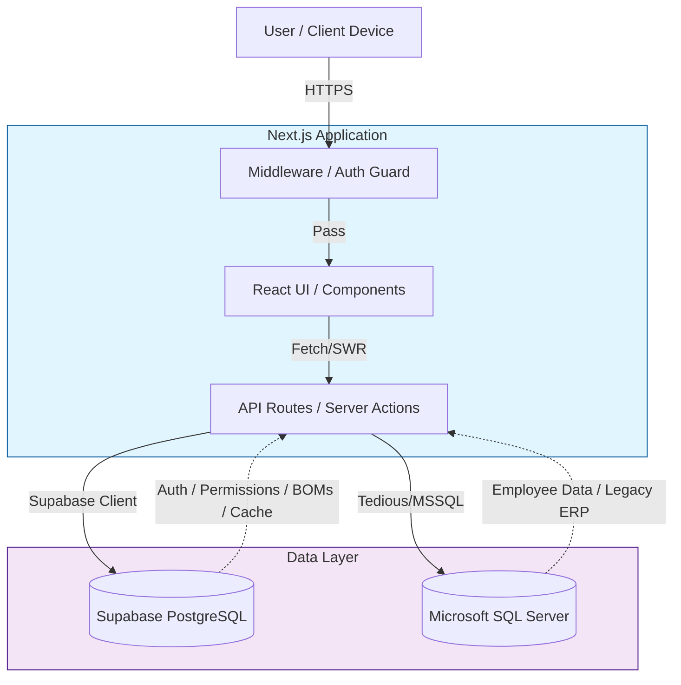
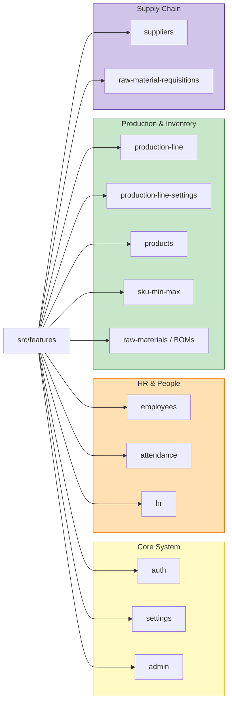
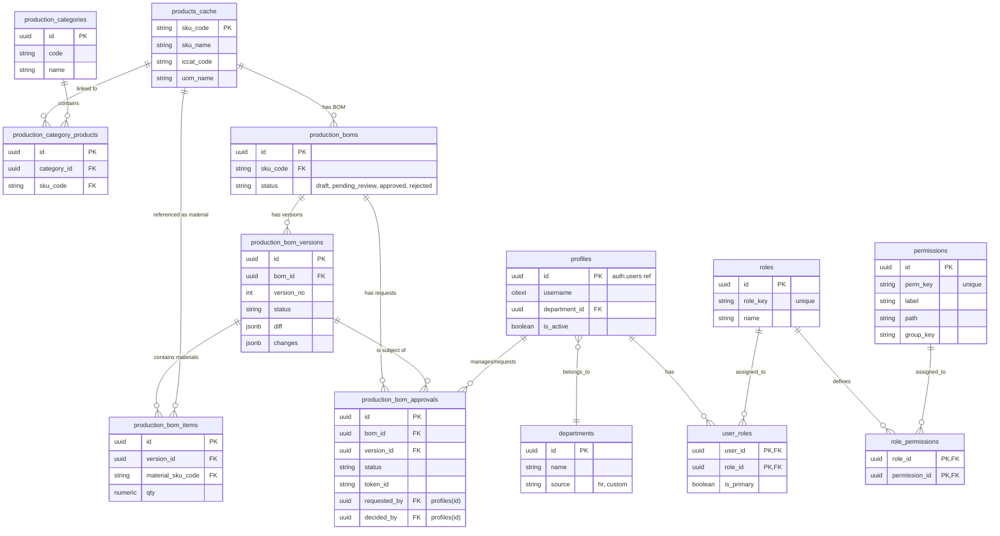

# Production-Line Project Diagrams

This document contains Mermaid diagrams for the Production-Line project. You can view these directly in GitHub, VS Code (with Mermaid extension), or copy the code into [draw.io](https://app.diagrams.net/).

## 1. System Architecture
Overview of the connection between the Frontend, API, Supabase, and SQL Server.

## 2. Feature Modules Structure
The modular structure of the `src/features` directory.

## 3. Comprehensive Entity Relationship Diagram (ERD)
Focus on IAM (Identity & Access Management) and Production/BOM Management.

---
*Created by Gemini CLI Agent - 2026-01-22*