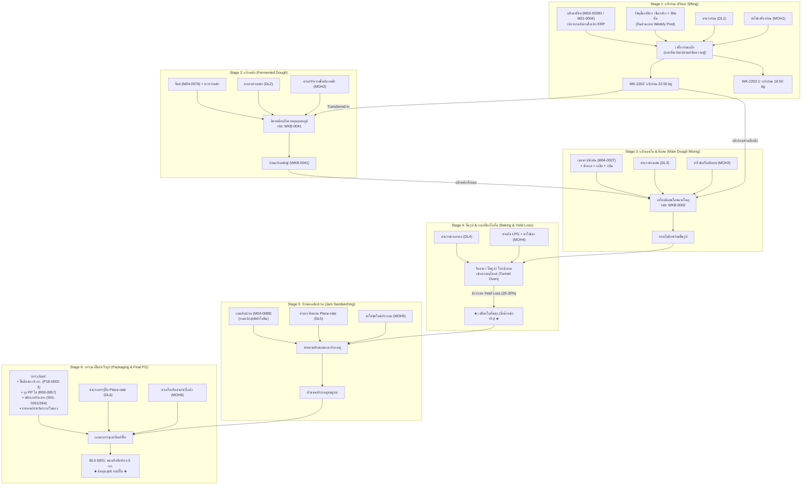
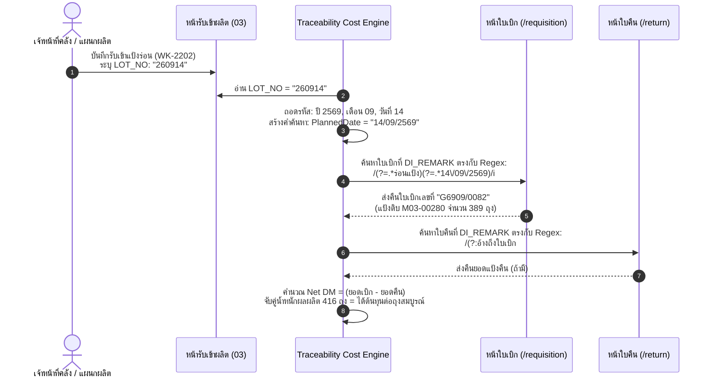

# สถาปัตยกรรมและข้อกำหนดระบบคิดต้นทุนการผลิตแบบแยกช่วงฉบับสมบูรณ์
## (Complete Multi-Stage Production Costing System Specification)
**ระบบ Quickplan / โรงงานอาหารและเบเกอรี่ KPF**  
*ระดับเอกสาร: Technical & Accounting Master Specification (สำหรับ Senior Engineer, Data Architect และฝ่ายบัญชีบริหาร)*  
*วันที่ปรับปรุงล่าสุด: 17 กันยายน 2569*

---

## 1. บทนำและสาระสำคัญของผู้บริหาร (Executive Summary)

ระบบคิดต้นทุนการผลิตของ KPF เป็นการประยุกต์ใช้หลักการ **Process Costing with Transferred-in Cost (ต้นทุนกระบวนการผลิตแบบยกยอดสะสม)** ผสานรวมกับโมเดล **Hybrid Data Integration** ระหว่างระบบ ERP หลัก (WINSpeed / Formula ERP) และระบบบริหารจัดการสายการผลิตหน้างาน (Quickplan Web/PWA)

### วัตถุประสงค์หลักของระบบ:
1. **ขจัดข้อจำกัดของ Black-Box Costing:** ไม่คิดต้นทุนแบบเหมารวมทั้งโรงงาน แต่แยกคิดตามช่วงการแปรสภาพจริง (WIP Stages)
2. **สะท้อนต้นทุนวัตถุดิบจริงตาม LOT (Actual Lot-based Costing):** ไม่ใช้ราคาประมาณการเฉลี่ย แต่ดึงราคาซื้อจริงของ LOT ที่ตัดเบิกจากคลัง
3. **คำนวณผลกระทบของ Yield Loss อย่างถูกต้องตามหลักคณิตศาสตร์บัญชี:** แยกแยะระหว่าง "น้ำหนักที่หายไปจากการอบระเหยน้ำ" กับ "มูลค่าเงินที่ยังคงสะสมอยู่ครบ"
4. **รองรับผลผลิตร่วมหลายขนาด (Joint Products Allocation by Weight):** สามารถปันส่วนต้นทุนได้อย่างถูกต้องเมื่อ 1 วัตถุดิบตั้งต้นผลิตออกมาได้ผลผลิตหลายขนาดบรรจุ (เช่น แป้งร่อน 22.5 kg และ 18.5 kg)
5. **ความสามารถในการสืบย้อนกลับอัตโนมัติ (Automated Backward Traceability):** เชื่อมโยงรหัส LOT สินค้าสำเร็จรูป/WIP ย้อนกลับไปหาใบเบิกและใบคืนวัตถุดิบใน ERP ด้วยกฎวันที่และ Regular Expression

---

## 2. โครงสร้างกระบวนการผลิตจริง 6 ขั้นตอน (The 6 Production Stages)
*(กรณีศึกษาเชิงลึก: สินค้า `BL0-5001` ขนมปังสับปะรด 5 กก. จำนวน 200 ปี๊บ)*



---

## 3. สถาปัตยกรรมข้อมูลแบบไฮบริด (Hybrid Architecture: ERP + Quickplan)

ระบบความเป็นจริงของโรงงานไม่ได้เก็บทุกอย่างไว้ในระบบเดียว จึงต้องแบ่งขอบเขตความรับผิดชอบของข้อมูล (Single Source of Truth) ดังนี้:

| ขอบเขตงาน | ระบบเจ้าของข้อมูล | แหล่งข้อมูล (Data Source) | วิธีการดึงข้อมูลมาคำนวณ |
|---|---|---|---|
| **การเบิกวัตถุดิบแป้ง/ส่วนผสม** | **ERP** | ตาราง `TRANSTKD`, `DOCINFO` (ประเภท DT 301/303/305) | ดึงผ่าน Gateway `/api/raw-material-requisitions` |
| **การคืนวัตถุดิบเหลือเข้าคลัง** | **ERP** | ตาราง `TRANSTKD`, `DOCINFO` (ประเภทใบคืน) | ดึงผ่าน Gateway `/api/raw-material-returns` |
| **การรับเข้าสต็อก WIP แป้งร่อน** | **ERP** | ตาราง `TRANSTKD` (ประเภท DT 305 หมวด `03`) | ดึงผ่าน Gateway `/api/production-receipts` |
| **สูตรการผลิตหลายระดับ (BOM)** | **Quickplan** | Supabase: `production_boms`, `production_bom_versions`, `production_bom_items` | Supabase PostgREST Client |
| **น้ำหนักชั่งจริงเปลือกโบตั๋น** | **Quickplan** | Supabase: ตาชั่งหน้าเตาอบ, `production_stock_movements`, Weight Scale MRP | Supabase Realtime / REST |
| **ค่าแรงช่าง/พนักงาน (Piece-rate)** | **Quickplan** | Supabase: `production_piece_rate_logs` (สแกนบาร์โค้ด) | Supabase REST |
| **ของเสียระหว่างไลน์ผลิต (Waste)** | **Quickplan** | Supabase: `production_piece_rate_waste_logs` | Supabase REST |

---

## 4. กลไกการสืบย้อนกลับและเชื่อมโยงเอกสาร (Automated Traceability & Matching Engine)

ระบบสามารถผูกข้อมูล **"รับเข้าสต็อก $\rightarrow$ ใบเบิก $\rightarrow$ ใบคืน"** ได้แบบ Deterministic (ไม่ต้องเดา) โดยอาศัยกฎ 3 ข้อ:



### กฎการแปลงรหัส LOT (Lot Decoding Rule):
- รูปแบบ LOT หน้างาน: `YYMMDD` (พ.ศ. 2 หลัก + เดือน 2 หลัก + วันที่ 2 หลัก)
  - ตัวอย่าง: `260914` $\rightarrow$ ปี 2569, เดือน 09, วันที่ 14
  - แปลงเป็นข้อความวันที่ใน ERP: `"14/09/2569"`
- ตรวจสอบใน `DI_REMARK` ของใบเบิก ERP:
  - ต้องมีคำว่า `"ร่อนแป้ง"` หรือ `"PLD"`
  - ต้องมีข้อความวันที่ผลิตตรงกัน เช่น `"แผนการผลิต, 14/09/2569"`

---

## 5. คณิตศาสตร์และการปันส่วนต้นทุน (Mathematical Formulations)

### 5.1 การปันส่วนผลผลิตร่วมตามน้ำหนัก (Joint Product Allocation by Weight)
เมื่อกระบวนการร่อนแป้ง 1 Batch ใช้วัตถุดิบแป้งสาลีดิบ `M03-00280` จำนวน $Q_{\text{raw}}$ ถุง แล้วได้ผลผลิตแป้งร่อนออกมา 2 ขนาด:
- ขนาดที่ 1 ($A$): แป้งร่อน 22.50 kg (`WK-2202`) จำนวน $N_A$ ถุง
- ขนาดที่ 2 ($B$): แป้งร่อน 18.50 kg (`WK-2202-1`) จำนวน $N_B$ ถุง

**ขั้นตอนการคำนวณ:**
1. **คำนวณน้ำหนักผลผลิตรวม (Total Output Weight):**
   $$W_{\text{total}} = (N_A \times 22.50) + (N_B \times 18.50) \quad \text{(kg)}$$
2. **คำนวณต้นทุนรวมของ Batch นั้น (Total Batch Cost):**
   $$C_{\text{batch}} = \text{Cost}_{\text{DM}} + \text{Cost}_{\text{DL}} + \text{Cost}_{\text{MOH}} \quad \text{(บาท)}$$
   *(โดย $\text{Cost}_{\text{DM}} = (\text{ถุงเบิก} - \text{ถุงคืน}) \times \text{ราคาซื้อต่อถุง})$*
3. **คำนวณต้นทุนเฉลี่ยต่อ 1 กิโลกรัมของเนื้อแป้งร่อน (Unit Cost per kg):**
   $$U_{\text{flour}} = \frac{C_{\text{batch}}}{W_{\text{total}}} \quad \text{(บาท/กก.)}$$
4. **คำนวณราคาต้นทุนรับเข้าสต็อกของแต่ละขนาด (Unit Cost per Bag):**
   $$\text{Cost per Bag}_{22.5\text{kg}} = U_{\text{flour}} \times 22.50 \quad \text{(บาท/ถุง)}$$
   $$\text{Cost per Bag}_{18.5\text{kg}} = U_{\text{flour}} \times 18.50 \quad \text{(บาท/ถุง)}$$

---

### 5.2 การปันส่วนวัสดุสิ้นเปลืองสัปดาห์ (Weekly Consumables Pool Allocation)
สำหรับวัสดุห่อหุ้มที่เบิกครั้งเดียวใช้ยาวทั้งสัปดาห์ (เชือกฟาง, ฟิล์มยืดพันพาเลท, เทปกาว):
1. รวบรวมมูลค่าวัสดุสิ้นเปลืองที่เบิกในสัปดาห์ $W$:
   $$C_{\text{supplies}} = \sum \text{มูลค่าวัสดุสิ้นเปลืองที่เบิกในสัปดาห์ } W \quad \text{(บาท)}$$
2. รวบรวมจำนวนถุงแป้งร่อนที่ผลิตได้ทั้งหมดในสัปดาห์ $W$:
   $$N_{\text{total\_week}} = \sum N_A + \sum N_B \quad \text{(ถุง)}$$
3. อัตราปันส่วนวัสดุสิ้นเปลืองต่อถุง:
   $$R_{\text{supply}} = \frac{C_{\text{supplies}}}{N_{\text{total\_week}}} \quad \text{(บาท/ถุง)}$$
4. สำหรับ Batch ใดๆ ที่ผลิตได้ $N_{\text{batch}}$ ถุง จะถูกคิดต้นทุนวัสดุสิ้นเปลืองเข้าช่อง MOH ประจำ Batch:
   $$\text{MOH}_{\text{supplies}} = N_{\text{batch}} \times R_{\text{supply}} \quad \text{(บาท)}$$

---

### 5.3 กฎทองของ Yield Loss ในขั้นตอนการอบ (Baking Yield Adjustment)
ในกระบวนการอบเปลือกขนม ความร้อนทำให้น้ำในก้อนโดระเหยไป น้ำหนักของแข็งและสารอาหารคงเดิม:
- **น้ำหนักโดดิบก่อนเข้าเตา:** $W_{\text{dough}}$ กก.
- **น้ำหนักเปลือกสุกหลังออกจากเตา:** $W_{\text{baked}}$ กก.
- **เปอร์เซ็นต์ผลผลิต (Baking Yield %):**
  $$Y\% = \left(\frac{W_{\text{baked}}}{W_{\text{dough}}}\right) \times 100\%$$
- **สูตรคำนวณต้นทุนเปลือกสุกต่อกิโลกรัม:**
  $$U_{\text{baked}} = \frac{\text{ต้นทุนสะสมโดดิบยกยอดมา} + \text{DL}_{\text{เตา}} + \text{MOH}_{\text{แก๊ส/ไฟ}}}{W_{\text{baked}}} \quad \text{(บาท/กก.)}$$
  *(มูลค่าเงินในเศษส่วนไม่ได้หายไป แต่น้ำหนักตัวหารลดลง ส่งผลให้ราคาต่อกิโลกรัมเพิ่มขึ้นตามความเข้มข้นของเนื้อแป้งสุกอย่างถูกต้อง)*

---

## 6. ตารางจำลองตัวเลขจริงการผลิต BL0-5001 (200 ปี๊บ)
*(อิงจากตัวเลขการใช้งานจริงของโรงงาน)*

| ขั้นตอน (Stage) | วัตถุดิบขาเข้า (Input) | ผลผลิตขาออก (Output) | DM (บาท) | DL (บาท) | MOH (บาท) | ต้นทุนสะสม (บาท) | ต้นทุนต่อหน่วยผลผลิต |
|---|---|---|---|---|---|---|---|
| **Stage 1: แป้งร่อน** | แป้งอินทัช `M03-00280` (389 ถุง @ 354.-) = 8,752.5 กก. | • 22.5 kg: 292 ถุง (6,570 กก.)<br/>• 18.5 kg: 124 ถุง (2,294 กก.) | 137,706 | 1,200 | 400<br/>*(รวมฟิล์ม/เชือก)* | **139,306** | **15.716 บ./กก.**<br/>(353.61 บ./ถุงใหญ่)<br/>(290.75 บ./ถุงเล็ก) |
| **Stage 2: แป้งหมัก (`WKB-0041`)** | • แป้งร่อน 22.5 kg ยกมา 12 ชุด (270 กก.)<br/>• ยีสต์ `M04-0079` 5 กก. + สารเร่ง | ก้อนแป้งหมักฟู 280 กก. | 4,243<br/>*(โอนมา)*<br/>+ 1,150<br/>*(ยีสต์)* | 300 | 150 | **5,843** | **20.87 บ./กก.** |
| **Stage 3: เมนโด & ตีผสม (`WKB-0002`)** | • แป้งหมักยกมา 280 กก.<br/>• แป้งร่อนยกมา 24 ชุด (540 กก.)<br/>• เนยขาว/น้ำมัน `M04-0027` 180 กก. + น้ำตาล/เกลือ | ก้อนโดดิบพร้อมขึ้นรูป 1,050 กก. | 14,330<br/>*(โอนมา)*<br/>+ 13,800<br/>*(เนย/น้ำตาล)* | 800 | 400 | **29,330** | **27.93 บ./กก.** |
| **Stage 4: อบเปลือกโบตั๋น** | ก้อนโดดิบ 1,050 กก. (โรยน้ำตาลหน้าเปลือก) | **เปลือกสุกชั่งจริง 780 กก.**<br/>*(Yield = 74.29%)* | 29,330<br/>*(โอนมา)*<br/>+ 500<br/>*(น้ำตาล)* | 1,200 | 3,500<br/>*(แก๊ส LPG)* | **34,530** | **44.27 บ./กก.**<br/>*(ปรับตาม Yield)* |
| **Stage 5: ป้ายแยมสับปะรด** | • เปลือกสุกยกมา 780 กก.<br/>• แยมสับปะรด `M04-0088` สุทธิ 520 กก. (@ 45.-) | ตัวขนมประกบคู่สมบูรณ์ 1,300 กก. | 34,530<br/>*(โอนมา)*<br/>+ 23,400<br/>*(แยม)* | 1,800<br/>*(Piece-rate)* | 300 | **60,030** | **46.18 บ./กก.**<br/>(ประมาณ 200 ปี๊บ) |
| **Stage 6: บรรจุลงปี๊บ (`BL0-5001`)** | • ตัวขนม 1,300 กก.<br/>• ปี๊บ `P18-0002-3` 200 ใบ (@ 135.-)<br/>• ถุง PP, สติกเกอร์, สายรัด, กาว, ใบตอง | **สินค้าสำเร็จรูป 200 ปี๊บ** | 60,030<br/>*(โอนมา)*<br/>+ 29,250<br/>*(Packaging)* | 3,000<br/>*(Piece-rate)* | 500 | **92,780** | **463.90 บาท/ปี๊บ** |

### สรุปสัดส่วนโครงสร้างต้นทุนสุทธิ (Cost Breakdown):
$$\mathbf{\text{ต้นทุนสุทธิต่อปี๊บ}} = \mathbf{463.90} \text{ \textbf{บาท/ปี๊บ}}$$
- **Direct Material (วัตถุดิบและบรรจุภัณฑ์รวม):** 81,830 บาท (**88.20%**)
- **Direct Labor (ค่าแรงรวมทุกแผนก):** 6,500 บาท (**7.01%**)
- **Manufacturing Overhead (ค่าแก๊ส, ค่าไฟ, โสหุ้ยรวม):** 4,450 บาท (**4.79%**)

---

## 7. ข้อกำหนดทางเทคนิคและการออกแบบหน้าจอ (UI/UX Specification)

### 7.1 ตำแหน่งและเส้นทางเมนู (Navigation & Routing)
- **URL เส้นทางใหม่:** `/production-line/costing` (หรือเพิ่มแท็บในหน้า Planning Control Center)
- **สิทธิ์การเข้าถึง (Permission Guard):** `production-costing-admin`, `production-costing-viewer`

### 7.2 องค์ประกอบของหน้าจอ (Component Breakdown)

```mermaid
graph TD
    UI["หน้าจอ Production Costing Workbench (/production-line/costing)"]
    
    UI --> H["1. Header Filter Bar"]
    H --> H1["เลือกสินค้า (FG SKU Selector): BL0-5001"]
    H --> H2["เลือกล็อตการผลิต / Master Plan No."]
    H --> H3["กรอกจำนวนผลผลิตเป้าหมาย (เช่น 200 ปี๊บ)"]
    
    UI --> C["2. Step Cards Container (เรียงตามลำดับสายการผลิต)"]
    C --> C1["Card 1: แป้งร่อน (เชื่อมโยงอัตโนมัติจากใบเบิก ERP + ปันส่วน 2 ขนาด)"]
    C --> C2["Card 2: แป้งหมัก (ดึงสูตร WKB-0041 + Input DL/MOH)"]
    C --> C3["Card 3: เมนโด (ดึงสูตร WKB-0002 + Input DL/MOH)"]
    C --> C4["Card 4: อบเปลือก (ดึง นน. ชั่งจริงหน้าเตา + คำนวณ Yield Loss + Input DL/MOH)"]
    C --> C5["Card 5: ป้ายแยม (ดึงยอดเบิกหักคืนแยม ERP + Piece-rate DL + Input MOH)"]
    C --> C6["Card 6: บรรจุปี๊บ (ดึงยอดเบิกบรรจุภัณฑ์ + Piece-rate DL + Input MOH)"]
    
    UI --> S["3. Final Cost Summary Card (Sticky ท้ายหน้า)"]
    S --> S1["ต้นทุนสุทธิ: บาท/ปี๊บ"]
    S --> S2["ต้นทุนรวมทั้งล็อต: บาท"]
    S --> S3["Progress Bar แสดงสัดส่วน: DM % | DL % | MOH %"]
    S --> S4["ปุ่ม Export รายงานต้นทุน Excel / Print PDF"]
```



### 7.3 พฤติกรรมของการ์ดแต่ละขั้นตอน (Step Card Interactive Behavior)
ในทุกๆ การ์ดจะมีฟิลด์มาตรฐาน 2 ช่องตามข้อกำหนดของผู้บริหาร:
1. **ช่อง `DL (ค่าแรง)`:** 
   - มีปุ่ม `Auto-fetch Piece-rate` ดึงค่าจาก `production_piece_rate_logs` มาใส่เป็นค่าตั้งต้น (ถ้ามี)
   - ผู้ใช้สามารถพิมพ์ตัวเลขทับ (Override) ได้ตลอดเวลา
2. **ช่อง `MOH (ค่าโสหุ้ย)`:**
   - มีปุ่ม `Apply Preset` (เช่น ค่าแก๊สเตาอบบาท/กก., ค่าไฟเครื่องร่อน)
   - ผู้ใช้สามารถพิมพ์ตัวเลขทับ (Override) ได้ตลอดเวลา
3. **ช่อง `Output Qty (ผลผลิตที่ได้)`:**
   - แสดงน้ำหนักที่ได้จริง พร้อมคำนวณ **Yield Loss %** และแสดง Badge สถานะ (เช่น สีเขียวถ้าได้ Yield ตามเกณฑ์ 74-76%, สีแดงถ้าต่ำกว่าเกณฑ์)

---

## 8. แผนการพัฒนาทีละ Step อย่างรอบคอบ (Implementation Roadmap)

```
[Step 1: Flour Trace Engine] ──> [Step 2: Dual Output Allocation] ──> [Step 3: Downstream Rollup] ──> [Step 4: Full UI Workbench]
     จับคู่ LOT แป้งร่อนกับ             คำนวณปันส่วนราคาแป้ง 2 ขนาด          ดึงข้อมูลตาชั่งเปลือก + ค่าแยม           ประกอบทุกการ์ดเข้าด้วยกัน
     ใบเบิก ERP อัตโนมัติ               (22.50 kg และ 18.50 kg)             และสแกน Piece-rate                   เป็นหน้าคำนวณต้นทุนสมบูรณ์
```

### Step 1: สร้าง Service สำหรับสืบย้อนแป้งร่อน (Flour Sifting Traceability Service)
- เขียนฟังก์ชันค้นหาใบเบิก ERP ที่ `DI_REMARK` มีคำว่า `"ร่อนแป้ง"` และวันที่ตรงกับ `LOT_NO`
- เชื่อมต่อยอดใบคืนจากตารางคืนวัตถุดิบเพื่อหักลบได้ยอดใช้สุทธิ

### Step 2: สร้างฟังก์ชันปันส่วนผลผลิตร่วม (Joint Product Calculator)
- รับน้ำหนักรวมของถุง 22.5 kg และ 18.5 kg
- คำนวณต้นทุนต่อกิโลกรัม และแตกลงสู่แต่ละขนาดสินค้าเข้าคลัง WIP 03

### Step 3: เชื่อมโยงข้อมูลท่อนปลาย (Downstream Data Binding)
- ดึงยอดชั่งจริงเปลือกโบตั๋น `WKB-0002` จากตาชั่งหน้าเตา
- ดึงยอดเบิกหักคืนแยมสับปะรด `M04-0088`
- ดึงยอดเงินจาก `production_piece_rate_logs` เข้าเป็น Default DL

### Step 4: ประกอบหน้าจอ UI และรายงานสรุป (UI Assembly & Validation)
- สร้างหน้า `/production-line/costing`
- ทดสอบคำนวณแบบจำลองจริงกับล็อต `BL0-5001` และตรวจสอบความถูกต้องกับฝ่ายบัญชี

---
*เอกสารนี้จัดทำขึ้นเพื่อเป็นพิมพ์เขียวกลาง (Master Blueprint) ห้ามแก้ไขข้อกำหนดเชิงโครงสร้างโดยไม่ผ่านการทบทวนร่วมกับทีมบริหารและทีมวิศวกรรม*
