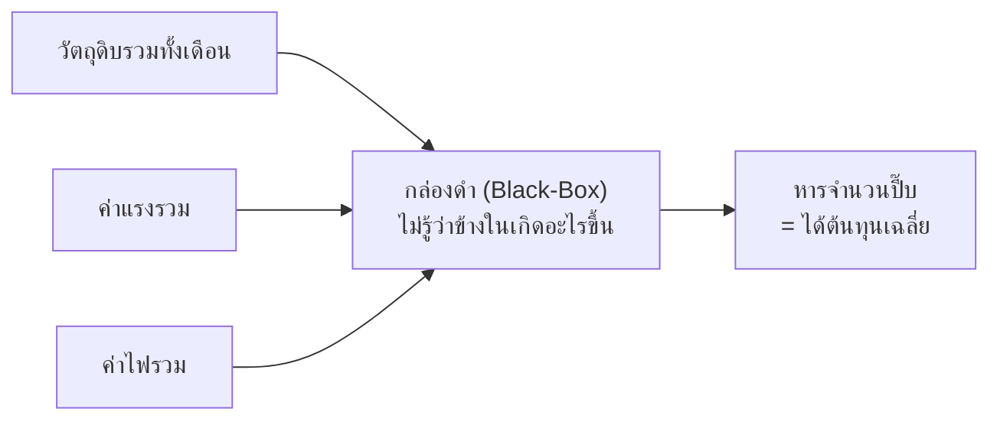
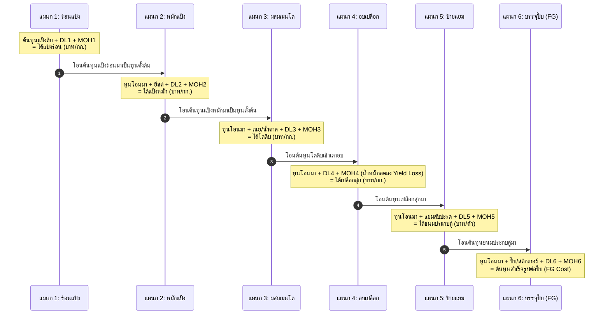
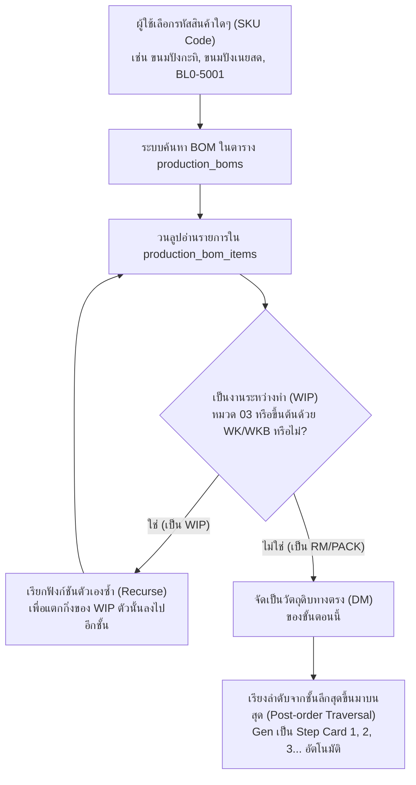
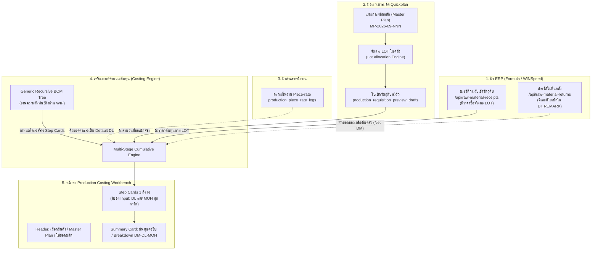

# คู่มืออธิบายแก่นแท้ระบบคิดต้นทุนการผลิตแบบแยกช่วง (Multi-Stage Production Costing Explained)
**ระบบ Quickplan / โรงงานผลิตอาหารและเบเกอรี่ KPF**  
*จัดทำขึ้นเพื่อให้ผู้บริหาร, วิศวกรระบบ, ทีมโปรแกรมเมอร์ และฝ่ายบัญชี เข้าใจหลักการเดียวกันอย่างลึกซึ้ง*

---

## สารบัญ
1. [บทนำ: แก่นแท้และปรัชญาของระบบต้นทุน (Core Philosophy)](#1-บทนำ-แก่นแท้และปรัชญาของระบบต้นทุน-core-philosophy)
2. [ทำไมห้ามคิดต้นทุนแบบ Black-Box?](#2-ทำไมห้ามคิดต้นทุนแบบ-black-box)
3. [แนวคิด Transferred-in Cost (การส่งไม้ผลัดของต้นทุน)](#3-แนวคิด-transferred-in-cost-การส่งไม้ผลัดของต้นทุน)
4. [โครงสร้าง 3 เสาหลักของต้นทุน (DM, DL, MOH)](#4-โครงสร้าง-3-เสาหลักของต้นทุน-dm-dl-moh)
5. [การตรวจสอบโครงสร้างจริงในระบบ (BOM Reality Check: BL0-5001)](#5-การตรวจสอบโครงสร้างจริงในระบบ-bom-reality-check-bl0-5001)
6. [ทำไมสูตรนี้จึงใช้คิดต้นทุนสินค้าตัวอื่นได้ทั้งโรงงาน? (Generic Traversal)](#6-ทำไมสูตรนี้จึงใช้คิดต้นทุนสินค้าตัวอื่นได้ทั้งโรงงาน-generic-traversal)
7. [หัวใจสำคัญ: ทำไมวัตถุดิบต้องผูกตาม LOT และ Master Plan?](#7-หัวใจสำคัญ-ทำไมวัตถุดิบต้องผูกตาม-lot-และ-master-plan)
8. [Yield Loss: ผลกระทบของน้ำหนักที่หายไประหว่างอบ](#8-yield-loss-ผลกระทบของน้ำหนักที่หายไประหว่างอบ)
9. [เจาะลึก 6 ขั้นตอนจำลองการผลิต BL0-5001 (200 ปี๊บ)](#9-เจาะลึก-6-ขั้นตอนจำลองการผลิต-bl0-5001-200-ปี๊บ)
10. [แผนที่การเชื่อมโยงข้อมูลในระบบ Quickplan (Data Flow Architecture)](#10-แผนที่การเชื่อมโยงข้อมูลในระบบ-quickplan-data-flow-architecture)
11. [สรุปแผนพัฒนาทีละ Step อย่างมั่นคง (Step-by-Step Implementation Roadmap)](#11-สรุปแผนพัฒนาทีละ-step-อย่างมั่นคง-step-by-step-implementation-roadmap)

---

## 1. บทนำ: แก่นแท้และปรัชญาของระบบต้นทุน (Core Philosophy)

ในโรงงานอุตสาหกรรมผลิตอาหารและเบเกอรี่ สินค้าสำเร็จรูป 1 ชิ้นไม่ได้เกิดขึ้นในขั้นตอนเดียว แต่เกิดจากการ **แปรสภาพวัตถุดิบต่อเนื่องกันเป็นลูกโซ่**

> **แก่นแท้ของระบบนี้คือ:**  
> *"ต้นทุนไม่ได้เกิดขึ้นที่ปลายไลน์ แต่ค่อยๆ สะสมและเพิ่มมูลค่าขึ้นในทุกๆ เมตรที่วัตถุดิบเคลื่อนผ่านแต่ละแผนก"*

เมื่อเราผลิตขนมปัง 1 ปี๊บ:
- แป้งสาลีถูกเทลงเครื่องร่อน $\rightarrow$ มีต้นทุนแป้ง + ค่าแรงร่อน + ค่าไฟเครื่อง
- แป้งร่อนถูกส่งไปหมัก $\rightarrow$ แป้งร่อนกลายเป็น **"วัตถุดิบตั้งต้น"** ให้แผนกหมักบวกยีสต์เข้าไป
- แป้งหมักถูกส่งไปตีเมนโด $\rightarrow$ กลายเป็นก้อนโดดิบ
- ก้อนโดดิบเข้าเตาอบ $\rightarrow$ น้ำระเหยไป น้ำหนักลดลง แต่ต้นทุนเงินยังอยู่เท่าเดิม
- นำมาป้ายแยม $\rightarrow$ นำมาบรรจุลงปี๊บปิดฝา

ถ้าเราไม่คำนวณต้นทุนทีละช่วง เราจะไม่มีวันรู้เลยว่า **"กำไรหรือขาดทุนรั่วไหลออกไปที่ขั้นตอนไหนกันแน่"**

---

## 2. ทำไมห้ามคิดต้นทุนแบบ Black-Box?

วิธีดั้งเดิมที่หลายโรงงานใช้คือ **Black-Box Costing (คิดแบบเหมากล่องดำ):**
1. ดูว่าทั้งเดือนซื้อวัตถุดิบไปกี่บาท
2. ดูค่าแรงรวมทั้งโรงงาน
3. เอามาหารจำนวนปี๊บที่ผลิตได้ในเดือนนั้น



### ปัญหาคอขาดบาดตายของวิธี Black-Box:
1. **ไม่รู้จุดของเสีย (Blind to Yield Loss):** ถ้าเตาอบทำขนมไหม้ หรือแผนกป้ายแยมทำไส้หก เราจะไม่รู้เลยเพราะตัวเลขถูกกลืนไปในยอดรวม
2. **ประเมินมูลค่างานระหว่างทำ (WIP) สิ้นงวดผิด:** สิ้นเดือนมักมีแป้งหมักค้างถัง หรือเปลือกที่ยังไม่ได้ป้ายแยมค้างอยู่หลายตัน หากไม่รู้ต้นทุนของแต่ละขั้น จะลงบัญชีสต็อก WIP ผิดทันที
3. **กำหนดราคาสินค้าใหม่พลาด:** หากออกรสชาติใหม่ที่ใช้แป้งแบบเดิมแต่เปลี่ยนไส้ จะคำนวณราคาขายยากเพราะไม่รู้ต้นทุนฐานของตัวเปลือกขนม

---

## 3. แนวคิด Transferred-in Cost (การส่งไม้ผลัดของต้นทุน)

หลักการสากลที่ระบบนี้ใช้เรียกว่า **Process Costing with Transferred-in Cost (ต้นทุนโอนมาระหว่างแผนก)**  
เปรียบเสมือนการวิ่งผลัด:



**สมการแก่นแท้ของแต่ละช่วงการผลิต:**
$$\text{Total Cost}_{\text{Stage } n} = \text{Transferred-in Cost}_{\text{Stage } (n-1)} + \text{Added DM}_n + \text{DL}_n + \text{MOH}_n$$

$$\text{Unit Cost}_{\text{Stage } n} = \frac{\text{Total Cost}_{\text{Stage } n}}{\text{Actual Output Qty}_{\text{Stage } n}}$$

---

## 4. โครงสร้าง 3 เสาหลักของต้นทุน (DM, DL, MOH)

ในทุกๆ การ์ดขั้นตอน (Step Card) ของระบบ จะมีเสาหลักต้นทุนอยู่ 3 ตัวเสมอ:

| ตัวย่อ | ชื่อเต็ม | ความหมายในโรงงาน | แหล่งที่มาในระบบ Quickplan |
|---|---|---|---|
| **DM** | Direct Material (วัตถุดิบทางตรง) | วัตถุดิบหรือส่วนผสมที่เติมลงไปในขั้นตอนนี้โดยเฉพาะ | คำนวณจากสูตร BOM $\times$ ราคาต่อหน่วยของ LOT ที่เบิกจริง |
| **DL** | Direct Labor (ค่าแรงทางตรง) | ค่าจ้างของพนักงานที่ลงมือทำในขั้นตอนนี้ | **ฟิลด์ Input ที่ 1** (หรือดึง Default จาก Piece-Rate Log) |
| **MOH** | Manufacturing Overhead (ค่าโสหุ้ย) | ค่าไฟเครื่องจักร, ค่าแก๊สเตาอบ, ค่าถาด, ค่าเสื่อม | **ฟิลด์ Input ที่ 2** (กรอกตามสูตรปันส่วนหรือบาทคงที่) |

> **ความต้องการของผู้ใช้ที่ระบุไว้:**  
> *"ในแต่ละ Step ให้มีฟิลด์ Input 2 ช่อง คือ DL กับ MOH"*  
> ระบบจึงออกแบบให้ทั้งสองช่องนี้สามารถคีย์ตัวเลขตรงๆ ได้ หรือมีค่าแนะนำที่ดึงจากระบบมาให้กด Override ได้ตามต้องการ

---

## 5. การตรวจสอบโครงสร้างจริงในระบบ (BOM Reality Check: BL0-5001)

จากการ Query ตรวจสอบตารางจริงใน Supabase (`production_boms`, `production_bom_versions`, `production_bom_items`):

### ลำดับชั้นจริงในฐานข้อมูลโรงงาน:

```
[Level 0: สินค้าสำเร็จรูป FG]
└── BL0-5001 (ขนมปังสับปะรด 5 กก. ปี๊บ)
    ├── M04-0088 (แยมสับปะรด): 65 KG
    ├── P18-0002-3 (ปี๊บมือสอง+ฝา XL): 24 ใบ
    ├── R00-0057 (ถุง PP ใส 20x24"): 0.4528 KG
    ├── S01-0261 (ฉลากติดปี๊บ 4 สี): 24 ใบ
    ├── S01-0264 (Sticker สีดำ XL): 24 ใบ
    ├── S02-0010 (สายคาดปี๊บ): 24 เส้น
    ├── S02-0013 (สายรัดกล่องน้ำเงิน): 0.075 ม้วน
    ├── S03-0001-1 (กาวแท่ง): 0.4364 แท่ง
    ├── S04-0003-1 (แผ่นใบตองรองปี๊บ): 0.1333 KG
    └── WKB-0002 (เปลือกโบตั๋น): 4 ชุด  <── [Level 1: WIP]
        ├── M01-0004 (แป้งสาลีเสริม): 20 KG + 1 ถุงx50กก.
        ├── M01-0013 (แป้งสาลีพิเศษ): 14 KG + 1 ถุงx50กก.
        ├── M04-0027 (น้ำมัน/เนยขาว): 17 KG + 17 ก.ล.x24กก.
        ├── M04-0012, M04-0016, M04-0029, M04-0030 (น้ำตาล, เกลือ, สารเสริม)
        ├── WK-2202 (แป้งสาลีร่อน D1 22.5 kg): 12 ชุด  <── [Level 2: WIP ย่อย]
        └── WKB-0041 (แป้งหมัก): 4 ชุด  <── [Level 2: WIP ย่อย]
            ├── M04-0079 (ยีสต์): 5 KG + 1 กล่องx15
            ├── M01-0004 (แป้งสาลี): 0.44 KG
            ├── M04-0093, M04-0137 (สารเสริมหมัก)
            └── WK-2202 (แป้งสาลีร่อน D1 22.5 kg): 12 ชุด  <── [Level 3: WIP ฐาน]
```

นี่คือหลักฐานว่าระบบของโรงงาน **ได้ผูกความสัมพันธ์ของสูตรไว้ครบถ้วนอยู่แล้ว** เพียงแต่วันนี้ยังไม่มีหน้าจอคำนวณเงินเชื่อมแต่ละขั้นเข้าด้วยกัน

---

## 6. ทำไมสูตรนี้จึงใช้คิดต้นทุนสินค้าตัวอื่นได้ทั้งโรงงาน? (Generic Traversal)

คำถามสำคัญ: *"ถ้าวันหลังจะคิดต้นทุนตัวอื่นที่ไม่ใช่ BL0-5001 ระบบจะทำได้ไหม?"*

**คำตอบคือ ทำได้ทันที เพราะระบบใช้อัลกอริทึม Generic Recursive BOM Tree:**



### ตัวอย่างเปรียบเทียบ:
- **กรณีที่ 1 (ซับซ้อน 6 ขั้น):** `BL0-5001 ขนมปังสับปะรด 5 กก.` $\rightarrow$ ร่อน $\rightarrow$ หมัก $\rightarrow$ เมนโด $\rightarrow$ อบเปลือก $\rightarrow$ ป้ายแยม $\rightarrow$ บรรจุปี๊บ
- **กรณีที่ 2 (ปานกลาง 3 ขั้น):** `บิสกิตเนยสด` $\rightarrow$ ร่อน $\rightarrow$ ตีผสม $\rightarrow$ อบและแพ็คถุง
- **กรณีที่ 3 (สั้น 2 ขั้น):** `สินค้าซื้อมาบรรจุใหม่` $\rightarrow$ นำเข้าวัตถุดิบ $\rightarrow$ บรรจุกล่อง

**ข้อดี:** ระบบจะไม่เขียนโค้ดล็อกเฉพาะขนมสับปะรด แต่จะสร้างหน้าจอและขั้นตอนตามโครงสร้าง BOM จริงของสินค้านั้นๆ โดยอัตโนมัติ

---

## 7. หัวใจสำคัญ: ทำไมวัตถุดิบต้องผูกตาม LOT และ Master Plan?

ความแตกต่างระหว่าง **"ต้นทุนทฤษฎี (Theoretical Cost)"** กับ **"ต้นทุนที่แท้จริง (Actual Cost)":**

### 1. ราคาซื้อของวัตถุดิบเปลี่ยนตลอดเวลา
- แป้งสาลี `M01-0004`:
  - `LOT 1508260001` (ซื้อเดือนสิงหาคม): ราคา **27.50 บาท/กก.**
  - `LOT 0409260004` (ซื้อเดือนกันยายน): ราคา **29.80 บาท/กก.**
- ถ้าเราใช้ราคาเฉลี่ยกลาง เราจะไม่มีวันรู้เลยว่าล็อตการผลิตที่ใช้แป้งล็อตแพง มีกำไรจริงเท่าไหร่

### 2. แผนหลัก (Master Plan) เชื่อมโยงกับ Lot คลังอยู่แล้ว
ในระบบ Quickplan ปัจจุบัน:
1. เมื่อเปิดแผนการผลิตหลัก เช่น `MP-2026-09-001`
2. ระบบจะสร้าง **Requisition Preview / Drafts**
3. มีการจัดสรร LOT จากคลัง (Lot Allocation) ว่าจะตัดเบิกวัตถุดิบจาก `TRD_LOT_NO` ใดใน ERP
4. ในตารางประวัติรับเข้า `/api/raw-material-receipts` และ `/api/raw-material-lot-costs` จะมีราคาซื้อสุทธิต่อหน่วยของ Lot นั้นๆ บันทึกไว้อยู่แล้ว

> **สรุป:** เมื่อผู้ใช้ระบุ **เลขที่ Master Plan** ระบบจะดึงรหัส LOT ที่ถูกจัดสรรไปใช้ในแผนนั้นจริง และหยิบราคาทุนจริงของ LOT นั้นมาคูณ ทำให้ต้นทุนที่ได้คือ **ต้นทุนจริงตามบัญชี 100% ไม่ใช่การกะประมาณ**

---

## 8. Yield Loss: ผลกระทบของน้ำหนักที่หายไประหว่างอบ

จุดที่ทำให้คนสับสนมากที่สุดในการคิดต้นทุนเบเกอรี่คือ **"การอบ"**:

```
[ก่อนเข้าเตาอบ]                                    [หลังออกจากเตาอบ]
แป้งโดดิบหนัก 100 กิโลกรัม                         เปลือกขนมสุกหนัก 75 กิโลกรัม
ต้นทุนแป้งรวม = 3,000 บาท                           ต้นทุนเงินยังคงอยู่ = 3,000 บาท
(ตกกิโลกรัมละ 30 บาท)                               (แต่น้ำระเหยไป 25 กิโลกรัม!)
                                                  ต้นทุนใหม่ = 3,000 ÷ 75 = 40 บาท/กก.
```

### กฎทองของการคำนวณ Yield:
1. **เงินไม่ได้ระเหยไปกับน้ำ:** ต้นทุนสะสมที่จ่ายไปในวัตถุดิบ ค่าแรง และค่าไฟ ยังคงอยู่ครบ 3,000 บาท
2. **ตัวหารลดลง:** เพราะน้ำหนักเปลือกสุกเหลือเพียง 75 กิโลกรัม
3. **ต้นทุนต่อหน่วยเพิ่มขึ้นอัตโนมัติ:** จากเดิม 30 บาท/กก. กลายเป็น 40 บาท/กก.

ในระบบของเรา ที่การ์ด **Stage 4 (อบเปลือก)** จะมีช่องให้ใส่:
- น้ำหนักโดดิบก่อนอบ (กก.)
- น้ำหนักเปลือกสุกจริงหลังอบ (กก.) หรือช่องกรอก **% Yield** (เช่น 75%)
- ระบบจะปรับฐานราคาต่อกิโลกรัมของเปลือกสุกให้สะท้อนต้นทุนจริงก่อนส่งต่อไปป้ายแยมทันที

---

## 9. เจาะลึก 6 ขั้นตอนจำลองการผลิต BL0-5001 (200 ปี๊บ)

เพื่อให้เห็นภาพตัวเลขจริง สมมุติการผลิต **`BL0-5001` จำนวน 200 ปี๊บ** (ใช้เปลือกโบตั๋นประมาณ 1,000 กก., แยมสับปะรด 520 กก.):

---

### Step 1: แป้งร่อน (`WK-2202`)
*แผนกเตรียมวัตถุดิบ นำแป้งสาลีดิบมาร่อนเอาสิ่งแปลกปลอมออกและเพิ่มความฟู*
- **DM (วัตถุดิบ):** แป้งสาลีดิบ 700 กก. @ 28 บาท/กก. (ดึงจาก Lot ที่เบิก) = 19,600 บาท
- **DL (ฟิลด์ Input 1):** ค่าแรงคนร่อนแป้ง 2 คน = 400 บาท
- **MOH (ฟิลด์ Input 2):** ค่าไฟเครื่องร่อนแป้ง = 100 บาท
- **Output:** ได้แป้งร่อนสุทธิ 695 กก. (สูญเสียฝุ่นแป้ง 5 กก.)
- **ต้นทุนสะสม Step 1:** $19,600 + 400 + 100 = 20,100$ บาท  
  *(เฉลี่ย = 28.92 บาท/กก.)*

---

### Step 2: แป้งหมัก (`WKB-0041`)
*นำแป้งร่อนส่วนหนึ่งมาผสมยีสต์และน้ำ หมักในห้องควบคุมอุณหภูมิ*
- **Transferred-in Cost:** ดึงแป้งร่อนจาก Step 1 มา 250 กก. @ 28.92 บาท = 7,230 บาท
- **Added DM (วัตถุดิบเติมเพิ่ม):** ยีสต์ `M04-0079` + น้ำตาล + สารเร่ง = 1,200 บาท
- **DL (ฟิลด์ Input 1):** ค่าแรงช่างหมักแป้ง = 300 บาท
- **MOH (ฟิลด์ Input 2):** ค่าแอร์/ความชื้นห้องบ่ม = 150 บาท
- **Output:** ได้ก้อนแป้งหมักฟู 280 กก.
- **ต้นทุนสะสม Step 2:** $7,230 + 1,200 + 300 + 150 = 8,880$ บาท  
  *(เฉลี่ย = 31.71 บาท/กก.)*

---

### Step 3: แป้งเมนโด & ตีผสมก้อนโด (`WKB-0002`)
*นำแป้งหมักจาก Step 2 มาตีผสมกับแป้งร่อนที่เหลือ และเติมเนย/น้ำมัน/น้ำตาล/เกลือ*
- **Transferred-in Cost:** 
  - แป้งหมักจาก Step 2: 280 กก. = 8,880 บาท
  - แป้งร่อนจาก Step 1: 445 กก. @ 28.92 บาท = 12,870 บาท
- **Added DM (วัตถุดิบเติมเพิ่ม):** เนยขาว/น้ำมันพืช `M04-0027` 180 กก., น้ำตาล, เกลือ, กลิ่น = 14,500 บาท
- **DL (ฟิลด์ Input 1):** ค่าแรงช่างคุมเครื่องผสม/รีดแป้ง = 800 บาท
- **MOH (ฟิลด์ Input 2):** ค่าไฟเครื่องตีโดขนาดใหญ่ = 400 บาท
- **Output:** ได้ก้อนโดดิบพร้อมขึ้นรูป 1,050 กก.
- **ต้นทุนสะสม Step 3:** $8,880 + 12,870 + 14,500 + 800 + 400 = 37,450$ บาท  
  *(เฉลี่ย = 35.67 บาท/กก. ของโดดิบ)*

---

### Step 4: ขึ้นรูปและอบเปลือกโบตั๋น (Baking & Yield Effect)
*รีดแป้ง ปั๊มลาย โรยน้ำตาล และลำเลียงเข้าเตาอบอุโมงค์ (Tunnel Oven)*
- **Transferred-in Cost:** ก้อนโดดิบจาก Step 3 ยกมาทั้งก้อน = 37,450 บาท
- **Added DM:** น้ำตาลโรยหน้าเปลือก = 600 บาท
- **DL (ฟิลด์ Input 1):** ค่าแรงช่างคุมเตาอบและคนเก็บถาด = 1,200 บาท
- **MOH (ฟิลด์ Input 2):** ค่าแก๊ส LPG เตาอบ + ค่าไฟเตา = 3,500 บาท
- **ต้นทุนรวมก่อนคิด Yield:** $37,450 + 600 + 1,200 + 3,500 = 42,750$ บาท
- **★ การคิด Yield Loss:**  
  - โดดิบ 1,050 กก. เมื่อผ่านความร้อน น้ำระเหยออกไป เหลือเปลือกสุกจริง **780 กก.** (Yield = 74.3%)
- **ต้นทุนสะสม Step 4:** 42,750 บาท  
  *(ต้นทุนเปลือกสุกเฉลี่ยพุ่งขึ้นเป็น = $42,750 \div 780 = \mathbf{54.81}$ **บาท/กก.**)*

---

### Step 5: ป้ายแยมสับปะรดและประกบคู่ (Sandwiching)
*นำเปลือกโบตั๋นสุกมาวางบนสายพาน ป้ายไส้แยมสับปะรดและประกบฝาบน*
- **Transferred-in Cost:** เปลือกสุกจาก Step 4 ยกมาทั้งหมด 780 กก. = 42,750 บาท
- **Added DM:** แยมสับปะรดกวน `M04-0088` จำนวน 520 กก. @ 45 บาท/กก. = 23,400 บาท
- **DL (ฟิลด์ Input 1):** ค่าแรงพนักงานป้ายแยม/ประกบ (หรือดึงจาก Piece-rate log) = 1,800 บาท
- **MOH (ฟิลด์ Input 2):** ค่าโสหุ้ยไลน์ประกอบ = 300 บาท
- **Output:** ได้ตัวขนมสับปะรดประกบคู่สมบูรณ์ 1,300 กก. (ประมาณ 200 ปี๊บ)
- **ต้นทุนสะสม Step 5:** $42,750 + 23,400 + 1,800 + 300 = 68,250$ บาท  
  *(เฉลี่ย = 52.50 บาท/กก. ของตัวขนมพร้อมบรรจุ)*

---

### Step 6: บรรจุลงปี๊บและปิดฝา (Final FG: BL0-5001)
*นำขนมมาชั่งน้ำหนักใส่ถุง รองใบตอง บรรจุลงปี๊บ ปิดฝา คาดเทป และติดสติกเกอร์*
- **Transferred-in Cost:** ตัวขนมทั้งหมดจาก Step 5 = 68,250 บาท
- **Packaging DM (บรรจุภัณฑ์):**
  - ปี๊บมือสอง `P18-0002-3` จำนวน 200 ใบ @ 135 บาท = 27,000 บาท
  - ถุง PP ใส `R00-0057` = 650 บาท
  - สติกเกอร์ + ฉลาก 4 สี `S01-0261`, `S01-0264` 200 ชุด = 900 บาท
  - สายคาดปี๊บ `S02-0010` + สายรัดกล่อง = 450 บาท
  - กาวแท่ง + แผ่นใบตองรองปี๊บ = 250 บาท
  - *รวม Packaging DM = 29,250 บาท*
- **DL (ฟิลด์ Input 1):** ค่าแรงพนักงานบรรจุปี๊บ (Piece-rate 200 ปี๊บ @ 15 บาท) = 3,000 บาท
- **MOH (ฟิลด์ Input 2):** ค่าเครื่องรัดสาย + ค่าโกดังพักสินค้า = 500 บาท
- **Output สุทธิ:** **สินค้าสำเร็จรูป 200 ปี๊บ**

---

### สรุปผลลัพธ์สุดท้าย (Final Cost Summary Card)

$$\text{ต้นทุนรวมทั้งล็อต 200 ปี๊บ} = 68,250 + 29,250 + 3,000 + 500 = \mathbf{101,000} \text{ บาท}$$

$$\mathbf{\text{ต้นทุนสินค้าสำเร็จรูปต่อปี๊บ}} = \frac{101,000 \text{ บาท}}{200 \text{ ปี๊บ}} = \mathbf{505.00} \text{ \textbf{บาท/ปี๊บ}}$$

#### โครงสร้างต้นทุน (Cost Breakdown Breakdown %):
- **วัตถุดิบและบรรจุภัณฑ์ (DM รวม):** 86,750 บาท (**85.89%**)
- **ค่าแรงคนงานรวม (DL รวม):** 7,500 บาท (**7.43%**)
- **ค่าโสหุ้ยและพลังงานรวม (MOH รวม):** 6,750 บาท (**6.68%**)

---

## 10. แผนที่การเชื่อมโยงข้อมูลในระบบ Quickplan (Data Flow Architecture)



---

## 11. สรุปแผนพัฒนาทีละ Step อย่างมั่นคง (Step-by-Step Implementation Roadmap)

เพื่อให้งานเสร็จอย่างมีคุณภาพและทดสอบได้จริงในทุกช่วง:

### **Phase 1: สร้าง Engine คำนวณและหน้าจอ UI พื้นฐาน (Core Foundation)**
1. **สร้าง Service คำนวณ:** `src/features/production-costing/services/costCalculationEngine.js`
   - ฟังก์ชันระเบิด BOM แบบ Recursive (รองรับสินค้าทุกตัว)
   - ฟังก์ชันคำนวณ Transferred-in Cost สะสมทีละขั้น
2. **สร้างหน้าจอ Workbench:** `src/app/production-line/costing/page.js`
   - Header ให้เลือกสินค้า (เช่น `BL0-5001`) และกรอกยอดผลิต (เช่น `200 ปี๊บ`)
   - แสดง Step Cards ตามโครงสร้าง BOM อัตโนมัติ
   - มีช่อง Input 2 ช่องในทุกการ์ด: `DL (ค่าแรง)` และ `MOH (ค่าโสหุ้ย)`
   - สรุปผลลัพธ์ท้ายหน้าเป็น **บาท/ปี๊บ** และสัดส่วน DM/DL/MOH %

### **Phase 2: เชื่อมโยงราคาตาม LOT จริงจาก Master Plan (Lot Cost Integration)**
1. ให้ Header สามารถเลือก **เลขที่ Master Plan** ได้
2. เมื่อเลือก Master Plan ให้ระบบไปดึงรายการ Lot Allocation จากหน้า Requisition
3. นำราคาซื้อจริงของ LOT นั้นๆ จากตารางรับเข้า ERP มาใส่เป็นราคาวัตถุดิบ (DM) อัตโนมัติ

### **Phase 3: ดึงค่าแรง Piece-rate และคำนวณของเสียจริง (Advanced Actuals)**
1. ดึงยอดเงินจากตาราง `production_piece_rate_logs` มาใส่เป็นค่า Default ในช่อง DL ของขั้นป้ายแยมและบรรจุปี๊บ
2. ดึงน้ำหนักสุกจริงจากตาราง `production_snack_yield_logs` หรือตาชั่งพาเลทมาคำนวณ Yield Loss ในขั้นเตาอบ
3. ดึงใบคืนจาก `/api/raw-material-returns` มาหักลบวัตถุดิบที่ใช้ไม่หมด เพื่อให้ได้ต้นทุนสุทธิหลังจบการผลิตจริง 100%

---
*เอกสารนี้บันทึกไว้ใน `docs/PRODUCTION_COSTING_EXPLAINED_STEP_BY_STEP.md` เพื่อใช้อ้างอิงมาตรฐานตลอดการพัฒนาระบบ*
