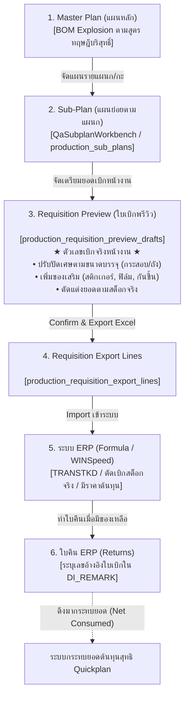
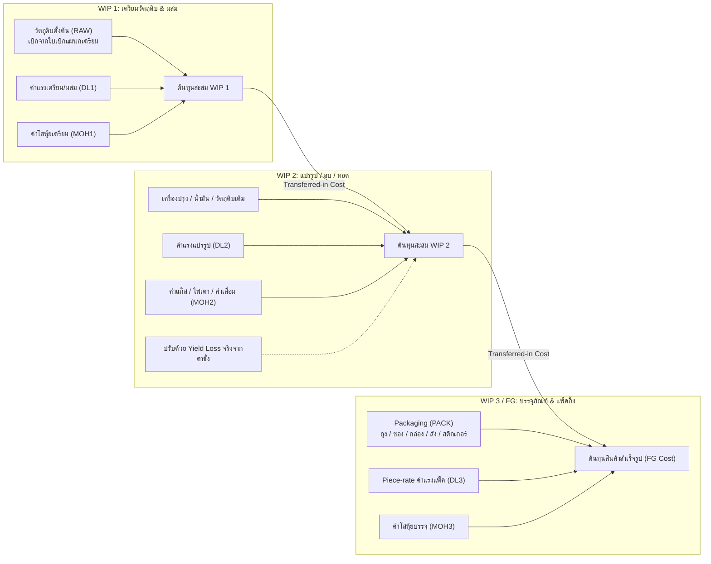
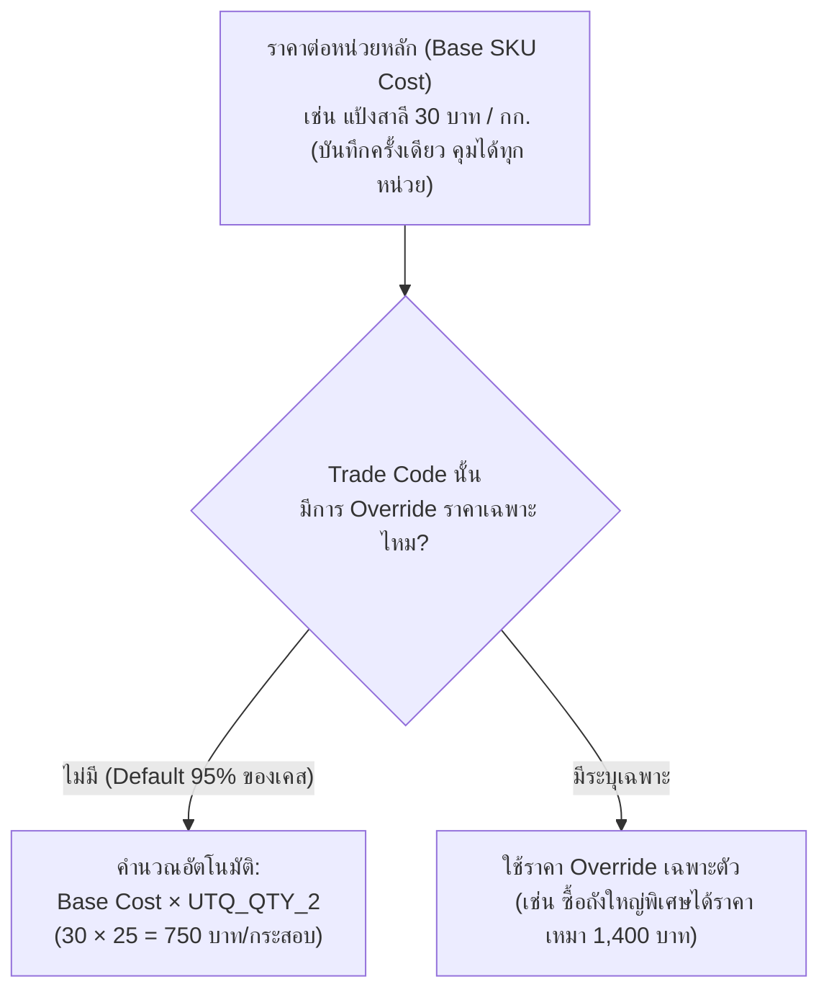
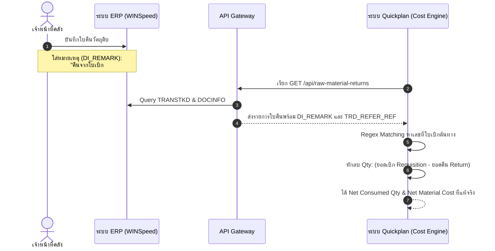

# สถาปัตยกรรมและการออกแบบระบบคิดต้นทุนการผลิต (Production Costing System Design)
**ระบบ Quickplan / KPF Production Line**  
*วันที่จัดทำ: 8 กันยายน 2026*  
*สถานะ: Design Specification & Implementation Guide*

---

## 1. บทนำและหลักการพื้นฐาน (Executive Summary & Core Principles)

### 1.1 ความสำคัญของการคิดต้นทุนแบบแยกช่วง (Multi-Stage WIP Costing)
ในอุตสาหกรรมการผลิตอาหาร/ขนมขบเคี้ยว (Food & Snack Processing) การคิดต้นทุนแบบเหมารวมทั้งโรงงาน (Black-Box Costing หรือดูแค่วัตถุดิบเข้าหัวไลน์แล้วดูสินค้าสำเร็จรูปท้ายไลน์) จะทำให้ฝ่ายบริหารและฝ่ายผลิตตาบอดต่อจุดรั่วไหล การคิดต้นทุนตามมาตรฐานสากล (**Multi-Stage Process Costing / Cumulative Step-Up Costing**) จึงต้องแยกคำนวณตามช่วงการผลิตจริง (WIP 1 $\rightarrow$ WIP 2 $\rightarrow$ WIP 3 $\rightarrow$ FG) ด้วยเหตุผล 4 ประการ:

1. **ระบุจุดสูญเสียของ Yield Loss / Scrap ได้ตรงจุด:** รู้ทันทีว่าวัตถุดิบสูญหายหรือน้ำหนักลดลงในขั้นตอนใด (ตอนล้างเตรียม? ตอนอบระเหยน้ำ? หรือแตกหักตอนแพ็ค?)
2. **ประเมินมูลค่างานระหว่างทำ (Ending WIP Valuation) ถูกต้องตามมาตรฐานบัญชี:** เมื่อสิ้นงวดบัญชี หากมีงานค้างอยู่ในไลน์ผลิต จะสามารถลงมูลค่าสต็อก WIP แต่ละแผนกได้อย่างแม่นยำ
3. **การคิดค่าแรง (Labor Cost) แยกตามทักษะและแผนก:** ช่างเตรียม ช่างคุมเตาอบ และพนักงานแพ็คกิ้ง ใช้อัตราค่าแรงเหมา (Piece-rate) หรือค่าแรงเวลาที่ต่างกัน
4. **การตัดสินใจ Make-or-Buy:** ทราบต้นทุน Conversion Cost ของแต่ละช่วง เพื่อเปรียบเทียบว่าควรจ้างตัดแต่งภายนอกหรือผลิตเอง

---

## 2. ทำไมต้องเริ่มจาก "หน้า Requisition Preview (ใบเบิกพรีวิว)" ?

ความจริงหน้างานของระบบ Quickplan มี 3 เลเยอร์ของข้อมูลวัตถุดิบ:



### การเปรียบเทียบต้นทุน 3 ระดับ
| ระดับต้นทุน | แหล่งที่มาในระบบ | บทบาทในการบริหารจัดการ |
|---|---|---|
| **1. Standard Theoretical Cost** | สูตร BOM จาก Master Plan | ต้นทุนทฤษฎี ใช้เป็นเกณฑ์มาตรฐาน (Baseline) |
| **2. Planned Requisition Cost** | **หน้า Requisition Preview** | **ยอดขอเบิกจริงหน้างาน (มีปัดเศษกระสอบ/เพิ่มของเสริม)** |
| **3. Actual Consumed Cost** | ยอดเบิกหักใบคืน ERP (Reconciled) | ต้นทุนที่แท้จริงหลังจบการผลิต |

> **สรุป:** การเริ่มต้นคิดต้นทุนจาก **หน้า Requisition Preview** ให้ความแม่นยำสูงกว่า Master Plan เพราะสะท้อนปริมาณวัตถุดิบและบรรจุภัณฑ์ที่หน้างานต้องใช้จริง 100%

---

## 3. โครงสร้างการคำนวณต้นทุนแยก 3 ช่วง WIP (WIP Stage Breakdown)

ระบบแบ่งช่วงการคำนวณตามแผนกเจ้าของงาน (`ownerDepartmentId`) และกลุ่มวัตถุดิบ (`dispatchMaterialGroup`):



### สูตรคำนวณแต่ละช่วง

#### ช่วงที่ 1: WIP 1 (แผนกเตรียม / ผสม)
* **วัตถุดิบ:** ดึงจากใบเบิกของแผนกเตรียม (`dispatchMaterialGroup = 'RAW'`)
* **ต้นทุนวัตถุดิบรวม:**
  $$\text{Material Cost}_{\text{WIP1}} = \sum (\text{Net Qty เบิกสุทธิ} \times \text{ราคาต้นทุนต่อหน่วย})$$
* **ต้นทุนต่อกิโลกรัม WIP 1:**
  $$\text{Unit Cost}_{\text{WIP1}} = \frac{\text{Material Cost}_{\text{WIP1}} + \text{DL}_1 + \text{MOH}_1}{\text{น้ำหนักที่ผสมเสร็จจริง (kg)}}$$

#### ช่วงที่ 2: WIP 2 (แผนกแปรรูป / อบ / ทอด)
* **Transferred-in Cost:** ยกยอดต้นทุนสะสมทั้งหมดมาจาก WIP 1
* **วัตถุดิบเพิ่มเติม:** เครื่องปรุง, ผงปรุงรส, น้ำมันทอด ที่เบิกในใบเบิกของแผนกนี้
* **ผลกระทบของ Yield (Yield Loss Effect):**  
  *เมื่อผ่านเตาอบ น้ำหนักจะระเหยหายไป (เช่น จาก 100 kg เหลือ 75 kg)*
* **ต้นทุนต่อกิโลกรัม WIP 2:**
  $$\text{Unit Cost}_{\text{WIP2}} = \frac{\text{ต้นทุนโอนมาจาก WIP 1} + \text{Material เพิ่มเติม} + \text{DL}_2 + \text{MOH}_2}{\text{น้ำหนักอบเสร็จจริงจากตาชั่ง (Actual Weighed kg)}}$$
  *(ระบบมีตาราง `production_snack_yield_logs` คอยบันทึกน้ำหนักจริงจุดนี้อยู่แล้ว)*

#### ช่วงที่ 3: WIP 3 / FG (แผนกบรรจุภัณฑ์ / แพ็คกิ้ง)
* **Transferred-in Cost:** ยกยอดต้นทุนสะสมเนื้อสินค้ามาจาก WIP 2
* **Packaging Material:** ดึงจากใบเบิกหมวด `PACK` (ซอง, ซองกันชื้น, กล่อง, เทปกาว, สติกเกอร์)
* **ต้นทุนสำเร็จรูปต่อหน่วย FG:**
  $$\text{Cost per FG Unit} = \frac{\text{ต้นทุนโอนมาจาก WIP 2} + \text{ต้นทุน Packaging รวม} + \text{DL}_3 + \text{MOH}_3}{\text{จำนวนชิ้น/ลัง FG ที่ชั่งตรวจรับจริง (Actual FG Output)}}$$

---

## 4. กลไกราคาวัตถุดิบและรหัสซื้อขาย (Base SKU vs Trade Code)

ระบบ Quickplan อิงสินค้าตาม 2 รหัส:
1. **`SKU_CODE` (Base SKU):** รหัสวัตถุดิบหลัก อิงหน่วยนับมาตรฐาน เช่น กิโลกรัม (`KG`)
2. **`GOODS_CODE` (Trade Code / รหัสซื้อขาย):** รหัสแพ็คเกจที่ใช้เบิก เช่น กระสอบ 25 กก., ถัง 50 กก., ลัง 12 ซอง
   - มี `UTQ_NAME_2` = หน่วยนับบรรจุ (กระสอบ / ถัง)
   - มี `UTQ_QTY_2` = อัตราการบรรจุ / ตัวคูณ (เช่น 25, 50, 1)

### การออกแบบการจัดเก็บราคา: Smart Hybrid Model (แนะนำ)



### ข้อดีของโมเดลนี้:
1. **ลดภาระงานบัญชี:** ฝ่ายบัญชีไม่ต้องคีย์ราคาให้ครบทุก 5-10 Trade Code ของสินค้าตัวเดียวกัน เพียงกรอกราคาต่อ กิโลกรัม หรือต่อ ชิ้น เพียงครั้งเดียว
2. **หน้า Requisition Preview ทำงานได้ทันที:** เมื่อใบเบิกสั่งเบิกหน่วยกระสอบ ระบบจะดึง `UTQ_QTY_2` มาคูณให้อัตโนมัติ

---

## 5. กลไกการกระทบยอดใบคืนจาก ERP (Stock Return Reconciliation)

เมื่อโรงงานเบิกวัตถุดิบไปแล้ว ผลิตเสร็จมีของเหลือส่งคืนคลัง:
* **การเบิก:** สร้างใบเบิกจาก Quickplan $\rightarrow$ Export Excel $\rightarrow$ Import เข้า ERP
* **การคืน:** ฝ่ายคลังเปิดใบคืนใน ERP โดยตรง (ไม่ได้ทำใน Quickplan)
* **Quickplan:** ดึงข้อมูลใบคืนผ่าน Gateway `/api/raw-material-returns`

### วิธีการ Match ใบคืนกลับมาหาใบเบิก (Matching Logic)



### Fallback Logic (กรณีคลังลืมใส่เลขใบเบิก):
1. **ลำดับที่ 1 (Direct Reference):** ตรวจสอบ `TRD_REFER_REF` หรือ Regex ใน `DI_REMARK` หาเลขที่ใบเบิก Quickplan (เช่น `X\d{4}/\d{4}` หรือ `MP-YYYY-MM-NNN`)
2. **ลำดับที่ 2 (Lot Matching):** ตรวจสอบ `TRD_LOT_NO` + รหัสสินค้า + แผนก
3. **ลำดับที่ 3 (Daily Window Bucket):** จับคู่ตาม (วันที่คืน $\pm 1$ วัน) + แผนกเดียวกัน + รหัสสินค้าตัวเดียวกัน

---

## 6. โครงสร้างการเชื่อมโยงค่าแรง (DL) และค่าโสหุ้ย (MOH)

เมื่อฝ่ายบัญชีมีตัวเลขสรุป DL และ MOH อยู่แล้ว สามารถนำมาผูกเข้ากับระบบได้ดังนี้:

| ประเภทต้นทุน | วิธีการปันส่วนเข้าแต่ละ Batch / Sub-plan | แหล่งข้อมูลใน Quickplan |
|---|---|---|
| **Direct Labor (DL) แบบ Piece-rate** | คิดตามจำนวนชิ้น/ถัง ที่พนักงานสแกนทำได้จริง $\times$ Wage Rate ประจำ Work Type | ตาราง `production_piece_rate_logs` |
| **Direct Labor (DL) แบบรายวัน/กะ** | (ค่าแรงพนักงานต่อกะ $\times$ จำนวนคน) $\div$ จำนวนผลผลิตที่ได้ | ตาราง `production_daily_work_logs` / `attendance_scan_events` |
| **Variable Overhead (MOH-V)** | ค่าไฟ, แก๊ส, ไอน้ำ ปันส่วนตามชั่วโมงเดินเครื่อง หรือบาทต่อกิโลกรัมผลผลิต | Work Center Overhead Rate |
| **Fixed Overhead (MOH-F)** | ค่าเสื่อมราคาเครื่องจักร, ค่าแรงหัวหน้ากะ, ค่าเช่า ปันส่วนตามเกณฑ์ปันส่วนคงที่ | Accounting Monthly Overhead Pool |

---

## 7. แผนการพัฒนาระบบ 4 ระยะ (Implementation Roadmap)

```
[Phase 1: Master Cost Data] ──> [Phase 2: Preview Value] ──> [Phase 3: Return Reconcile] ──> [Phase 4: Cost Report]
   กำหนดราคาต้นทุนสินค้า/          หน้าใบเบิกแสดงมูลค่าเงิน         ระบบหักใบคืน ERP           รายงานสรุปต้นทุนรวม
   รหัสซื้อขายในระบบ               แยกตามช่วง WIP อัตโนมัติ         ได้ยอดใช้จริงสุทธิ           COGM & Cost Variance
```

### Phase 1: การจัดการข้อมูลราคาหลัก (Master Cost Setup)
1. เพิ่มฟิลด์ราคาต้นทุนมาตรฐานในตารางสินค้า/วัตถุดิบ:
   - `standard_cost_base` (ราคาต่อหน่วยหลัก เช่น บาท/กก.)
   - `currency` (ค่าเริ่มต้น THB)
   - `effective_date` (วันที่มีผลบังคับใช้)
2. ในหน้า `/admin/products/trade-codes` เพิ่มช่องแสดงราคาคำนวณตามขนาดบรรจุ (`Base Cost × UTQ_QTY_2`) และช่องใส่ราคา Override เฉพาะตัว
3. สร้างปุ่มหรือสคริปต์ Sync ราคาทุนล่าสุดจากตาราง `TRANSTKD` ของ ERP มาเป็นค่าตั้งต้น

### Phase 2: แสดงมูลค่าเงินในหน้า Requisition Preview (Requisition Value Preview)
1. ดึงราคาต้นทุนมาคูณกับ `qty` ในหน้า Requisition Preview
2. แสดงผลสรุปมูลค่าเงินที่จะขอเบิก (Estimated Requisition Value) แยกตาม:
   - มูลค่าวัตถุดิบ Stage 1 (แผนกเตรียม)
   - มูลค่าวัตถุดิบ Stage 2 (แผนกแปรรูป)
   - มูลค่าบรรจุภัณฑ์ Stage 3 (แผนกแพ็ค)
3. สรุปมูลค่าเงินรวมของ Master Plan ประจำสัปดาห์

### Phase 3: กลไกกระทบยอดใบคืน (Net Requisition Reconciliation Engine)
1. นำ Service ดึงใบคืนจาก ERP `/api/raw-material-returns` มาตรวจจับข้อความใน `DI_REMARK`
2. สร้างตารางบันทึกสถานะการกระทบยอด: `production_requisition_reconciliations`
3. คำนวณยอดใช้สุทธิ: $\text{Net Consumed} = \text{เบิก} - \text{คืน}$

### Phase 4: หน้ารายงานสรุปต้นทุนการผลิตจริง (Production Batch Costing Report)
1. รวมยอด: $\text{Actual DM (สุทธิ)} + \text{Actual DL (จาก Piece-rate/กะ)} + \text{MOH (อัตราปันส่วน)}$
2. ดึงจำนวนผลผลิตจริงจากตาชั่ง (`pallet_qty_scan_logs` หรือ `production_snack_yield_logs`)
3. แสดงผลเปรียบเทียบ:
   - **Cost of Goods Manufactured (COGM) ต่อกิโลกรัม และต่อชิ้น FG**
   - **Material Usage Variance:** ผลต่างระหว่างสูตร BOM กับยอดใช้จริง (ชี้จุดของเสีย)
   - **Batch Profitability:** กำไรขั้นต้นของล็อตการผลิตนั้นๆ
