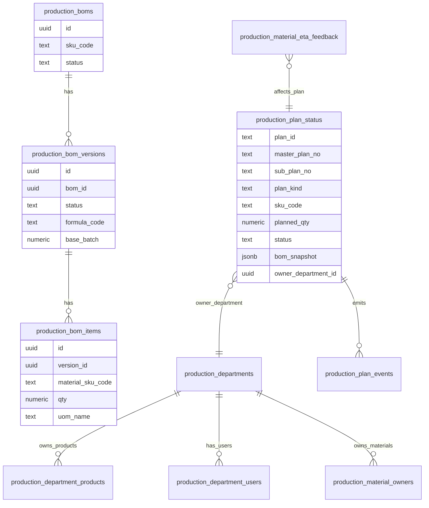
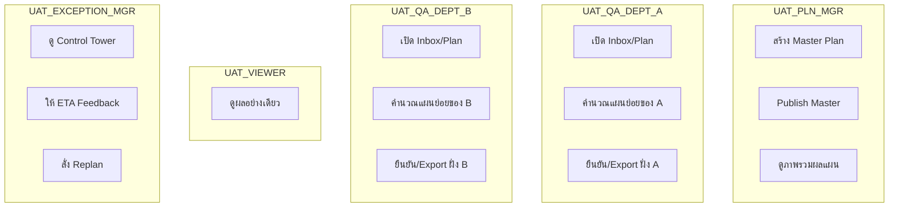
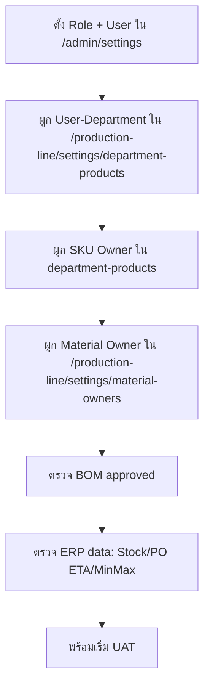
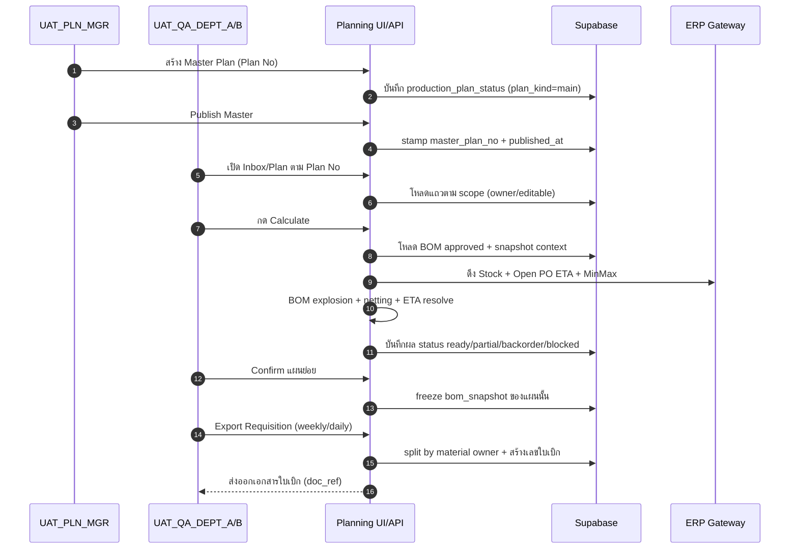
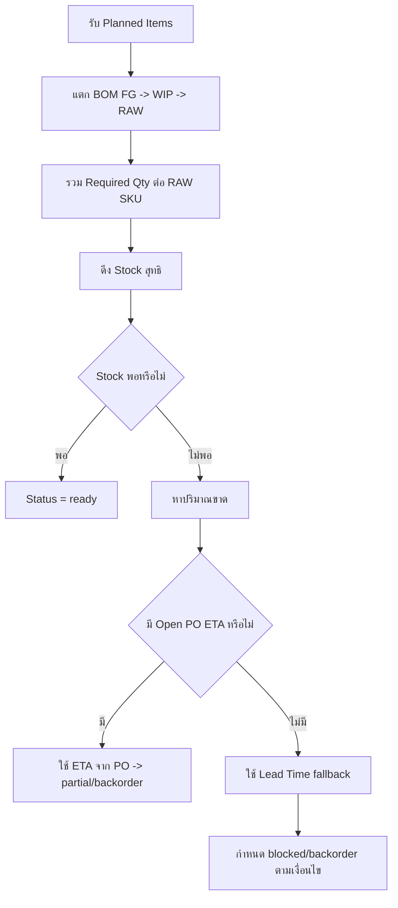
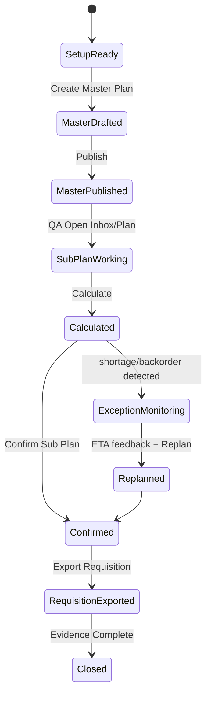

# Detailed Onboarding UAT + Mermaid (Master Plan -> Requisition)

วันที่เอกสาร: 2026-02-16  
สถานะ: Active (Detailed)  
กลุ่มผู้อ่าน: QA ใหม่, ทีมพัฒนาใหม่, TestSprite

---

## 1) เอกสารนี้คืออะไร

เอกสารนี้เป็นคู่มือทดสอบแบบละเอียดตั้งแต่เริ่มต้นสำหรับคนที่ไม่เคยเห็นโปรเจกต์มาก่อน  
เป้าหมายคือให้เข้าใจว่า:

1. ระบบนี้ทำอะไรและใครทำอะไร
2. ต้องตั้งค่าหน้าไหนก่อน
3. เริ่มเทสจาก Master Plan ยังไง
4. จบที่ Export ใบเบิกยังไง
5. จะตรวจได้อย่างไรว่าข้อมูล “ถูกต้องจริง”

---

## 2) Scope ทดสอบรอบนี้ (ชัดเจน)

- Start: หลัง BOM ที่ใช้ในรอบทดสอบเป็น `approved`
- End: ได้ใบเบิก (Requisition) ที่พร้อม import ERP และผ่านเกณฑ์ตรวจข้อมูล
- เอกสาร import ERP ใช้ **เลขใบเบิก** (Requisition No) ไม่ใช่ Plan No

---

## 3) Glossary (คำที่ต้องรู้ก่อน)

- `Master Plan`: แผนผลิตหลักทั้งสัปดาห์ (รองผู้จัดการวาง)
- `Sub Plan`: แผนย่อยของแต่ละแผนก (QA วาง/ยืนยันตาม scope)
- `BOM`: สูตรการผลิต (FG -> WIP -> RAW)
- `Material Owner`: เจ้าของวัตถุดิบระดับ SKU (แผนกที่รับผิดชอบ)
- `Open PO ETA`: คำสั่งซื้อคงค้างและวันที่คาดว่าจะรับเข้า
- `Policy Status`: ผลคำนวณ เช่น `ready`, `partial`, `backorder`, `blocked`

---

## 4) ภาพรวมระบบ (Context)

```mermaid
flowchart LR
  A[User UI] --> B[Next.js App]
  B --> C[Production Planning APIs]
  C --> D[Supabase]
  C --> E[API Gateway]
  E --> F[ERP SQL]

  subgraph UI Pages
    A1[/production-line/planning/master]
    A2[/production-line/planning/plan]
    A3[/production-line/planning/inbox]
    A4[/production-line/planning/control-tower]
    A5[/raw-material-requisitions/requisition]
  end

  A --> A1
  A --> A2
  A --> A3
  A --> A4
  A --> A5

  subgraph ERP Data
    F1[Stock Summary]
    F2[Open PO ETA]
    F3[Min/Max + Lead Time]
    F4[Trade Codes]
  end
  F --> F1
  F --> F2
  F --> F3
  F --> F4
```

---

## 5) โครงสร้างข้อมูลหลัก (ER แบบย่อ)



---

## 6) บทบาทและความรับผิดชอบ



---

## 7) ลำดับตั้งค่าก่อนเริ่มเทส (สำคัญมาก)



Checklist ก่อนเริ่ม:
- ผู้ใช้ UAT 5 บทบาทล็อกอินได้
- QA A/B ถูกผูกเป็น `editor` ในแผนกของตัวเอง
- Viewer ถูกผูกเป็น `viewer` (ถ้าต้องจำกัดรายแผนก)
- วัตถุดิบใน BOM มี material owner ครบ
- Plan No สำหรับรอบเทสถูกกำหนดแล้ว

---

## 8) End-to-End Flow หลัก (Master -> Requisition)



---

## 9) Decision Logic ตอนคำนวณ



---

## 10) หน้า UI ที่เกี่ยวข้อง และจุดประสงค์

| หน้า | ใช้ทำอะไร | ผู้ใช้หลัก |
|---|---|---|
| `/admin/settings` | สร้าง role/user | Admin |
| `/production-line/settings/department-products` | ผูก user กับแผนก + SKU owner | Admin/Planner setup |
| `/production-line/settings/material-owners` | ผูกเจ้าของวัตถุดิบ RAW | Admin/Planner setup |
| `/production-line/bom` | ตรวจสูตรและสถานะ approved | Planner/BOM owner |
| `/production-line/planning/master` | สร้างและ publish master plan | UAT_PLN_MGR |
| `/production-line/planning/plan` | ทำงานแผนย่อย | QA editor |
| `/production-line/planning/inbox` | รับงานจาก master | QA editor/viewer |
| `/production-line/planning/control-tower` | ติดตามความเสี่ยง/ETA/replan | UAT_EXCEPTION_MGR |
| `/production-line/planning/trace` | ย้อนรอยผลกระทบ | Manager/Viewer |
| `/raw-material-requisitions/requisition` | ตรวจใบเบิกที่ export แล้ว | QA/Manager |

---

## 11) Test Cases หลักที่ต้องมี

### TC-01 Happy Path (Stock พอ)
1. สร้าง master plan
2. QA คำนวณ
3. Status ต้องเป็น `ready` ส่วนใหญ่
4. Export ใบเบิกสำเร็จ

### TC-02 Stock ไม่พอ แต่มี PO
1. ปรับให้บาง SKU ขาด
2. มี Open PO ETA สำหรับ SKU ขาด
3. คำนวณแล้วต้องเห็น ETA และ `partial/backorder`

### TC-03 Stock ไม่พอ และไม่มี PO
1. SKU ขาดและไม่มี PO
2. คำนวณแล้วต้อง fallback lead time
3. สถานะต้องสะท้อนความเสี่ยง (`blocked/backorder`)

### TC-04 Scope Security
1. QA A พยายามแก้แถวแผนก B
2. ต้องถูกปฏิเสธ (403 / read-only)

### TC-05 Viewer Security
1. Viewer ลองทำ action เขียนข้อมูล
2. ต้องถูก block

### TC-06 Exception Loop
1. Exception mgr ให้ ETA feedback
2. สั่ง replan
3. ตรวจว่าแผนอัปเดตตาม ETA ใหม่

---

## 12) Data Correctness Checklist (ใช้ตอนเทสทุกเคส)

### 12.1 Plan & Scope
- `masterPlanNo` ถูกต้องและตรงกันทุกแถวในรอบ
- ผู้ใช้แก้ได้เฉพาะแผนกที่เป็น owner scope

### 12.2 BOM & Requirement
- วัตถุดิบที่คำนวณได้ต้องอ้างอิง BOM ที่ approved
- ปริมาณรวมต้องสัมพันธ์กับ planned qty และสูตร BOM

### 12.3 Stock/PO/LeadTime
- Stock ที่ใช้คำนวณต้องเป็น snapshot ล่าสุดที่ระบบดึงมา
- หากขาด ต้องมีเหตุผล ETA ที่ตรวจย้อนกลับได้ (PO หรือ lead time)

### 12.4 Requisition
- รายการ export ถูก split ตาม `material owner`
- เลขเอกสารที่ export เป็นเลขใบเบิกจากระบบ ไม่ใช่ Plan No

### 12.5 Traceability
- ค้นย้อนด้วย Plan No แล้วเห็น main/sub/material impact ครบ

---

## 13) Error/Negative Expectations (ต้องเจอเพื่อยืนยัน enforcement)

- เรียก calculate โดยไม่มี `masterPlanNo` -> 400
- `masterPlanNo` ไม่ตรงกับ item ใน payload -> 400
- export ข้ามแผนกที่ไม่มีสิทธิ์ -> 403
- viewer ทำ action write -> forbidden

---

## 14) UAT State Machine



---

## 15) หลักฐานที่ต้องเก็บ (สำหรับ sign-off)

- Screenshot ตาม phase A->E
- JSON response ของ endpoint สำคัญ:
  - `/api/production-planning/calculate`
  - `/api/production-planning/wip-sufficiency`
  - `/api/production-planning/wip-plan/draft`
  - `/api/production-planning/requisition/export`
- ตารางผล role-based: pass/fail ของทั้ง 5 user
- ตารางเปรียบเทียบ before/after เมื่อทำ ETA feedback + replan

---

## 16) Prompt แนะนำส่งให้ TestSprite (คัดลอกได้)

```text
Run full UAT for Production Planning from Master Plan creation to Requisition export.
Use document: docs/TESTSPRITE_DETAILED_ONBOARDING_E2E_WITH_MERMAID_2026-02-16.md
Start after BOM approved.
Validate role scope for 5 users:
UAT_PLN_MGR, UAT_QA_DEPT_A, UAT_QA_DEPT_B, UAT_VIEWER, UAT_EXCEPTION_MGR.
Include positive and negative tests, and attach evidence for:
calculate, wip-sufficiency, wip-plan/draft, requisition/export.
Validate data correctness against BOM explosion, stock, open PO ETA, lead time, and owner split.
```

---

## 17) เอกสารที่ใช้คู่กัน

- Canonical สั้น: `docs/TESTSPRITE_CANONICAL_MASTER_TO_REQUISITION_UAT_2026-02-16.md`
- ตั้งค่า 5 role: `docs/UAT_5_ROLES_UI_SETUP_CHECKLIST_2026-02-16.md`
- ข้อมูลตั้งต้น/BOM จำลอง: `docs/UAT_DATA_PREP_BOM_SIMULATION_FROM_ZERO_2026-02-16.md`

