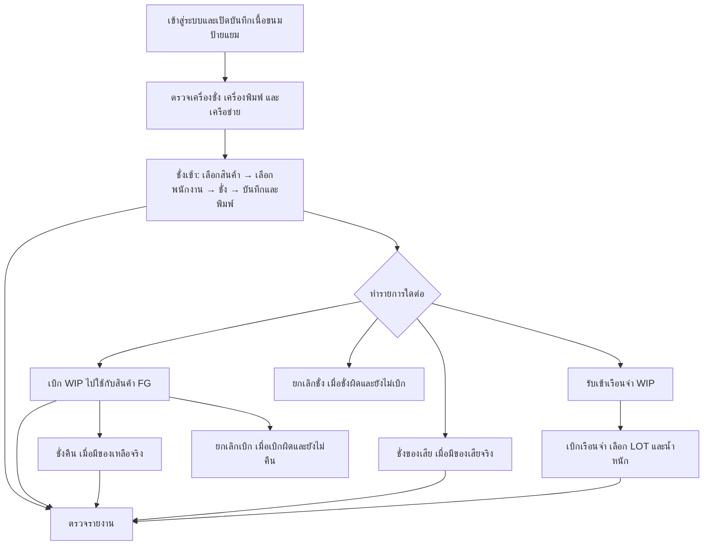

# คู่มือการใช้งานระบบบันทึกเนื้อขนมป้ายแยม

**ขอบเขต:** หน้า `/production-line/attendance/piece-rate-scan` บนเครื่องหน้างาน และรายงานที่เปิดจากเมนูของหน้านี้  
**จัดทำ:** 14 กันยายน 2569  
**ผู้ใช้เอกสาร:** ผู้ปฏิบัติงานที่เริ่มใช้งานครั้งแรก

คู่มือนี้อธิบายขั้นตอนตามภาพหน้าจอที่ได้รับและการทำงานของโปรแกรมในโครงการ ให้ตรวจชื่อสินค้า พนักงาน วันที่ LOT น้ำหนัก และผลสำเร็จบนหน้าจอทุกครั้งก่อนทำรายการถัดไป ภาพบางภาพแสดงสถานะเครื่องชั่งหรือเครื่องพิมพ์ออฟไลน์ จึงใช้ประกอบตำแหน่งเมนูเท่านั้น ไม่ใช่ตัวอย่างการบันทึกสำเร็จ

**ชุดคู่มือภาพ (Mockup):** ภาพเหล่านี้ใช้ดูตำแหน่งหน้าจอและลำดับงาน ข้อความขนาดเล็กหรือค่าจำลองในภาพอาจไม่ตรงระบบจริง ให้ยึดขั้นตอนในคู่มือและหน้าจอใช้งานจริงเป็นหลัก

1. [ชั่งเข้า](ภาพตัวอย่างคู่มือ-ชั่งเข้า.png)
2. [ยกเลิกชั่ง · ชั่งคืน · ชั่งของเสีย](ภาพคู่มือ-ยกเลิกชั่ง-ชั่งคืน-ของเสีย.png)
3. [เบิก · ยกเลิกเบิก](ภาพคู่มือ-เบิก-ยกเลิกเบิก.png)
4. [รับเข้าเรือนจำ · เบิกเรือนจำ](ภาพคู่มือ-รับเข้า-เบิกเรือนจำ.png)
5. [รายงานทุกประเภท](ภาพคู่มือ-รายงาน.png)

## 1. ภาพรวมลำดับงาน

รายการ **ชั่งคืน**, **ชั่งของเสีย** และ **ยกเลิก** เป็นทางเลือกตามเหตุการณ์ ไม่จำเป็นต้องทำต่อจากทุกใบชั่ง

| ต้องการทำอะไร | เปิดเมนู |
|---|---|
| ชั่งรับงานผลิตตามสินค้าและพนักงาน | **ชั่ง → ชั่งเข้า** |
| รับ WIP เข้าเรือนจำเป็น LOT และกระบะ | **ชั่ง → รับเข้าเรือนจำ** |
| บันทึกของเสีย | **ชั่ง → ชั่งของเสีย** |
| นำส่วนที่เบิกแล้วกลับมาชั่ง | **ชั่ง → ชั่งคืน** |
| ยกเลิกใบชั่งที่ยังไม่เบิก | **ชั่ง → ยกเลิกชั่ง** |
| เบิกป้าย WIP ไปใช้ผลิตสินค้า FG | **เบิก → เบิก** |
| เบิก WIP เรือนจำตาม LOT | **เบิก → เบิกเรือนจำ** |
| ยกเลิกการเบิกที่ยังไม่ชั่งคืน | **เบิก → ยกเลิกเบิก** |
| ตรวจยอดและประวัติ | **รายงาน** |

## 2. เตรียมเครื่องและเริ่มใช้งาน

1. เข้าสู่ระบบด้วยบัญชีของผู้ปฏิบัติงาน แล้วเลือก **ไลน์ผลิต → บันทึกเนื้อขนมป้ายแยม**
2. บนเครื่องหน้างาน ตรวจแถบ **สถานะอุปกรณ์** ใต้หน้าชั่ง โดยเฉพาะเครื่องชั่ง เครื่องพิมพ์ เครื่องสแกน และเครือข่าย
3. หากเครื่องชั่งยังเป็น **OFFLINE** หรือ **รอพอร์ต** ให้กดรูปเฟืองมุมขวาบนเพื่อเปิด **ตั้งค่าจุดบันทึกเนื้อขนมป้ายแยม** ตรวจพอร์ต COM และค่าการเชื่อมต่อที่สถานีกำหนด แล้วกด **บันทึกเครื่องชั่ง**
4. ในหน้าตั้งค่าเดียวกัน เลือก **เครื่องพิมพ์ Windows** กด **ทดสอบพิมพ์** และ **บันทึกเครื่องพิมพ์** ตรวจว่ากระดาษออกจากเครื่องที่ใช้งานจริง เครื่องพิมพ์ส่วนนี้มีโปรไฟล์แยกจากระบบ Weight Scale
5. กลับหน้าชั่ง รอให้ค่าน้ำหนักเปลี่ยนตามเครื่องจริงและสถานะพร้อมใช้งาน จากนั้นนำสิ่งของออกจากเครื่องให้ค่าเริ่มต้นถูกต้องก่อนเริ่มชั่ง
6. หากระบบแสดงข้อความต้องซิงค์ข้อมูลสินค้าและพนักงานก่อนใช้งาน ให้ทำการซิงค์ตามหน้าจอหรือแจ้งผู้ดูแลสถานี แล้วเริ่มใหม่เมื่อระบบพร้อม

**ผลที่ต้องเห็น:** เครื่องชั่งอ่านน้ำหนักได้ เครื่องพิมพ์พร้อม และระบบค้นสินค้า/พนักงานได้ ภาพด้านล่างเป็นตัวอย่างตำแหน่งข้อมูล แต่แสดงสถานะ OFFLINE จึงยังไม่พร้อมบันทึก

## 3. ชั่งเข้า: บันทึกน้ำหนักและพิมพ์ป้าย

**ใช้เมื่อ:** ผลิตเนื้อขนมป้ายแยมเสร็จและต้องบันทึกน้ำหนักให้สัมพันธ์กับสินค้าและผู้ปฏิบัติงาน

1. เปิด **ชั่ง → ชั่งเข้า** หน้าจอแสดงลำดับ **สแกนสินค้า → สแกนพนักงาน → ชั่งและบันทึก**
2. สแกนรหัสสินค้าหรือกด **เลือกสินค้า** เพื่อค้นหารหัส/ชื่อสินค้า ตรวจรูป รหัสสินค้า และชื่อที่แสดงในช่อง **สินค้าปัจจุบัน**
3. สแกนรหัสพนักงานหรือกด **เลือกพนักงาน** ตรวจรหัส ชื่อ และแผนกในช่อง **พนักงานปัจจุบัน** ภาพพนักงานช่วยตรวจตัวบุคคล แต่ให้ใช้รหัสเป็นหลัก
4. วางสินค้าที่ต้องบันทึกบนเครื่องชั่ง ตรวจน้ำหนักที่แสดงและรอเครื่องอ่านค่านิ่ง ไม่กดบันทึกขณะสถานะ OFFLINE หรือค่าน้ำหนักยังไม่พร้อม
5. กด **บันทึกและพิมพ์** หนึ่งครั้ง รอผลการบันทึกและการพิมพ์ ไม่กดซ้ำระหว่างระบบกำลังประมวลผล
6. ตรวจป้ายที่พิมพ์: รหัสสินค้า/ชื่อสินค้า รหัสพนักงาน น้ำหนัก และเลขบาร์โค้ดต้องตรงของจริง
7. ตรวจแถวใหม่ใน **บันทึกล่าสุด 20 รายการ** ซึ่งแสดงบาร์โค้ด LOT เวลา พนักงาน สินค้า น้ำหนัก จำนวน และสถานะ
8. นำสินค้าออกจากเครื่องชั่งก่อนบันทึกรายการต่อไป หากยังเป็นสินค้าเดิม สามารถสแกนพนักงานคนต่อไปแล้วชั่งต่อได้ตามลำดับหน้าจอ หากเปลี่ยนสินค้าให้ใช้ **เปลี่ยนสินค้า** แล้วตรวจข้อมูลใหม่

**กรณีป้ายไม่ออก:** ตรวจว่ารายการบันทึกแล้วหรือไม่ในตารางล่าสุด หากมีรายการแล้ว ให้จดเลขบาร์โค้ด ตรวจเครื่องพิมพ์ และแจ้งผู้ดูแลสถานีเพื่อดำเนินการพิมพ์ป้ายของรายการเดิม ตารางบันทึกล่าสุดบนเครื่องหน้างานไม่มีปุ่มพิมพ์ซ้ำ อย่าสร้างใบชั่งใหม่เพียงเพราะเครื่องพิมพ์ขัดข้อง

**หมายเหตุ:** สินค้าบางชนิดใช้รูปแบบกรอกจำนวนกระบะแทนน้ำหนักจากเครื่อง ให้ทำตามชนิดข้อมูลที่หน้าจอของสินค้านั้นเปิดให้บันทึก

**ตรวจยอดรายคนประจำวัน:** กด **สรุปรายคน (วันนี้)** เหนือตารางบันทึกเพื่อเปิดหน้าสรุปเต็มจอ ตรวจจำนวนพนักงาน จำนวนรายการ และน้ำหนักรวม ใช้ช่องค้นหาด้วยรหัสหรือชื่อพนักงาน แล้วตรวจรายการชั่งและยอดรวมของคนนั้น กดปุ่มปิดหรือ Esc เพื่อกลับหน้าชั่ง หน้านี้ใช้ตรวจงานประจำวัน ไม่ใช่ปุ่มบันทึกชั่งใหม่

## 4. ยกเลิกชั่งเข้า

**ใช้เมื่อ:** ใบชั่งบันทึกผิดและยังไม่ถูกนำไปเบิก

1. เปิด **ชั่ง → ยกเลิกชั่ง**
2. ตรวจบาร์โค้ดบนป้ายที่ต้องการยกเลิก สแกนหรือกรอกในช่อง **สแกนบาร์โค้ดป้ายแยม แล้วกด ENTER**
3. รอให้ระบบแสดงสินค้า LOT น้ำหนัก และสถานะ ตรวจว่าตรงกับใบชั่งที่ต้องการย้อน
4. หากระบบแจ้งว่าใบชั่งถูกเบิกแล้ว ให้ตรวจและยกเลิกการเบิกที่เกี่ยวข้องก่อนตามเงื่อนไขของระบบ
5. กด **ยืนยันยกเลิกชั่ง** เมื่อข้อมูลถูกต้อง แล้วรอข้อความผลสำเร็จ
6. แยกป้ายที่ยกเลิกออกจากของพร้อมใช้งาน และตรวจสถานะย้อนหลังใน **รายงานรับเข้า WIP → แบบรายละเอียด**

ปุ่มยืนยันจะยังใช้งานไม่ได้จนกว่าระบบจะพบรายการที่ยกเลิกได้ ภาพตัวอย่างอยู่ในสถานะ **รอรับบาร์โค้ด**

## 5. ชั่งของเสีย

**ใช้เมื่อ:** มีของเสียจากสินค้าที่กำลังทำงานจริง โดยต้องบันทึกประเภทและน้ำหนัก

1. เปิด **ชั่ง → ชั่งของเสีย**
2. สแกนหรือเลือกสินค้า ตรวจรหัสและชื่อในช่อง **สินค้าที่เลือก** หากผิดให้กด **เปลี่ยนสินค้า / สแกนสินค้าใหม่**
3. เลือกประเภทของเสียหนึ่งประเภท: **เศษป้าย**, **เศษหัก** หรือ **ไหม้**
4. วางของเสียบนเครื่องชั่ง รอค่าน้ำหนักนิ่งและตรวจน้ำหนักที่แสดง
5. กด **บันทึกของเสีย** หนึ่งครั้ง รอข้อความสำเร็จก่อนเปลี่ยนสินค้า/ชั่งรายการใหม่
6. หากไม่มีเครื่องชั่งและหน้าจอแสดงช่อง **กรอกน้ำหนักเมื่อไม่มีเครื่องชั่ง** ให้กรอกน้ำหนักจริงตามวิธีปฏิบัติของหน่วยงานและตรวจตัวเลขก่อนกดบันทึก
7. ตรวจรายการในรายงานเคลื่อนไหวหรือรายงานที่เกี่ยวข้องภายหลัง

ภาพแสดงสถานะ **Scale Agent ออฟไลน์** ปุ่มบันทึกยังไม่พร้อม จึงไม่ใช่ภาพผลบันทึกของเสียสำเร็จ

## 6. รับเข้าเรือนจำ: เพิ่ม WIP ตาม LOT

**ใช้เมื่อ:** ต้องรับเนื้อขนม WIP เข้าเรือนจำ โดยระบุ LOT จำนวนกระบะ และน้ำหนักจริง รายการนี้สร้างเอกสารรับเข้าและเพิ่มสต็อก WIP ฝั่งเรือนจำ

1. เปิด **ชั่ง → รับเข้าเรือนจำ** แล้วเลือกแท็บ **รับเข้าเรือนจำ**
2. ตรวจรหัสสินค้า WIP ที่ระบบแสดงในส่วน **สินค้า WIP**
3. ในแถวแรก กรอก **หมายเลข LOT**, **จำนวน** กระบะเป็นจำนวนเต็มมากกว่า 0 และ **น้ำหนัก (KG)** มากกว่า 0
4. หากมีหลาย LOT กด **เพิ่ม LOT** แล้วกรอกให้ครบทีละแถว ตรวจไม่ให้ใช้ LOT ผิดหรือบันทึกซ้ำ หากเพิ่มแถวเกินให้ลบแถวนั้น
5. ตรวจยอดรวมจำนวน LOT กระบะ และน้ำหนักด้านล่างตาราง
6. กด **ยืนยันรับเข้า** แล้วรอข้อความ **รับเข้าสำเร็จ** พร้อมเลขที่เอกสาร
7. ตรวจ **รายการรับเข้าล่าสุด** ว่าจำนวนและน้ำหนักตรงกับที่รับจริง

**ข้อสำคัญ:** หน้านี้รับเข้า WIP เรือนจำ ไม่ใช่การชั่ง FG และไม่ใช่การเบิกออกจากเรือนจำ

## 7. เบิกเนื้อขนมป้ายแยมไปใช้กับสินค้า FG

**ใช้เมื่อ:** มีใบชั่ง WIP พร้อมเบิก และทราบสินค้า FG ปลายทาง

1. เปิด **เบิก → เบิก**
2. ตรวจ **วันที่เบิก** ก่อนดำเนินรายการ
3. ในส่วน **เลือก / สแกนสินค้า** เลือกสินค้า FG ปลายทางจากรายชื่อหรือสแกนรหัสสินค้า ตรวจรหัสและชื่อที่แสดง
4. ที่ช่อง **สแกนใบเบิก / ป้ายแยม** สแกนบาร์โค้ดของใบชั่ง WIP หรือกรอกแล้วกด Enter
5. การสแกนที่ผ่านเงื่อนไขจะบันทึกเบิกทันที รอข้อความ **เบิกสำเร็จ** และตรวจรายการล่าสุดก่อนสแกนอีกใบ
6. หากต้องเบิกหลายใบ ใช้ **เปิดรายการที่ยังไม่เคยเบิก** เลือกใบที่ถูกต้อง ตรวจจำนวนและน้ำหนักรวม แล้วกดยืนยันการเบิกตามปุ่มในหน้าต่าง
7. หากเลือกสินค้า FG หรือใบชั่งผิด ให้หยุดและตรวจวิธียกเลิกเบิกในหัวข้อ 10

ภาพแสดงวิธีเลือกสินค้า/วันเบิกและตำแหน่งสแกน ปุ่ม **ยืนยันเบิกเอกสาร** ในภาพยังเป็นสีเทาเพราะยังไม่มีรายการที่พร้อมดำเนินการ

## 8. ชั่งคืนของที่เบิกไปแล้ว

**ใช้เมื่อ:** มีเนื้อขนมเหลือกลับจริงจากใบที่เบิกแล้ว

1. เปิด **ชั่ง → ชั่งคืน**
2. ตรวจ **วันที่ชั่งคืน** วันที่นี้ใช้กับรายงานและการเคลื่อนไหวสต็อก
3. สแกนบาร์โค้ดป้ายที่เบิกแล้ว รอข้อมูลสินค้า LOT น้ำหนักเบิก และยอด **คืนได้ไม่เกิน**
4. วางของที่จะคืนบนเครื่องชั่ง ตรวจว่า Scale Agent เชื่อมต่อ พอร์ตเปิด ค่าน้ำหนักใหม่ และสถานะ **STABLE · พร้อมบันทึก**
5. ตรวจว่าน้ำหนักคืนมากกว่า 0 และไม่เกินยอดคืนได้ ระบบจะบันทึกอัตโนมัติเมื่อเงื่อนไขครบ ให้รอผลโดยไม่สแกนรายการถัดไปก่อน
6. ตรวจข้อความบันทึกสำเร็จและบาร์โค้ดป้ายคืนใหม่ หากพิมพ์ไม่สำเร็จให้ใช้เลขรายการที่บันทึกแล้วตรวจ/พิมพ์ป้ายเดิม ไม่ชั่งคืนซ้ำ
7. ยกสินค้าออกให้เครื่องกลับสู่สภาพพร้อม ก่อนสแกนใบต่อไป

หากใบเดิมยังไม่เบิกหรือคืนครบแล้ว ระบบไม่อนุญาตให้คืนอีก ภาพตัวอย่างยังรอบาร์โค้ดและเครื่องชั่งออฟไลน์

## 9. เบิกเนื้อขนมเรือนจำ

**ใช้เมื่อ:** มี WIP รับเข้าเรือนจำแล้วและต้องเบิกตาม LOT ไปยังสินค้า FG ปลายทาง

1. เปิด **เบิก → เบิกเรือนจำ**
2. ตรวจ **วันที่เบิก** และเลือก/สแกนสินค้า FG ปลายทาง
3. กด **เปิดรายการ LOT เนื้อขนมเรือนจำ**
4. ค้นหา LOT ที่ต้องการในหน้าต่าง ตรวจวันที่รับเข้า ยอดคงเหลือ น้ำหนักเฉลี่ยต่อกระบะ และลำดับ FIFO
5. เลือก LOT และระบุ **น้ำหนักที่เบิกจริง (กก.)** หรือใช้ตัวเลือกสัดส่วนกระบะตามหน้าจอ ระบบคำนวณจำนวนกระบะเทียบเท่าให้
6. ตรวจยอดรวม LOT จำนวนกระบะ และน้ำหนักที่เลือก แล้วกด **ยืนยันการเบิก**
7. รอผลสำเร็จ ตรวจรายงานเรือนจำทั้งรับเข้า เบิกออก และคงเหลือแยก LOT

ภาพแสดงหน้าเบิกเรือนจำก่อนเปิดรายการ LOT

## 10. ยกเลิกเบิก

**ใช้เมื่อ:** เบิกใบชั่งผิด และยังไม่มีการชั่งคืนจากรายการเบิกนั้น

1. เปิด **เบิก → ยกเลิกเบิก**
2. ตรวจบาร์โค้ดของป้ายที่จะย้อน สแกนหรือกรอกในช่อง **สแกนบาร์โค้ดป้ายแยม แล้วกด ENTER**
3. รอข้อมูลสินค้า LOT น้ำหนัก และสถานะ ตรวจรายการให้ตรงก่อนดำเนินการ
4. กด **ยืนยันยกเลิกเบิก** แล้วรอข้อความสำเร็จ
5. ตรวจว่าป้ายกลับเป็น **พร้อมเบิก** และตรวจประวัติใน **รายงานเบิก → แบบรายละเอียด** โดยเลือกสถานะยกเลิกเบิก
6. หากระบบแจ้งว่ามีการชั่งคืนแล้ว ให้หยุดและแจ้งผู้รับผิดชอบตรวจรายการเกี่ยวข้อง ไม่สร้างการเบิกซ้ำเพื่อแก้ยอด

ภาพตัวอย่างยังรอบาร์โค้ด ปุ่มยืนยันจึงยังไม่พร้อมกด

## 11. รายงานทั้งหมดในเมนูนี้

เปิด **รายงาน** ที่แถบบนของหน้า แล้วเลือกตามคำถามที่จะตรวจ รายงานชั่งเข้าและเบิกมีตัวเลือกย่อย **แบบรายละเอียด** กับ **แบบสรุป** ส่วนรายงานเรือนจำมีแท็บรับเข้า เบิกออก และคงเหลือแยก LOT

| รายงาน | ใช้ตรวจ |
|---|---|
| **รับเข้า WIP → แบบรายละเอียด / แบบสรุป** | ใบชั่ง WIP รายบาร์โค้ด หรือยอดรวมตามช่วงวัน |
| **รับเข้า FG → แบบรายละเอียด / แบบสรุป** | ผลผลิต FG ที่เสร็จแล้ว |
| **เบิก → แบบรายละเอียด / แบบสรุป** | ใบเบิก การชั่งคืน และยอดเบิกตามตัวกรอง |
| **เคลื่อนไหว** | การรับ เบิก คืน ของเสีย และผลต่อยอดในช่วงวัน |
| **คงเหลือ** | ยอดที่ยังมีแยกสินค้า/LOT |
| **รายงานเรือนจำ → รับเข้า** | WIP ที่รับเข้าฝั่งเรือนจำ |
| **รายงานเรือนจำ → เบิกออก** | WIP ที่เบิกออกจากเรือนจำ |
| **รายงานเรือนจำ → คงเหลือแยก LOT** | WIP เรือนจำที่ยังเหลือ |

### วิธีตรวจรายงานทีละขั้น

1. คลิก **รายงาน** แล้วเลือกรายงานที่ตรงเรื่อง หากมีลูกศรให้เลือกรูปแบบ **แบบรายละเอียด** หรือ **แบบสรุป**
2. กำหนด **จากวันที่** และ **ถึงวันที่** ในรายงานที่มีช่วงวัน รายงานคงเหลือไม่แสดงช่องช่วงวันแบบเดียวกับรายงานเคลื่อนไหว
3. ใช้ช่อง **ค้นหา** ด้วยเลขป้าย เลขเอกสาร รหัส/ชื่อสินค้า LOT หรือพนักงานตามข้อมูลที่มี
4. รายงานรับเข้า WIP/FG เลือก **สถานะใบชั่ง** เช่น รับเข้าทั้งหมด พร้อมเบิก เบิกแล้ว หรือยกเลิกชั่ง; รายงานเบิกแบบละเอียดเลือกสถานะ **เบิกสำเร็จ** หรือ **ยกเลิกเบิก**
5. กด **ค้นหา** อ่านหัวรายงาน ช่วงวัน สถานะ จำนวนรายการ น้ำหนัก และแถวรายละเอียดให้สอดคล้องกัน หากมีหลายหน้ากด **ถัดไป** เพื่อดูต่อ
6. ใช้ **รีเฟรช** เมื่อจำเป็นต้องโหลดข้อมูลล่าสุด กด **พิมพ์รายงาน**, **Export Excel** หรือ **พิมพ์ / บันทึก PDF** ตามปุ่มที่หน้านั้นแสดง หลังตรวจตัวกรองแล้ว
7. เมื่อดูเสร็จ กด **กลับหน้าสแกน**

ตัวอย่างภาพรายงานรับเข้า WIP แบบรายละเอียด:

รายงานของหน้านี้อยู่ที่ `/production-line/attendance/report/piece-rate-stock` โดยเลือกชนิดด้วย `report=inbound`, `inbound-fg`, `issue`, `movement`, `balance` หรือ `prison` ชื่อเมนูในหน้าเป็นหลักสำหรับผู้ใช้งาน

## 12. เมื่อระบบไม่พร้อมหรือผลไม่ตรง

| อาการ | วิธีตรวจเบื้องต้น |
|---|---|
| เครื่องชั่ง OFFLINE / รอพอร์ต | ตรวจ Scale Agent สายเครื่องชั่ง และพอร์ต COM ในหน้าตั้งค่า อย่าบันทึกจากค่า 0.000 ที่ค้างอยู่ |
| เครื่องพิมพ์ออฟไลน์ | ตรวจเครื่องพิมพ์ Windows ที่เลือก ทดสอบพิมพ์ แล้วตรวจใบที่บันทึกไว้ก่อนพิมพ์ซ้ำ |
| ค้นไม่พบสินค้า/พนักงาน | ตรวจรหัสหรือการเลือกจากรายชื่อ รวมถึงสถานะซิงค์ข้อมูลของเครื่องหน้างาน |
| ปุ่มบันทึกเป็นสีเทา | ตรวจว่าสินค้า พนักงาน น้ำหนัก และสถานะเครื่องพร้อมตามหน้าจอ |
| ชั่งคืนไม่ได้ | ตรวจว่าใบถูกเบิกแล้ว ยังมีน้ำหนักคืนได้ และเครื่องชั่งนิ่ง/เชื่อมต่อ |
| ยกเลิกชั่งไม่ได้ | ตรวจว่าใบถูกเบิกหรือไม่ หากถูกเบิกต้องตรวจรายการเบิกก่อน |
| ยกเลิกเบิกไม่ได้ | ตรวจว่ามีการชั่งคืนจากใบเบิกนั้นหรือไม่ |
| ยอดรายงานต่างจากรายการที่เห็น | ตรวจชนิดรายงาน ช่วงวัน สถานะ สินค้า LOT และการแบ่งหน้าให้ตรงกัน |

## 13. ภาพประกอบและข้อจำกัด

ภาพต้นฉบับมาจากโฟลเดอร์ `C:\Users\Riew\Desktop\KPF\Production-Line\บันทึกเนื้อขนมป้ายแยม` สำเนาที่ใช้กับเอกสารอยู่ใน `images/` ภาพที่มีแสดงตำแหน่งเมนูและสถานะก่อนทำรายการเป็นหลัก ยังไม่มีภาพต่อไปนี้: หน้าตั้งค่าเครื่องชั่ง/เครื่องพิมพ์ที่เปิดแล้ว, หน้าต่างเลือกสินค้า/พนักงาน, ค่าน้ำหนัก STABLE และผลชั่งสำเร็จ, กล่องข้อมูลหลังสแกนยกเลิก, ผลรับเข้า/เบิก/คืนสำเร็จ, หน้าต่าง LOT เรือนจำ และรายงานทุกชนิด หากจัดพิมพ์คู่มือฉบับใช้งานจริง ควรเพิ่มภาพจากรายการที่ได้รับอนุญาตโดยไม่ทำธุรกรรมใหม่เพียงเพื่อถ่ายภาพ

ภาพบางส่วนมีข้อมูลบุคคลและรายการจริง ก่อนแจกจ่ายภายนอกหน่วยงานให้ตรวจสิทธิ์การเผยแพร่ภาพถ่ายพนักงาน รหัสบาร์โค้ด และยอดธุรกรรม

**ข้อมูลตรวจสอบสำหรับผู้ดูแลเอกสาร:** เมนูอยู่ใน `src/features/attendance/components/PieceRateWorkflowTabs.js`; หน้าชั่งและพนักงานใน `src/app/production-line/attendance/piece-rate-scan/`; รับเข้าเรือนจำใน `PieceRatePrisonReceiptForm.js`; เบิก/คืน/ยกเลิกใน `src/features/attendance/components/PieceRateStockWorkflowPageClient.js`; เบิกเรือนจำตาม LOT ใน `PieceRatePrisonIssueModal.js`; รายงานใน `PieceRateStockMovementReportPageClient.js` คู่มือนี้เรียบเรียงจากโค้ดและภาพ ไม่ได้ทดสอบบันทึกข้อมูลบนระบบใช้งานจริง
