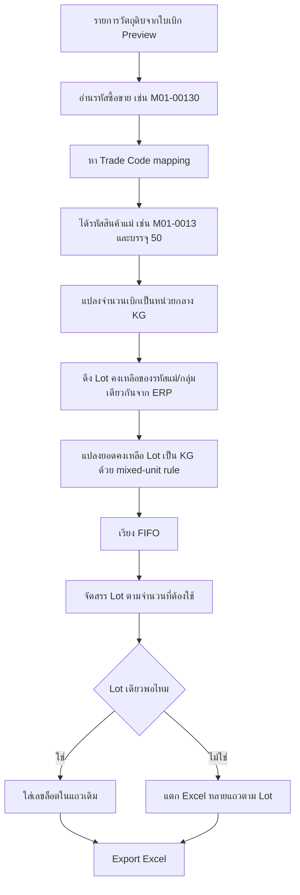

# Requisition Lot FIFO Allocation Implementation Plan

> **For agentic workers:** REQUIRED SUB-SKILL: Use superpowers:subagent-driven-development (recommended) or superpowers:executing-plans to implement this plan task-by-task. Steps use checkbox (`- [ ]`) syntax for tracking.

**Goal:** ทำให้ใบเบิกวัตถุดิบสามารถเติม `เลขล็อต` อัตโนมัติจากสต็อค ERP ตามรหัสแม่/รหัสซื้อขาย/ขนาดบรรจุ และจัด Lot ตาม FIFO ก่อน export Excel

**Architecture:** ระบบจะไม่เดา Lot จากชื่อวัตถุดิบ แต่จะใช้ `รหัสสินค้าแม่` จากหน้า Trade Codes เป็นตัวรวมวัตถุดิบเดียวกัน แล้วใช้ `รหัสซื้อขาย` และ `บรรจุ` เพื่อแปลงจำนวนเบิกให้เป็นหน่วยกลางก่อนจัด Lot. การจัด Lot จะทำตอนสร้างใบเบิกจริงหรือก่อน export โดยแยกแถว Excel เมื่อหนึ่งรายการต้องใช้หลาย Lot.

**Tech Stack:** Next.js App Router, Supabase, Express API Gateway, SQL Server ERP, ExcelJS, Node test runner

---

## Business Context

ระบบผลิตของเรามี BOM ที่ผูกวัตถุดิบด้วย `รหัสซื้อขาย` ได้หลายหน่วย เช่น:

| รหัสสินค้าแม่ | รหัสซื้อขาย | ชื่อ | หน่วย | บรรจุ |
| --- | --- | --- | --- | --- |
| M01-0013 | M01-0013 | น้ำตาลทรายขาว เกล็ดใหญ่ | KG | 1 |
| M01-0013 | M01-00130 | น้ำตาลทรายขาว เกล็ดใหญ่ | ถุงx50กก. | 50 |

ทั้ง `M01-0013` และ `M01-00130` คือวัตถุดิบตัวเดียวกัน แต่เป็นคนละหน่วยเบิก/ซื้อขาย. ดังนั้นระบบ Lot ต้องมองสองรหัสนี้เป็นกลุ่มเดียวกันผ่าน `รหัสสินค้าแม่`.

ERP ของบริษัทตีความยอดคงเหลือแบบ mixed unit เช่น:

`5.3 ถุงx50กก.` หมายถึง `5 ถุง + 3 KG` ไม่ใช่ `5.3 x 50 KG`.

ดังนั้นถ้า `บรรจุ = 50`:

```text
5.3 ถุงx50กก. = (5 x 50) + 3 = 253 KG
```

นี่คือกติกาของบริษัทนี้ ต้องเขียนแยกจาก ERP ทั่วไป เพราะ ERP ทั่วไปหลายระบบอาจตีความ decimal เป็น 5.3 ถุงเต็ม.

---

## Current System Findings

จากโค้ดปัจจุบัน:

- หน้า `สต็อคคลังวัตถุดิบ > แยก LOT` ใช้ `src/features/raw-materials/components/RawMaterialsPageClient.js`
- API หน้า Lot คือ `src/app/api/raw-materials/route.js`
- Gateway query อยู่ใน `kpf-api-gateway/server.js` endpoint `/api/raw-materials`
- ข้อมูล Lot จาก ERP ใช้ `SKUMOVE.SKM_LOT_NO`
- จำนวนคงเหลือ Lot คำนวณจาก `SUM(SKUMOVE.SKM_QTY) / UTQ_QTY`
- ตอนนี้ Lot table เรียงด้วย `SKU_CODE ASC, SKM_LOT_NO ASC`
- ยังไม่ได้เรียง FIFO จากวันที่รับเข้า/วันที่เอกสาร/วันหมดอายุ
- Export ใบเบิกมีคอลัมน์ `เลขล็อต` แล้ว แต่ใส่ค่าว่าง:
  - `src/app/api/production-planning/requisition/export/route.js`
  - `src/app/api/production-planning/requisition/confirm-daily/route.js`
- `src/lib/stockDeduction.js` ปิดการหัก stock ในระบบเราแล้ว ให้ ERP เป็น source of truth หลัง import ใบเบิกเข้า ERP

ผลคือ ตอนนี้ระบบ export ได้ แต่ยังไม่สามารถใส่ Lot อัตโนมัติแบบปลอดภัย.

---

## Correct Flow

Flow ที่ถูกต้อง:



---

## Data Model Decisions

### 1. รหัสแม่

ใช้ `รหัสสินค้า` จากหน้า `/admin/products/trade-codes` เป็น material parent.

ตัวอย่าง:

```text
parentSkuCode = M01-0013
tradeCode = M01-00130
unitName = ถุงx50กก.
packSize = 50
```

ถ้า code ใน BOM เป็น `M01-00130` ต้อง resolve ได้ว่า parent คือ `M01-0013`.

### 2. หน่วยกลาง

สำหรับวัตถุดิบที่เป็น KG/ถุง KG ให้ใช้ `KG` เป็นหน่วยกลาง.

เหตุผล:

- ERP เก็บเศษของหน่วยถุงเป็น KG ตามกติกาบริษัท
- BOM อาจเบิกทั้ง KG และถุง
- FIFO allocation ต้องเทียบกันในหน่วยเดียวก่อน

### 3. Mixed Unit Rule

สำหรับหน่วยที่มี `packSize > 1` และแสดง stock เป็น decimal:

```js
function mixedPackQtyToBaseQty(qty, packSize) {
  const fullPack = Math.trunc(qty);
  const remainderBaseUnit = Math.round((qty - fullPack) * 10 ** decimalPlaces(qty));
  return (fullPack * packSize) + remainderBaseUnit;
}
```

ตัวอย่าง:

```text
5.3 ถุงx50กก. = 5 ถุง + 3 KG = 253 KG
5.25 ถุงx50กก. = 5 ถุง + 25 KG = 275 KG
5.025 ถุงx50กก. = 5 ถุง + 25 กรัม/หน่วยย่อย? ต้องห้ามใช้จนกว่าจะกำหนด precision ชัดเจน
```

ข้อเสนอสำหรับบริษัท:

- ถ้าหน่วยถุงใช้เศษเป็น KG ให้รองรับทศนิยม 1-2 หลักตามที่ ERP ใช้จริง
- ถ้าเจอเศษมากกว่าหรือเท่ากับ `packSize` ต้อง reject เพราะข้อมูลผิด เช่น `5.60` สำหรับถุง 50 KG แปลว่าเศษ 60 KG ซึ่งเป็นไปไม่ได้

### 4. Export Row Split

ถ้าหนึ่งรายการต้องใช้หลาย Lot ต้องแตกแถว Excel.

ตัวอย่างต้องใช้ `300 KG`:

| รหัสซื้อขาย | จำนวน | เลขล็อต |
| --- | ---: | --- |
| M01-0013 | 253 | LOT-A |
| M01-0013 | 47 | LOT-B |

ห้ามใส่ Lot เดียวมั่วๆ เพราะ ERP จะตัด stock ผิด Lot.

---

## File Structure

### Create

- `src/lib/materialTradeCodeMapping.js`
  - รับผิดชอบ resolve รหัสซื้อขายไปเป็นรหัสแม่, หน่วย, บรรจุ
  - ใช้ข้อมูลจาก gateway `/api/trade-codes`

- `src/lib/materialLotQuantity.js`
  - รับผิดชอบแปลงจำนวนระหว่าง trade unit กับ base unit
  - แปลง mixed stock เช่น `5.3 ถุงx50กก.` เป็น `253 KG`

- `src/lib/requisitionLotAllocation.js`
  - รับผิดชอบ FIFO allocation
  - input เป็น demand lines + stock lots
  - output เป็น lines ที่มี `lotNo` และจำนวนแยกตาม Lot

- `src/app/api/raw-material-lots-by-parent/route.js`
  - API ฝั่ง Next.js สำหรับดึง Lot ตาม parent material codes

- `tests/material-lot-quantity.test.mjs`
  - unit test การแปลง mixed unit

- `tests/requisition-lot-allocation.test.mjs`
  - unit test FIFO allocation

### Modify

- `kpf-api-gateway/server.js`
  - เพิ่ม endpoint สำหรับดึง lots ตาม parent SKU/trade-code group พร้อม field วันที่สำหรับ FIFO

- `src/app/api/production-planning/requisition/export/route.js`
  - ก่อนสร้าง Excel ให้เรียก lot allocation
  - ใส่ `เลขล็อต`
  - แตกแถวเมื่อ demand ใช้หลาย Lot

- `src/app/api/production-planning/requisition/confirm-daily/route.js`
  - ใช้ logic เดียวกับ export route

- `src/features/production-planning/components/RequisitionPreviewGeneratorClient.js`
  - เพิ่มสถานะเตือนว่า Lot พร้อม/ไม่พร้อม
  - ไม่ต้องแก้การแยกใบเดิม

### Optional Later

- `supabase/migrations/YYYYMMDD_add_requisition_lot_allocations.sql`
  - เก็บ snapshot lot allocation ที่ใช้ตอน export เพื่อ audit ย้อนหลัง
  - ทำใน phase 2 ถ้าต้องการ lock lot ก่อน export

---

## Task 1: Add Unit Conversion Helpers

**Files:**

- Create: `src/lib/materialLotQuantity.js`
- Test: `tests/material-lot-quantity.test.mjs`

- [ ] **Step 1: Write failing tests**

Create `tests/material-lot-quantity.test.mjs`:

```js
import test from "node:test";
import assert from "node:assert/strict";
import {
  mixedPackQtyToBaseQty,
  demandQtyToBaseQty,
  baseQtyToTradeQty,
} from "../src/lib/materialLotQuantity.js";

test("mixedPackQtyToBaseQty treats 5.3 bags with pack size 50 as 253 kg", () => {
  assert.equal(mixedPackQtyToBaseQty(5.3, 50), 253);
});

test("mixedPackQtyToBaseQty treats 5.25 bags with pack size 50 as 275 kg", () => {
  assert.equal(mixedPackQtyToBaseQty(5.25, 50), 275);
});

test("mixedPackQtyToBaseQty rejects impossible remainder", () => {
  assert.throws(
    () => mixedPackQtyToBaseQty(5.60, 50),
    /remainder exceeds pack size/
  );
});

test("demandQtyToBaseQty converts 2 bags pack size 50 to 100 kg", () => {
  assert.equal(demandQtyToBaseQty(2, { packSize: 50 }), 100);
});

test("demandQtyToBaseQty keeps kg with pack size 1 unchanged", () => {
  assert.equal(demandQtyToBaseQty(18, { packSize: 1 }), 18);
});

test("baseQtyToTradeQty converts 100 kg back to 2 bags for export when exact", () => {
  assert.equal(baseQtyToTradeQty(100, { packSize: 50 }), 2);
});

test("baseQtyToTradeQty keeps 18 kg as 18 for kg trade code", () => {
  assert.equal(baseQtyToTradeQty(18, { packSize: 1 }), 18);
});
```

- [ ] **Step 2: Run test to verify it fails**

Run:

```bash
npm run test -- tests/material-lot-quantity.test.mjs
```

Expected: FAIL because `src/lib/materialLotQuantity.js` does not exist.

- [ ] **Step 3: Implement helper**

Create `src/lib/materialLotQuantity.js`:

```js
function toFiniteNumber(value, fieldName) {
  const parsed = Number(value);
  if (!Number.isFinite(parsed)) {
    throw new Error(`${fieldName} must be a finite number`);
  }
  return parsed;
}

function decimalScale(value) {
  const text = String(value);
  const decimalPart = text.includes(".") ? text.split(".")[1] : "";
  return decimalPart.length ? 10 ** decimalPart.length : 1;
}

export function mixedPackQtyToBaseQty(qty, packSize) {
  const safeQty = toFiniteNumber(qty, "qty");
  const safePackSize = toFiniteNumber(packSize, "packSize");
  if (safePackSize <= 0) {
    throw new Error("packSize must be greater than 0");
  }

  if (safePackSize === 1) {
    return safeQty;
  }

  const fullPack = Math.trunc(safeQty);
  const scale = decimalScale(safeQty);
  const remainder = Math.round((safeQty - fullPack) * scale);

  if (remainder >= safePackSize) {
    throw new Error("remainder exceeds pack size");
  }

  return (fullPack * safePackSize) + remainder;
}

export function demandQtyToBaseQty(qty, tradeMeta) {
  const safeQty = toFiniteNumber(qty, "qty");
  const packSize = toFiniteNumber(tradeMeta?.packSize ?? 1, "packSize");
  if (packSize <= 0) {
    throw new Error("packSize must be greater than 0");
  }
  return safeQty * packSize;
}

export function baseQtyToTradeQty(baseQty, tradeMeta) {
  const safeBaseQty = toFiniteNumber(baseQty, "baseQty");
  const packSize = toFiniteNumber(tradeMeta?.packSize ?? 1, "packSize");
  if (packSize <= 0) {
    throw new Error("packSize must be greater than 0");
  }
  return safeBaseQty / packSize;
}
```

- [ ] **Step 4: Run test to verify it passes**

Run:

```bash
npm run test -- tests/material-lot-quantity.test.mjs
```

Expected: PASS.

---

## Task 2: Resolve Trade Code to Parent Material

**Files:**

- Create: `src/lib/materialTradeCodeMapping.js`
- Test: `tests/material-trade-code-mapping.test.mjs`

- [ ] **Step 1: Write failing tests**

Create `tests/material-trade-code-mapping.test.mjs`:

```js
import test from "node:test";
import assert from "node:assert/strict";
import {
  buildTradeCodeMap,
  resolveTradeCode,
} from "../src/lib/materialTradeCodeMapping.js";

const rows = [
  {
    SKU_CODE: "M01-0013",
    SKU_NAME: "น้ำตาลทรายขาว เกล็ดใหญ่",
    GOODS_CODE: "M01-0013",
    UTQ_NAME_2: "KG",
    UTQ_QTY_2: 1,
  },
  {
    SKU_CODE: "M01-0013",
    SKU_NAME: "น้ำตาลทรายขาว เกล็ดใหญ่",
    GOODS_CODE: "M01-00130",
    UTQ_NAME_2: "ถุงx50กก.",
    UTQ_QTY_2: 50,
  },
];

test("resolveTradeCode maps kg trade code to parent material", () => {
  const map = buildTradeCodeMap(rows);
  assert.deepEqual(resolveTradeCode(map, "M01-0013"), {
    parentSkuCode: "M01-0013",
    tradeCode: "M01-0013",
    materialName: "น้ำตาลทรายขาว เกล็ดใหญ่",
    unitName: "KG",
    packSize: 1,
  });
});

test("resolveTradeCode maps bag trade code to parent material with pack size", () => {
  const map = buildTradeCodeMap(rows);
  assert.deepEqual(resolveTradeCode(map, "M01-00130"), {
    parentSkuCode: "M01-0013",
    tradeCode: "M01-00130",
    materialName: "น้ำตาลทรายขาว เกล็ดใหญ่",
    unitName: "ถุงx50กก.",
    packSize: 50,
  });
});

test("resolveTradeCode returns fallback for unknown code", () => {
  const map = buildTradeCodeMap(rows);
  assert.deepEqual(resolveTradeCode(map, "UNKNOWN"), {
    parentSkuCode: "UNKNOWN",
    tradeCode: "UNKNOWN",
    materialName: "UNKNOWN",
    unitName: "",
    packSize: 1,
  });
});
```

- [ ] **Step 2: Run test to verify it fails**

Run:

```bash
npm run test -- tests/material-trade-code-mapping.test.mjs
```

Expected: FAIL because helper does not exist.

- [ ] **Step 3: Implement helper**

Create `src/lib/materialTradeCodeMapping.js`:

```js
function normalizeCode(value) {
  return String(value || "").trim().toUpperCase();
}

function normalizeText(value) {
  return String(value || "").trim();
}

function toPackSize(value) {
  const parsed = Number(value);
  return Number.isFinite(parsed) && parsed > 0 ? parsed : 1;
}

export function buildTradeCodeMap(rows) {
  const map = new Map();
  (Array.isArray(rows) ? rows : []).forEach((row) => {
    const parentSkuCode = normalizeCode(row?.SKU_CODE);
    const tradeCode = normalizeCode(row?.GOODS_CODE || row?.SKU_CODE);
    if (!parentSkuCode || !tradeCode) return;

    map.set(tradeCode, {
      parentSkuCode,
      tradeCode,
      materialName: normalizeText(row?.SKU_NAME) || tradeCode,
      unitName: normalizeText(row?.UTQ_NAME_2 || row?.UTQ_NAME || row?.UTQ_NAME_1),
      packSize: toPackSize(row?.UTQ_QTY_2 ?? row?.UTQ_QTY ?? row?.UTQ_QTY_1),
    });
  });
  return map;
}

export function resolveTradeCode(map, code) {
  const tradeCode = normalizeCode(code);
  return map.get(tradeCode) || {
    parentSkuCode: tradeCode,
    tradeCode,
    materialName: tradeCode,
    unitName: "",
    packSize: 1,
  };
}
```

- [ ] **Step 4: Run test to verify it passes**

Run:

```bash
npm run test -- tests/material-trade-code-mapping.test.mjs
```

Expected: PASS.

---

## Task 3: Add FIFO Allocation Helper

**Files:**

- Create: `src/lib/requisitionLotAllocation.js`
- Test: `tests/requisition-lot-allocation.test.mjs`

- [ ] **Step 1: Write failing tests**

Create `tests/requisition-lot-allocation.test.mjs`:

```js
import test from "node:test";
import assert from "node:assert/strict";
import { allocateLotsFifo } from "../src/lib/requisitionLotAllocation.js";

test("allocateLotsFifo fills one demand from one lot", () => {
  const result = allocateLotsFifo({
    demands: [
      {
        lineKey: "line-1",
        materialGoodsCode: "M01-0013",
        requiredBaseQty: 18,
      },
    ],
    lotsByParentCode: new Map([
      [
        "M01-0013",
        [
          { lotNo: "LOT-A", availableBaseQty: 253, fifoDate: "2026-05-01" },
        ],
      ],
    ]),
    parentCodeByLineKey: new Map([["line-1", "M01-0013"]]),
  });

  assert.deepEqual(result.lines, [
    {
      lineKey: "line-1",
      materialGoodsCode: "M01-0013",
      lotNo: "LOT-A",
      allocatedBaseQty: 18,
    },
  ]);
  assert.deepEqual(result.warnings, []);
});

test("allocateLotsFifo splits one demand across two lots", () => {
  const result = allocateLotsFifo({
    demands: [
      {
        lineKey: "line-1",
        materialGoodsCode: "M01-0013",
        requiredBaseQty: 300,
      },
    ],
    lotsByParentCode: new Map([
      [
        "M01-0013",
        [
          { lotNo: "LOT-A", availableBaseQty: 253, fifoDate: "2026-05-01" },
          { lotNo: "LOT-B", availableBaseQty: 200, fifoDate: "2026-05-02" },
        ],
      ],
    ]),
    parentCodeByLineKey: new Map([["line-1", "M01-0013"]]),
  });

  assert.deepEqual(result.lines, [
    {
      lineKey: "line-1",
      materialGoodsCode: "M01-0013",
      lotNo: "LOT-A",
      allocatedBaseQty: 253,
    },
    {
      lineKey: "line-1",
      materialGoodsCode: "M01-0013",
      lotNo: "LOT-B",
      allocatedBaseQty: 47,
    },
  ]);
  assert.deepEqual(result.warnings, []);
});

test("allocateLotsFifo reports shortage when lots are not enough", () => {
  const result = allocateLotsFifo({
    demands: [
      {
        lineKey: "line-1",
        materialGoodsCode: "M01-0013",
        requiredBaseQty: 300,
      },
    ],
    lotsByParentCode: new Map([
      [
        "M01-0013",
        [
          { lotNo: "LOT-A", availableBaseQty: 100, fifoDate: "2026-05-01" },
        ],
      ],
    ]),
    parentCodeByLineKey: new Map([["line-1", "M01-0013"]]),
  });

  assert.deepEqual(result.lines, [
    {
      lineKey: "line-1",
      materialGoodsCode: "M01-0013",
      lotNo: "LOT-A",
      allocatedBaseQty: 100,
    },
  ]);
  assert.equal(result.warnings.length, 1);
  assert.equal(result.warnings[0].shortBaseQty, 200);
});
```

- [ ] **Step 2: Run test to verify it fails**

Run:

```bash
npm run test -- tests/requisition-lot-allocation.test.mjs
```

Expected: FAIL because helper does not exist.

- [ ] **Step 3: Implement helper**

Create `src/lib/requisitionLotAllocation.js`:

```js
function normalizeCode(value) {
  return String(value || "").trim().toUpperCase();
}

function toPositiveNumber(value) {
  const parsed = Number(value);
  return Number.isFinite(parsed) && parsed > 0 ? parsed : 0;
}

function compareLot(a, b) {
  const dateA = String(a?.fifoDate || "");
  const dateB = String(b?.fifoDate || "");
  if (dateA !== dateB) return dateA.localeCompare(dateB);
  return String(a?.lotNo || "").localeCompare(String(b?.lotNo || ""));
}

export function allocateLotsFifo({ demands, lotsByParentCode, parentCodeByLineKey }) {
  const remainingLots = new Map();
  const lines = [];
  const warnings = [];

  (Array.isArray(demands) ? demands : []).forEach((demand) => {
    const lineKey = String(demand?.lineKey || "").trim();
    const parentCode = normalizeCode(parentCodeByLineKey?.get(lineKey) || demand?.parentSkuCode || demand?.materialGoodsCode);
    if (!remainingLots.has(parentCode)) {
      const sourceLots = Array.isArray(lotsByParentCode?.get(parentCode))
        ? lotsByParentCode.get(parentCode)
        : [];
      remainingLots.set(
        parentCode,
        sourceLots
          .map((lot) => ({
            lotNo: String(lot?.lotNo || "").trim(),
            fifoDate: String(lot?.fifoDate || ""),
            availableBaseQty: toPositiveNumber(lot?.availableBaseQty),
          }))
          .filter((lot) => lot.lotNo && lot.availableBaseQty > 0)
          .sort(compareLot)
      );
    }

    const materialGoodsCode = normalizeCode(demand?.materialGoodsCode);
    let remainingDemand = toPositiveNumber(demand?.requiredBaseQty);
    const lotRows = remainingLots.get(parentCode);

    for (const lot of lotRows) {
      if (remainingDemand <= 0) break;
      if (lot.availableBaseQty <= 0) continue;

      const allocatedBaseQty = Math.min(remainingDemand, lot.availableBaseQty);
      lot.availableBaseQty -= allocatedBaseQty;
      remainingDemand -= allocatedBaseQty;

      lines.push({
        lineKey,
        materialGoodsCode,
        lotNo: lot.lotNo,
        allocatedBaseQty,
      });
    }

    if (remainingDemand > 0) {
      warnings.push({
        lineKey,
        materialGoodsCode,
        parentSkuCode: parentCode,
        shortBaseQty: remainingDemand,
      });
    }
  });

  return { lines, warnings };
}
```

- [ ] **Step 4: Run test to verify it passes**

Run:

```bash
npm run test -- tests/requisition-lot-allocation.test.mjs
```

Expected: PASS.

---

## Task 4: Add ERP Lot Endpoint With FIFO Fields

**Files:**

- Modify: `kpf-api-gateway/server.js`
- Create: `src/app/api/raw-material-lots-by-parent/route.js`

- [ ] **Step 1: Add gateway endpoint**

Add an endpoint near the existing raw-material endpoints:

```js
app.get("/api/raw-material-lots-by-parent", async (req, res) => {
  try {
    const parentCodes = normalizeListParam(req.query.parentCodes);
    if (!parentCodes) {
      return res.status(400).json({ error: "parentCodes is required" });
    }

    const connection = await getErpPool();
    const requestSql = connection.request();
    requestSql.input("parentCodesParam", sql.NVarChar, parentCodes);

    const query = `
      DECLARE @parentCodes NVARCHAR(MAX) = @parentCodesParam;

      WITH LotBase AS (
        SELECT
          SKUMASTER.SKU_CODE AS PARENT_SKU_CODE,
          SKUMASTER.SKU_NAME,
          UTQ2.UTQ_NAME_1 AS STOCK_UNIT_NAME,
          UTQ2.UTQ_QTY_1 AS STOCK_PACK_SIZE,
          SKUMOVE.SKM_LOT_NO,
          MIN(DOCINFO.DI_DATE) AS FIFO_DATE,
          SUM(SKUMOVE.SKM_QTY) / NULLIF(UTQ2.UTQ_QTY_1, 0) AS QTY
        FROM SKUMASTER
        JOIN SKUMOVE ON SKUMASTER.SKU_KEY = SKUMOVE.SKM_SKU
        JOIN DOCINFO ON SKUMOVE.SKM_DI = DOCINFO.DI_KEY
        JOIN WARELOCATION ON SKUMOVE.SKM_WL = WARELOCATION.WL_KEY
        JOIN UOFQTY ON SKUMASTER.SKU_K_UTQ = UOFQTY.UTQ_KEY
        JOIN (
          SELECT
            UOFQTY1.UTQ_KEY AS UTQ_KEY1,
            UOFQTY1.UTQ_NAME AS UTQ_NAME_1,
            UOFQTY1.UTQ_QTY AS UTQ_QTY_1
          FROM UOFQTY UOFQTY1
        ) UTQ2 ON SKUMASTER.SKU_S_UTQ = UTQ2.UTQ_KEY1
        WHERE
          SKUMASTER.SKU_ENABLE = 'Y'
          AND WARELOCATION.WL_CODE IN ('OL', '1', '02')
          AND LTRIM(RTRIM(SKUMASTER.SKU_CODE)) IN (
            SELECT LTRIM(RTRIM(value)) FROM STRING_SPLIT(@parentCodes, ',')
          )
        GROUP BY
          SKUMASTER.SKU_CODE,
          SKUMASTER.SKU_NAME,
          UTQ2.UTQ_NAME_1,
          UTQ2.UTQ_QTY_1,
          SKUMOVE.SKM_LOT_NO
      )
      SELECT
        PARENT_SKU_CODE,
        SKU_NAME,
        STOCK_UNIT_NAME,
        STOCK_PACK_SIZE,
        SKM_LOT_NO,
        FIFO_DATE,
        QTY
      FROM LotBase
      WHERE QTY > 0
      ORDER BY PARENT_SKU_CODE ASC, FIFO_DATE ASC, SKM_LOT_NO ASC;
    `;

    const result = await requestSql.query(query);
    res.json({ data: result.recordset ?? [] });
  } catch (error) {
    res.status(500).json({ error: "SQL query failed", details: error.message });
  }
});
```

Important: `FIFO_DATE` uses `MIN(DOCINFO.DI_DATE)` as the first version. If ERP has a better receipt-date field or expiry-date field, replace this before production use.

- [ ] **Step 2: Add Next.js proxy route**

Create `src/app/api/raw-material-lots-by-parent/route.js`:

```js
import { NextResponse } from "next/server";
import { requirePermissionKeys } from "@/lib/permissionGuard";
import { fetchGatewayJson } from "@/lib/gatewayClient";
import { toJsonResponse } from "@/lib/result";

export const dynamic = "force-dynamic";

export async function GET(request) {
  try {
    await requirePermissionKeys(request, [
      "raw-materials-summary",
      "production-line-planning-view",
      "production-line-planning-manage",
    ]);

    const { searchParams } = new URL(request.url);
    const result = await fetchGatewayJson(
      "/api/raw-material-lots-by-parent",
      searchParams,
      "production"
    );

    return toJsonResponse(result);
  } catch (error) {
    return NextResponse.json(
      { error: error?.message || "Failed to load raw material lots" },
      { status: 500 }
    );
  }
}
```

- [ ] **Step 3: Smoke test endpoint**

Run gateway locally and call:

```bash
curl "http://localhost:<gateway-port>/api/raw-material-lots-by-parent?parentCodes=M01-0013"
```

Expected JSON shape:

```json
{
  "data": [
    {
      "PARENT_SKU_CODE": "M01-0013",
      "SKU_NAME": "น้ำตาลทรายขาว เกล็ดใหญ่",
      "STOCK_UNIT_NAME": "ถุงx50กก.",
      "STOCK_PACK_SIZE": 50,
      "SKM_LOT_NO": "LOT-A",
      "FIFO_DATE": "2026-05-01T00:00:00.000Z",
      "QTY": 5.3
    }
  ]
}
```

---

## Task 5: Wire Lot Allocation Into Export

**Files:**

- Modify: `src/app/api/production-planning/requisition/export/route.js`
- Modify: `src/app/api/production-planning/requisition/confirm-daily/route.js`

- [ ] **Step 1: Identify export line shape**

In both export routes, find the place where export rows are created:

```js
exportRows.push({
  "วันที่เอกสาร": exportDate,
  "เลขที่เอกสาร": documentNo,
  ...
  "รหัสซื้อขาย": line.materialCode,
  "จำนวน": line.qty,
  ...
  "เลขล็อต": "",
});
```

The implementation must replace one export line with one or more allocated lot lines.

- [ ] **Step 2: Build demand rows before export**

For each aggregated line, build:

```js
const demand = {
  lineKey: `${documentNo}|${line.materialCode}|${index}`,
  materialGoodsCode: line.materialCode,
  originalQty: Number(line.qty || 0),
  originalUnit: line.unit || "",
};
```

Resolve trade metadata:

```js
const tradeMeta = resolveTradeCode(tradeCodeMap, demand.materialGoodsCode);
const requiredBaseQty = demandQtyToBaseQty(demand.originalQty, tradeMeta);
```

- [ ] **Step 3: Fetch required trade code rows**

Use existing gateway `/api/trade-codes` for all `materialCode` values involved in the export.

Important: if `/api/trade-codes?search=` is not enough for bulk exact lookup, add a new gateway endpoint later. Do not perform one HTTP request per line in production.

- [ ] **Step 4: Fetch lots by parent code**

Collect unique parent codes:

```js
const parentCodes = [...new Set(demands.map((item) => item.tradeMeta.parentSkuCode))];
```

Call:

```js
const lotResult = await fetchGatewayJson(
  "/api/raw-material-lots-by-parent",
  new URLSearchParams({ parentCodes: parentCodes.join(",") }),
  "production"
);
```

- [ ] **Step 5: Convert lot stock quantity to base quantity**

For each lot row:

```js
const availableBaseQty = mixedPackQtyToBaseQty(
  row.QTY,
  Number(row.STOCK_PACK_SIZE || 1)
);
```

Group by parent:

```js
const lotsByParentCode = new Map();
rows.forEach((row) => {
  const parent = normalizeSku(row.PARENT_SKU_CODE);
  const list = lotsByParentCode.get(parent) || [];
  list.push({
    lotNo: row.SKM_LOT_NO,
    fifoDate: row.FIFO_DATE,
    availableBaseQty,
  });
  lotsByParentCode.set(parent, list);
});
```

- [ ] **Step 6: Allocate lots**

Call:

```js
const allocation = allocateLotsFifo({
  demands,
  lotsByParentCode,
  parentCodeByLineKey,
});
```

If `allocation.warnings.length > 0`, return 409:

```js
return NextResponse.json(
  {
    error: "Lot stock is not enough for export",
    warnings: allocation.warnings,
  },
  { status: 409 }
);
```

- [ ] **Step 7: Push export rows from allocation**

For each allocated lot line:

```js
const tradeQty = baseQtyToTradeQty(allocated.allocatedBaseQty, tradeMeta);
exportRows.push({
  "วันที่เอกสาร": exportDate,
  "เลขที่เอกสาร": documentNo,
  "รหัสสาขา": "00000",
  "รหัสแผนก": exportDepartmentCode,
  "รหัสโครงการ": "0",
  "เบิกไปสำหรับ": "2",
  "ราคาที่แสดง": "-1",
  "หมายเหตุ": remarkStr,
  "รหัสซื้อขาย": sourceLine.materialCode,
  "จำนวน": tradeQty,
  "ราคาต่อหน่วย": "",
  "น้ำหนักต่อหน่วย": "",
  "เลขล็อต": allocated.lotNo,
  "เลขกำกับ": "",
  "ตำแหน่งเก็บ": "1",
});
```

If the original trade code is a bag code and allocated quantity is not divisible by pack size, choose one of these policies before implementation:

1. Split into KG trade code if the parent has a KG trade code.
2. Reject and ask user to export that material as KG.
3. Keep decimal mixed-unit format only if ERP import accepts it.

Recommended: use policy 1 because it matches how BOM can already use both KG and bag trade codes.

---

## Task 6: Add Preview Warning UI

**Files:**

- Modify: `src/features/production-planning/components/RequisitionPreviewGeneratorClient.js`

- [ ] **Step 1: Add non-blocking status in preview**

Add a small status near export buttons:

```jsx
<div className="rounded border border-[#d4af37]/50 bg-[#fff8e1] px-3 py-2 text-sm font-semibold text-[#102C57]">
  ระบบจะจัด Lot แบบ FIFO ตอน Export Excel หาก Lot ไม่พอ ระบบจะหยุดและแจ้งรายการที่ขาด
</div>
```

- [ ] **Step 2: Do not change existing split logic**

Keep current grouping by department, owner, room, shift, material group, grain. Lot allocation happens inside each exported document, after the existing document groups are already built.

Expected behavior:

- Same room/owner/shift stays grouped the same.
- Lot does not create new document groups.
- Lot only splits item rows inside Excel when needed.

---

## Task 7: Add Audit Snapshot Later

**Files:**

- Create: `supabase/migrations/YYYYMMDD_add_production_requisition_lot_allocations.sql`
- Modify: export routes

This task is optional but recommended before production.

- [ ] **Step 1: Create table**

```sql
create table if not exists public.production_requisition_lot_allocations (
  id uuid primary key default gen_random_uuid(),
  export_batch_id uuid,
  document_no text not null,
  line_seq integer not null,
  material_goods_code text not null,
  parent_sku_code text not null,
  lot_no text not null,
  original_qty numeric,
  original_uom text,
  allocated_base_qty numeric not null,
  exported_qty numeric not null,
  exported_uom text,
  fifo_date date,
  created_at timestamptz not null default now(),
  created_by uuid
);

create index if not exists idx_prla_document_no
  on public.production_requisition_lot_allocations(document_no);

create index if not exists idx_prla_export_batch
  on public.production_requisition_lot_allocations(export_batch_id);
```

- [ ] **Step 2: Insert allocation snapshot**

After export line rows are prepared, insert matching allocation records. This gives traceability when ERP stock changes later.

---

## Testing Checklist

### Unit

Run:

```bash
npm run test -- tests/material-lot-quantity.test.mjs
npm run test -- tests/material-trade-code-mapping.test.mjs
npm run test -- tests/requisition-lot-allocation.test.mjs
```

Expected: all PASS.

### Lint

Run:

```bash
npm run lint
```

Expected: no new errors.

### Build

Run:

```bash
npm run build
```

Expected: production build succeeds.

### Manual UAT

1. Open `/admin/products/trade-codes`.
2. Confirm material group:
   - parent `M01-0013`
   - trade code `M01-0013`, unit `KG`, pack `1`
   - trade code `M01-00130`, unit `ถุงx50กก.`, pack `50`
3. Open raw material stock Lot tab.
4. Confirm lots exist for parent material.
5. Create or use a plan that requires `M01-0013` and `M01-00130`.
6. Open requisition preview.
7. Export Excel.
8. Confirm Excel:
   - Column `เลขล็อต` is filled.
   - If one line uses multiple lots, the Excel has multiple rows.
   - Quantities still match the total demand.
   - Existing document grouping is unchanged.

---

## Edge Cases

### Same material appears twice with different trade codes

Example:

```text
M01-0013  = 18 KG
M01-00130 = 2 ถุง
```

Both map to parent `M01-0013`. FIFO stock must be consumed in one shared sequence so the second line does not reuse Lot already consumed by the first line.

### Lot stock not enough

Do not export silently. Return error showing:

- document group
- material code
- parent code
- required base quantity
- available base quantity
- short quantity

### Lot has blank lot number

Do not auto allocate blank Lot unless ERP explicitly allows it. Recommended behavior: mark as warning and require manual review.

### FIFO date ambiguity

Current first implementation can use `MIN(DOCINFO.DI_DATE)`. If ERP has expiry date or production date, use:

1. Expiry date first for food materials: FEFO
2. Receipt date second
3. Lot number as tie breaker

### Decimal mixed unit

Because company ERP uses `5.3 ถุง = 5 ถุง + 3 KG`, never use normal decimal multiplication for stock lot balances when `packSize > 1`.

---

## Rollout Plan

1. Implement helpers and tests first.
2. Add ERP lot endpoint and validate data against real examples.
3. Wire allocation into export behind a feature flag or env:

```env
PRODUCTION_REQUISITION_AUTO_LOT=true
```

4. Run UAT on one department and one material group first.
5. Compare Excel output with manual FIFO expectation.
6. Enable for all departments after confirmation.

---

## What This Does Not Change

- ไม่เปลี่ยน logic แยกใบเบิกเดิม
- ไม่เปลี่ยน routing
- ไม่เปลี่ยน BOM calculation
- ไม่หัก stock ในระบบเราเอง
- ไม่แก้หน้า Stock ให้กลายเป็นระบบตัด stock

Lot allocation เป็นขั้นตอนก่อน export เท่านั้น และ ERP ยังเป็น source of truth หลัง import ใบเบิก.

---

## Self-Review

Spec coverage:

- รู้รหัสแม่ก่อน: covered in Task 2.
- ใช้ขนาดบรรจุ: covered in Task 1 and Task 2.
- ERP mixed unit `5.3 = 5 ถุง + 3 KG`: covered in Task 1.
- FIFO: covered in Task 3 and Task 4.
- Export Excel `เลขล็อต`: covered in Task 5.
- ไม่กระทบ logic แยกใบเดิม: covered in Task 6 and What This Does Not Change.

Placeholder scan:

- No implementation steps contain TBD/TODO/fill later.
- Optional audit task is explicitly marked as later and not required for first working version.

Type consistency:

- `parentSkuCode`, `tradeCode`, `packSize`, `requiredBaseQty`, `availableBaseQty`, `allocatedBaseQty`, and `lotNo` are consistent across tasks.

