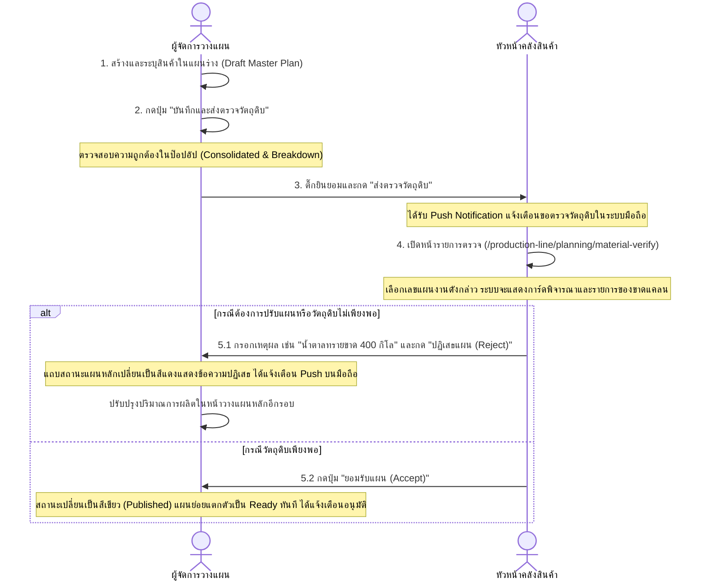

# คู่มือระบบตรวจสอบความเพียงพอและอนุมัติวัตถุดิบรายสัปดาห์ (Weekly Material Sufficiency Approval Guide)

เอกสารนี้ทำหน้าที่สรุปการพัฒนาและการทดสอบ (Implementation & UAT Manual) สำหรับระบบประเมินความเพียงพอของวัตถุดิบ (WIP & Raw Materials) ระหว่างผู้จัดการวางแผนการผลิต (Planning Manager) และหัวหน้าคลังสินค้า (Warehouse Manager) ก่อนเผยแพร่แผนงานหลัก

---

## 1. การเปลี่ยนแปลงในระดับฐานข้อมูล (Database Schema & RLS)

คำสั่ง SQL Migration ทั้งหมดถูกเก็บไว้ที่:
[20260713000000_weekly_material_sufficiency_workflow.sql](file:///C:/Users/Riew/Desktop/KPF/Production-Line/Production-Line/supabase/migrations/20260713000000_weekly_material_sufficiency_workflow.sql)

### 1.1 การปรับปรุงโครงสร้างตาราง
* **`production_master_plans`**:
  * เพิ่มคอลัมน์ `reject_reason` (TEXT) เพื่อบันทึกเหตุผลหากคลังสินค้าปฏิเสธแผนงาน
  * เพิ่มคอลัมน์ `verified_at` (TIMESTAMPTZ) และ `verified_by` (UUID) เพื่อทำ Audit Trail ในขั้นตอนอนุมัติวัตถุดิบ
* **`production_plan_material_verifications`** (ตารางใหม่):
  * ทำหน้าที่เก็บภาพถ่ายของปริมาณความต้องการวัตถุดิบแยกตามรายการ (Consolidated Snapshot) ที่เกิดขึ้น ณ ตอนส่งตรวจ
  * คอลัมน์ที่สำคัญ: `required_qty`, `stock_qty`, `shortage_qty`, `status` (`sufficient` / `shortage`)

### 1.2 ความเป็นระบบไร้ข้อผิดพลาด (Idempotency)
* คำสั่ง RLS Policies ทั้งหมดถูกตั้งค่าใหม่ให้มีคำสั่ง `DROP POLICY IF EXISTS` นำหน้าเพื่อป้องกันความล้มเหลวขณะรัน SQL สคริปต์ซ้ำซ้อน:
  ```sql
  DROP POLICY IF EXISTS select_all ON public.production_plan_material_verifications;
  CREATE POLICY select_all ON public.production_plan_material_verifications FOR SELECT TO authenticated USING (true);
  ```

---

## 2. โครงสร้างและส่วนหลังบ้าน (Backend API Routes)

ระบบประมวลผลถูกออกแบบโดยแยกออกจาก Gateway หลักของคลังสินค้า โดยฝั่ง Next.js จะดึงข้อมูลและ Netting สต็อกผ่าน API:

### 2.1 API ดึงยอดประเมินความเพียงพอวัตถุดิบ (Summary API)
* **ไฟล์:** [summary/route.js](file:///C:/Users/Riew/Desktop/KPF/Production-Line/Production-Line/src/app/api/production-planning/material-verify/summary/route.js)
* **วิธีทำงาน:**
  1. ค้นหาแผนงานผลิตย่อยทั้งหมดภายใต้เลขแผนหลัก `masterPlanNo`
  2. ทำการระเบิดสูตรการผลิตระดับล่างสุด (BOM Explosion) เฉพาะวัตถุดิบซื้อนอกประเภท `RAW` ผ่านตัวช่วย `explodeBomBatch`
  3.Netting ยอดคงเหลือด้วยยอด On-Hand ปัจจุบันจริงผ่าน Gateway API `GET /api/raw-materials-summary-by-skus`
  4. จัดทำข้อมูลออกมา 2 รูปแบบ:
     * **`consolidated`**: ยอดสรุปรายวัตถุดิบรวมทั้งสัปดาห์ (สำหรับคลังสินค้าตรวจสอบภาพรวม)
     * **`breakdown`**: รายละเอียดแจกแจงแบบลำดับขั้น (Department ➡️ Section ➡️ Daily Date ➡️ Finished Goods ➡️ BOM Raw Materials) สำหรับผู้วางแผนสืบค้นและปรับลดแผน

### 2.2 API ดำเนินการต่อแผนงาน (Action API)
* **ไฟล์:** [action/route.js](file:///C:/Users/Riew/Desktop/KPF/Production-Line/Production-Line/src/app/api/production-planning/material-verify/action/route.js)
* **การกระทำ (Actions):**
  * **`request_verify`**: บันทึกรายการ Snapshot ลงตารางอนุมัติ และเปลี่ยนสถานะแผนหลักเป็น `pending_verify` จากนั้นส่ง Web Push Notification แจ้งเตือนคลังสินค้า
  * **`accept`**: บันทึกสถานะ `published`, ทำการแช่แข็งผล Snapshot วัตถุดิบ, เรียกใช้ฟังก์ชัน `autoGenerateSubplanDraftsForMasterPlan` แตกแผนย่อยให้แผนกต่าง ๆ ดำเนินการต่อ และส่ง Web Push Notification ย้อนกลับไปแจ้งเตือนผู้วางแผนหลัก
  * **`reject`**: อัปเดตสถานะเป็น `rejected` และเก็บเหตุผลลงใน `reject_reason` จากนั้นยิงแจ้งเตือน Web Push Notification ตีกลับผู้วางแผนหลัก

---

## 3. ส่วนการแจ้งเตือนด้วยข้อความพุชมือถือ (Mobile Web Push Notification)

แจ้งเตือนจะถูกยิงผ่านโมดูลหลักของระบบที่:
[pushNotifications.js](file:///C:/Users/Riew/Desktop/KPF/Production-Line/Production-Line/src/lib/pushNotifications.js)

หัวข้อเหตุการณ์ที่ถูกเพิ่มเข้ามาใหม่ในรายการความสนใจ:
1. `planning.material_check_requested` ➡️ ยิงไปหาหัวหน้าคลังสินค้าเมื่อมีการกดขอตรวจวัตถุดิบ
2. `planning.material_check_accepted` ➡️ ยิงตีกลับมาหาผู้สร้างแผนเมื่อคลังกดตอบรับ (Accept)
3. `planning.material_check_rejected` ➡️ ยิงตีกลับมาพร้อมเหตุผลเมื่อคลังกดปฏิเสธแผน (Reject)

---

## 4. ส่วนหน้ากากผู้ใช้งาน (Frontend UI Implementation)

เพื่อให้เป็นไปตามคู่มือ Ferrari Design System [DESIGN.md](file:///C:/Users/Riew/Desktop/KPF/Production-Line/Production-Line/DOC/DESIGN.md) แต่ดัดแปลงมาใช้งานโทนสี **Navy `#102C57`** และ **ทอง `#d4af37`**:

### 4.1 หน้าต่างขอส่งตรวจสำหรับผู้จัดการวางแผน (MaterialVerifyModal)
* **ไฟล์:** [MaterialVerifyModal.js](file:///C:/Users/Riew/Desktop/KPF/Production-Line/Production-Line/src/features/production-planning/components/MaterialVerifyModal.js)
* **ความสามารถ:**
  * แท็บ 1: แสดงข้อมูลแบบ Consolidated ตารางแบนราบ เปรียบเทียบ Stock vs Demand
  * แท็บ 2: แสดงข้อมูลแบบ Breakdown ลิสต์ยืดหดได้ (Accordions) เพื่อแยกแยะแผนกและ Section
  * บังคับให้ติ๊ก Checkbox ยืนยันข้อมูลก่อนกดส่งตรวจ (ปุ่มส่งสี Navy ขอบตัดทองคมขนาด 2px)

### 4.2 การต่อเชื่อมปุ่มเข้ากับหน้าวางแผนหลัก
* **ไฟล์:** [ProductionPlanningPageClient.js](file:///C:/Users/Riew/Desktop/KPF/Production-Line/Production-Line/src/features/production-planning/components/ProductionPlanningPageClient.js)
* **การติดตั้ง:**
  * นำเข้าและเมานต์คอมโพเนนต์ `<MaterialVerifyModal>` ไว้ที่โครงสร้าง JSX ด้านล่าง
  * ปรับแต่งปุ่มและสถานะเมื่อตรวจสอบ (เช่น แสดงแถบสีเหลืองเมื่ออยู่ในสถานะ `pending_verify`, แถบสีแดงเมื่อแผนหลักถูกคลังสินค้าปฏิเสธ `rejected`, และแสดงแถบสีเขียวเมื่อได้รับการยอมรับวัตถุดิบ `published`)

### 4.3 ส่วนพิจารณาอนุมัติของหัวหน้าคลังสินค้า
* **ไฟล์:** [MaterialVerifyClient.js](file:///C:/Users/Riew/Desktop/KPF/Production-Line/Production-Line/src/features/production-planning/components/MaterialVerifyClient.js)
* **ความสามารถ:**
  * ดึงผลลัพธ์จาก Summary API เมื่อเลือกแผนการผลิตหลัก
  * เรนเดอร์การ์ดตรวจสอบอนุมัติวัตถุดิบ (Navy/Gold Layout) แสดงสถานะและสรุปผลวัตถุดิบขาดแคลน
  * มีพื้นที่กรอกหมายเหตุ Rejection Reason (ต้องระบุหากกด Reject)
  * ปุ่ม **ยอมรับแผน (Accept)** และ **ปฏิเสธแผน (Reject)** ทำงานประสานงานกับ WebPush และอัปเดตสถิติแบบ Real-time

---

## 5. คู่มือขั้นตอนการทดสอบการใช้งานระบบ (UAT Testing Manual)

เพื่อยืนยันว่าระบบทำงานได้อย่างถูกต้อง ให้ทำตามขั้นตอนการทดสอบ (UAT) ต่อไปนี้:



### ขั้นที่ 1: ขั้นตอนทดสอบฝั่งวางแผน (Planner Workflow)
1. เข้าไปที่หน้าหลักการวางแผนและสร้างแผนหลัก (เช่น เลือกช่วงสัปดาห์ปัจจุบัน และระบุเลขแผน)
2. เพิ่มสินค้า Finished Goods เข้าไปในแผนงาน
3. สังเกตที่ส่วนท้ายของตารางสรุปแผน จะพบปุ่มสีทอง **"บันทึกและส่งตรวจวัตถุดิบ"**
4. เมื่อกดปุ่มดังกล่าว จะมีป๊อปอัปตรวจสอบปรากฏขึ้น:
   * **สกรีนที่ 1 (ยอดรวม):** ตรวจสอบวัตถุดิบรวมว่ามีสินค้าใดสถานะขึ้นตัวแดงคำว่า **"ไม่พอ"** (Shortage) หรือไม่
   * **สกรีนที่ 2 (แจกแจงแผนก):** ทดลองเปิด-ปิด Accordion รายวันว่ามีการระเบิดวัตถุดิบตรงตามสินค้าที่เลือกหรือไม่
5. ติ๊กถูกที่ Checkbox เพื่อยินยอมส่งข้อมูล และกด **"ส่งตรวจวัตถุดิบ (Submit)"**
6. ป๊อปอัปจะปิดลง และสถานะบนหน้าจอหลักจะแสดงการแจ้งเตือนสีเหลืองว่า **"แผนหลักนี้อยู่ในระหว่างรอการตรวจสอบวัตถุดิบจากหัวหน้าคลังสินค้า"**

### ขั้นที่ 2: ขั้นตอนทดสอบฝั่งคลังสินค้า (Warehouse Workflow)
1. ลงชื่อเข้าใช้ด้วยบัญชีที่มีสิทธิ์ตรวจสอบวัตถุดิบ (`plan.verify_materials`)
2. เข้าไปที่หน้าพิจารณาอนุมัติผ่านลิงก์ `/production-line/planning/material-verify?masterPlanNo=เลขแผนที่สร้าง`
3. ในส่วนบนของหน้าจอ จะพบการ์ด Navy/Gold **"ผลการคำนวณและตรวจสอบความเพียงพอวัตถุดิบ"**
4. **ทดสอบกรณีปฏิเสธ (Reject Action):**
   * หากทดลองกดปุ่ม **"ปฏิเสธแผน (Reject)"** โดยไม่กรอกเหตุผล ระบบจะต้องแจ้งเตือนให้ระบุเหตุผลก่อน
   * พิมพ์เหตุผลเช่น `"วัตถุดิบน้ำตาลคงคลังจริงในระบบไม่เพียงพอ ขาดอีก 400 กิโลกรัม"` แล้วกด **"ปฏิเสธแผน (Reject)"**
   * กลับมาดูที่หน้ารายการวางแผนหลัก (Planner) จะต้องได้รับการแจ้งเตือน WebPush บนมือถือ และสถานะแถบแจ้งเตือนเปลี่ยนเป็นสีแดง แสดงเหตุผลการปฏิเสธที่หัวหน้าคลังระบุไว้
5. **ทดสอบกรณีตอบรับแผน (Accept Action):**
   * กลับมาที่หน้าตรวจวัตถุดิบอีกรอบ และลองกดส่งตรวจจากฝั่งผู้วางแผนอีกครั้ง
   * กดปุ่ม **"ยอมรับแผน (Accept)"**
   * แผนงานดังกล่าวจะถูกบันทึกสถานะเป็น `published` ทันที ยอดวัตถุดิบจะถูก Freeze และสร้างแผนย่อยร่างส่งไปให้แต่ละแผนกผลิตกะในไลน์ทำงาน
   * ผู้วางแผนหลักจะได้รับการแจ้งเตือน Push บนมือถือแสดงข้อความ **"แผนหลักได้รับอนุมัติวัตถุดิบ"** และแถบแจ้งเตือนในหน้าจอหลักจะเปลี่ยนเป็นสีเขียวระบุว่าได้รับการเผยแพร่เรียบร้อย
