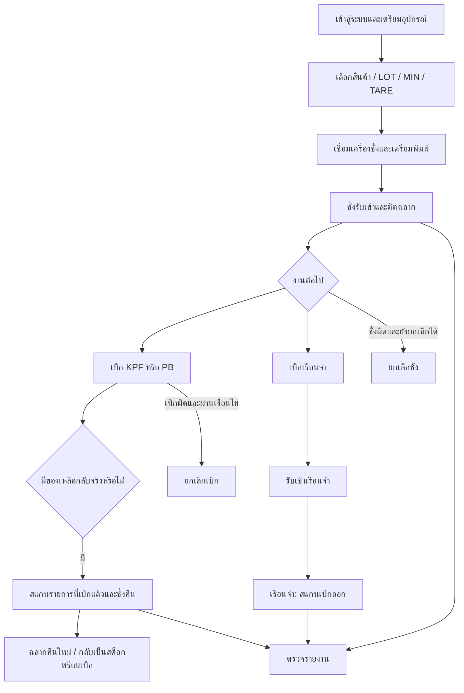

# คู่มือ Flow การใช้งานระบบชั่งน้ำหนักผลิตภัณฑ์และเรือนจำ

วันที่จัดทำ: 14 กันยายน 2569 (2026-09-14)

หน้าเริ่มต้น: https://production.kpfoods.co.th/production-line/weight-scale

เอกสารนี้เป็นทั้งคู่มือสำหรับผู้ปฏิบัติงานและข้อมูลต้นฉบับให้ AI ทำคู่มือภาพต่อ มีขั้นตอนเข้าใช้งาน การกระทำ ผลลัพธ์ และข้อควรระวัง โดยอ้างอิงโค้ดใน workspace และภาพหน้าจอที่ผู้ใช้ให้ 9 รูป ไม่ได้ทดลองบันทึกหรือยกเลิกข้อมูลบนระบบจริง การเปิด URL ผ่านเครื่องมือเว็บไม่สำเร็จ จึงยังไม่ได้ยืนยันว่าเวอร์ชันที่ใช้งานจริงตรงกับโค้ดทุกจุด

## 1. ต้องเริ่มจากอะไรก่อน

1. เข้าสู่ระบบด้วยบัญชีที่ได้รับสิทธิ์ แล้วเปิดเมนู **ไลน์ผลิต → ชั่งน้ำหนักผลิตภัณฑ์**
2. เตรียมเครื่องชั่ง เครื่องพิมพ์ฉลาก และเครื่องสแกนบาร์โค้ดให้พร้อม
3. เลือกผลิตภัณฑ์และตรวจ LOT, น้ำหนักขั้นต่ำ (MIN), น้ำหนักภาชนะ (TARE) ก่อนเริ่มชั่ง
4. เชื่อมเครื่องชั่งและทดสอบเครื่องพิมพ์ รอให้ระบบอ่านน้ำหนักได้จริง
5. ชั่งรับสินค้าเข้าให้สำเร็จ รับฉลาก และติดให้ตรงกับภาชนะ
6. เมื่อจะนำสินค้าไปใช้ ให้เข้า **เบิก → เบิกสต็อก** เลือกประเภทปลายทางก่อนสแกน
7. ถ้าใช้ไม่หมด ให้เข้า **ชั่งน้ำหนักผลิตภัณฑ์ → ชั่งคืนผลิตภัณฑ์** อ้างอิงบาร์โค้ดที่เบิกไป แล้วชั่งน้ำหนักที่นำกลับจริง
8. ถ้าบันทึกผิด ให้เลือกเส้นทางยกเลิกตามชนิดรายการ ห้ามใช้ชั่งคืนแทนการยกเลิกโดยอัตโนมัติ
9. ถ้าส่งเรือนจำ ให้ทำการเบิกประเภท **เบิกเรือนจำ** ก่อน แล้วจึงทำ **เรือนจำ → สแกนเบิกออก** เมื่อมีการเบิกออกจากฝั่งเรือนจำจริง
10. ตรวจรายงานชั่ง เบิก คืน คงเหลือ และเรือนจำ โดยใช้วันที่ สินค้า และ LOT เดียวกัน

> ไม่จำเป็นต้องทำการยกเลิกหรือชั่งคืนทุกครั้ง ทั้งสองอย่างเป็นทางแยกเมื่อเกิดเหตุ ไม่ใช่ขั้นตอนบังคับหลังชั่งรับเข้า



## 2. คำที่ต้องเข้าใจตรงกัน

| คำ | ความหมายสำหรับผู้ใช้ |
|---|---|
| สินค้า/ผลิตภัณฑ์ | ตรวจทั้งรหัสและชื่อ ห้ามใช้ชื่อคล้ายกันเป็นหลักฐานว่าเป็นตัวเดียวกัน |
| LOT | ชุดการผลิต ใช้ติดตามสินค้า ไม่ใช่เลขบาร์โค้ดของแต่ละภาชนะ |
| บาร์โค้ด | ตัวอ้างอิงรายการชั่ง/ภาชนะ ใช้เบิก ยกเลิก และคืนให้ตรงต้นทาง |
| น้ำหนักรวม | น้ำหนักที่อ่านได้รวมภาชนะ |
| TARE | น้ำหนักภาชนะที่หักออก ต้องตรงกับภาชนะที่ใช้จริง |
| น้ำหนักสุทธิ | น้ำหนักรวมลบ TARE ใช้ติดตามน้ำหนักสินค้า |
| MIN | น้ำหนักสุทธิขั้นต่ำที่ใช้ตรวจผ่านเกณฑ์ชั่งรับเข้า |
| ชั่งรับเข้า | สร้างรายการรับเข้าและบาร์โค้ดสินค้า |
| เบิก | นำรายการที่พร้อมเบิกออกจากสต็อกตามประเภทปลายทาง |
| ชั่งคืน | นำของเหลือจริงจากรายการที่เบิกแล้วกลับมาชั่ง สร้างรายการคืนและฉลากใหม่ |
| ยกเลิก | ย้อนรายการที่บันทึกผิดตามเงื่อนไข ไม่ได้หมายถึงของเหลือกลับจริง |
| รับเข้าเรือนจำ | รายการที่มาจากการเบิกประเภทเรือนจำของคลังต้นทาง |
| เบิกออกเรือนจำ | การเบิกอีกขั้นจากรายการรับเข้าเรือนจำ |

ตัวอย่างเพื่ออธิบายเท่านั้น: น้ำหนักรวม 14.80 กก. − TARE 2.80 กก. = สุทธิ 12.00 กก. ห้ามนำค่าตัวอย่างหรือค่าที่เห็นในภาพไปตั้งให้สินค้าทุกชนิด

## 3. เตรียมระบบก่อนเริ่มงาน

**เงื่อนไขก่อนเริ่ม:** มีบัญชีที่เข้าเมนูได้ มีสินค้าที่ต้องชั่ง และทราบ LOT กับค่าภาชนะที่ถูกต้อง

1. เข้าเมนูชั่งน้ำหนักผลิตภัณฑ์
2. ตรวจวันที่ผลิตและกะงานที่แสดง ถ้าไม่ตรงกับงานจริงให้ตรวจสอบกับผู้รับผิดชอบก่อนเริ่ม
3. ตรวจว่าไม่มีสินค้าค้างบนแท่นชั่ง และน้ำหนักกลับใกล้ศูนย์
4. ตรวจสาย/การเชื่อมต่อเครื่องชั่งตามที่สถานีใช้งาน
5. หากต้องตั้งการเชื่อมต่อ เปิด **ตั้งค่า → คอนฟิก** แล้วใช้ค่าที่ผู้ดูแลสถานีกำหนด โหมด IP และ RS232 ขึ้นกับสถานีนั้น
6. ตรวจการเลือกเครื่องพิมพ์ หน้าตั้งค่ารองรับการพิมพ์ผ่าน Agent หรือ USB ตามโหมดที่เลือก
7. เลือกเครื่องพิมพ์และใช้ **ทดสอบพิมพ์** ให้ฉลากออกก่อนเริ่มงานต่อเนื่อง
8. กลับหน้าหลักเพื่อเลือกสินค้าและเชื่อมเครื่องชั่ง

**ผลลัพธ์ที่ต้องเห็น:** อ่านน้ำหนักได้จริงและพิมพ์ทดสอบได้ หากยังขึ้น ERROR อย่าใช้ตัวเลข 0.00 เป็นหลักฐานว่าเครื่องพร้อม

ภาพที่มี: `Screenshot 2026-09-14 125237.png` แสดงทางเข้าเมนูตั้งค่า แต่ยังไม่ได้เปิดหน้าคอนฟิกด้านใน

## 4. Flow ชั่งรับเข้าผลิตภัณฑ์

เมนู: **ชั่งน้ำหนักผลิตภัณฑ์ → ชั่งน้ำหนักผลิตภัณฑ์**  
เส้นทาง: `/production-line/weight-scale`

### 4.1 เลือกสินค้าและตั้งค่าก่อนชั่ง

1. กด **เปลี่ยนผลิตภัณฑ์**
2. ในหน้าต่างเลือกผลิตภัณฑ์ ค้นด้วยชื่อสินค้าหรือรหัสสินค้า
3. กด **เลือก** ที่สินค้าที่ต้องการ
4. ตรวจชื่อ รหัส และหน่วยของสินค้าทางขวาอีกครั้ง
5. ตรวจช่อง **LOT ปัจจุบัน** ระบบช่วยเติมค่า แต่ผู้ใช้ต้องตรวจว่าตรงงานจริง
6. ตรวจ **น้ำหนักขั้นต่ำ** ให้เป็นค่าที่กำหนดสำหรับสินค้านี้ การชั่งอัตโนมัติต้องมี MIN มากกว่า 0 และน้ำหนักสุทธิผ่านเกณฑ์
7. ตรวจ **น้ำหนักภาชนะ** ให้ตรงภาชนะจริง
8. กด **ใช้สินค้านี้** แล้วรอให้ระบบบันทึกการตั้งค่าและปิดหน้าต่าง
9. ตรวจบัตรข้อมูลหน้าหลักอีกครั้งว่าเป็นสินค้า LOT MIN และ TARE ที่ต้องการ

**ผลลัพธ์:** สินค้าและ LOT พร้อมสำหรับชั่ง ไม่ใช่การเพิ่มยอดสต็อกจนกว่าจะชั่งบันทึกสำเร็จ

**ข้อสังเกตเรื่อง LOT:** ช่องเลือกสินค้ามีข้อความว่าแก้ LOT ได้ แต่โค้ดบันทึกชั่งมีการปรับ LOT รูปแบบอัตโนมัติให้สัมพันธ์กับวันผลิต/กะด้วย ดังนั้นคู่มือไม่ควรรับรองว่าการพิมพ์ LOT ย้อนหลังจะบังคับให้ผลชั่งเข้า LOT นั้นเสมอ ต้องตรวจ LOT บนรายการที่บันทึกและฉลากจริง

ภาพประกอบ: `Screenshot 2026-09-14 125214.png`

### 4.2 ชั่งและบันทึก

1. กด **เชื่อมเครื่องชั่ง** หากสถานีใช้ RS232 อาจเชื่อมอัตโนมัติและแสดงข้อความต่างออกไป
2. รอจนระบบอ่านค่าน้ำหนักได้ ตรวจสถานะการเชื่อมต่อ ไม่เริ่มจากสถานะ ERROR
3. วางสินค้าพร้อมภาชนะที่ตั้ง TARE ไว้บนแท่นชั่ง
4. ตรวจว่าน้ำหนักสุทธิถึง MIN ของสินค้านั้น
5. ปล่อยน้ำหนักให้นิ่ง ระบบปกติบันทึกอัตโนมัติเมื่อผ่านเงื่อนไข ไม่ต้องกดบันทึกทุกภาชนะ
6. รอข้อความบันทึกสำเร็จและเลขบาร์โค้ด อย่าเคลื่อนสินค้าในระหว่างบันทึก
7. รับฉลาก ตรวจรหัสสินค้า LOT บาร์โค้ด และน้ำหนัก แล้วติดบนภาชนะที่เพิ่งชั่ง
8. ยกสินค้าพร้อมภาชนะออกจากแท่นชั่ง ให้น้ำหนักกลับใกล้ศูนย์ก่อนวางชิ้นถัดไป
9. ตรวจรายการล่าสุดในส่วน **บันทึกรายการย้อนหลัง** ว่ารายการที่เพิ่งชั่งปรากฏ
10. ทำซ้ำขั้นตอน 3–9 สำหรับภาชนะถัดไป เมื่อเปลี่ยนสินค้า/ภาชนะ/LOT ให้กลับไปตรวจการตั้งค่าก่อน

**เงื่อนไขตามโค้ดปัจจุบันสำหรับ AI:** ชั่งรับเข้าอัตโนมัติรอค่านิ่งประมาณ 2.5 วินาที ใช้ช่วงคลาดเคลื่อน 0.01 กก. และรอ reset ที่น้ำหนักไม่เกิน 0.1 กก. หลังบันทึก ค่าเหล่านี้เป็นพฤติกรรมเวอร์ชันที่ตรวจ ไม่ใช่ค่าที่ผู้ใช้ต้องกรอก

**อย่าสับสนโหมดทดสอบ:** ปุ่ม **บันทึกข้อมูลการชั่ง** และการพิมพ์น้ำหนักเองในหน้าหลักเป็นทางเดินของโหมดทดสอบ ไม่ใช่ขั้นตอนมาตรฐานที่ต้องทำทุกครั้ง และอย่าสมมติว่าโหมดทดสอบจะไม่บันทึกข้อมูลจริง

### 4.3 บันทึกสำเร็จแต่ฉลากไม่ออก

1. อ่านข้อความว่าบันทึกสำเร็จแล้วหรือบันทึกล้มเหลว แยกออกจากข้อผิดพลาดการพิมพ์
2. ถ้าบันทึกสำเร็จ ให้ตรวจรายการล่าสุดและเลขบาร์โค้ดก่อน
3. แก้การเชื่อมต่อ/เลือกเครื่องพิมพ์ให้พร้อม
4. ใช้ **พิมพ์ฉลากล่าสุดซ้ำ** ถ้าเป็นรายการล่าสุด หรือค้นหารายการในรายงานชั่งละเอียดเพื่อพิมพ์รายการนั้น
5. ติดฉลากให้ตรงรายการเดิม ไม่ชั่งสร้างรายการใหม่เพียงเพราะกระดาษไม่ออก
6. รายการที่ยกเลิกแล้วไม่ควรนำฉลากไปใช้เบิก และระบบจำกัดการพิมพ์ซ้ำรายการยกเลิก

## 5. Flow ยกเลิกชั่ง

เมนู: **ชั่งน้ำหนักผลิตภัณฑ์ → ยกเลิกชั่ง**  
เส้นทาง: `/production-line/weight-scale/cancel`

**ใช้เมื่อ:** รายการชั่งผิดและยังอยู่ในเงื่อนไขยกเลิกได้ เช่น ยังไม่ถูกเบิก ไม่ใช้แทนการคืนของเหลือ

### 5.1 สแกนบาร์โค้ด

1. ตรวจฉลากของรายการที่จะยกเลิกให้แน่ใจตั้งแต่ก่อนสแกน
2. เปิดหน้ายกเลิกชั่ง
3. ถ้าเป็นรายการย้อนหลัง เปิด **เปิดรายการย้อนหลัง** เพื่อตรวจ/ปรับช่วงวันที่และตัวกรองก่อน เพราะการค้นหาจากสแกนใช้เงื่อนไขวันที่ด้วย และหน้าเริ่มต้นใช้วันปัจจุบัน
4. สแกนหรือพิมพ์รหัสในช่อง **สแกนหรือกรอกรหัสบาร์โค้ด** แล้วส่งค่า หรือใช้ **สแกนด้วยกล้อง**
5. ถ้าระบบพบรายการที่ยกเลิกได้เพียงรายการเดียว จะยกเลิกทันที ไม่มีขั้นตอนยืนยันเพิ่มใน flow นี้
6. ถ้าพบมากกว่าหนึ่งรายการ ระบบเปิดหน้าต่างให้เลือก ตรวจสินค้า LOT น้ำหนัก และวันที่ก่อนกด **ยกเลิกชั่ง** ที่แถว
7. รอข้อความสำเร็จ ตรวจรายการยกเลิกแล้วและรายงานของ LOT นั้น
8. แยกฉลากที่ยกเลิกออกจากของพร้อมเบิก ถ้าจำเป็นต้องชั่งใหม่ ให้แก้ต้นเหตุแล้วกลับไปชั่งรับเข้า

### 5.2 เลือกจากรายการย้อนหลัง

1. กด **เปิดรายการย้อนหลัง**
2. กำหนดวันที่เริ่มต้นและสิ้นสุด รวมถึงบาร์โค้ดหรือสินค้าเพื่อจำกัดผลลัพธ์
3. ค้นหาและตรวจแถวที่ต้องการกับสินค้าจริง
4. กด **ยกเลิกชั่ง** ในแถวนั้น
5. รอผลสำเร็จและตรวจว่ารายการถูกย้ายไปสถานะยกเลิกแล้ว

**ถ้าทำไม่ได้:** ตรวจช่วงวันที่และสถานะเบิก หากมีรายการปลายทางต้องตรวจเส้นทางนั้นก่อน อย่ารับรองว่าทุกประวัติย้อนกลับได้ เพราะระบบมีเงื่อนไขป้องกันประวัติที่เกี่ยวข้อง

ภาพประกอบ: `Screenshot 2026-09-14 125343.png`

## 6. Flow เบิกสต็อก

เมนู: **เบิก → เบิกสต็อก**  
เส้นทาง: `/production-line/stock/issues`

**เงื่อนไข:** มีรายการชั่งที่ยังพร้อมเบิก มีฉลากตรงสินค้า และทราบปลายทางที่จะใช้

1. เปิดหน้าเบิกสต็อก
2. เลือกประเภทการเบิกก่อนสแกน: **เบิก KPF**, **เบิก PB** หรือ **เบิกเรือนจำ**
3. ตรวจประเภทที่เลือกบนหน้าจอให้ตรงกับงานจริง อย่าเลือกจากชื่อสินค้าเพียงอย่างเดียว
4. กำหนด **เลือกวันที่ทำรายการเบิก** ให้ถูกต้องก่อนสแกน โดยเฉพาะงานที่ค้นจากรายการย้อนหลัง วันที่นี้เป็นวันที่เบิก ไม่ใช่ตัวกรองวันชั่งในหน้าต่างค้นหา
5. คลิกช่อง **ยิงบาร์โค้ดเพื่อบันทึกเบิก...** แล้วสแกนฉลากที่ต้องการ
6. ระบบบันทึกการเบิกเมื่อสแกนผ่านเงื่อนไข ไม่ใช่เพียงเพิ่มลงตะกร้าเพื่อรอปุ่มบันทึกอีกครั้ง
7. รอข้อความสำเร็จ ตรวจบาร์โค้ด สินค้า LOT น้ำหนัก และประเภทการเบิกในรายการล่าสุด
8. นำสินค้าไปตามปลายทางและสแกนรายการถัดไปทีละรายการ
9. หากบาร์โค้ดอ่านไม่ได้หรือต้องการหลายรายการ ใช้ **เลือกรายการเบิก** ค้นหารายการพร้อมเบิกด้วยช่วงวันชั่ง/สินค้า/LOT เลือกช่องแต่ละรายการหรือ **เลือกทั้งหมดในหน้านี้** ตรวจจำนวนและน้ำหนักรวม แล้วกด **ยืนยันเบิก N รายการ** จำกัด 100 รายการต่อครั้ง ทั้งชุดใช้ประเภทและวันที่เบิกจากหน้าหลัก และบันทึกแบบสำเร็จทั้งชุดหรือไม่บันทึกทั้งชุด
10. ตรวจรายงานเบิกแบบละเอียดหลังจบชุดงาน โดยกรองประเภทการเบิกให้ตรงกัน

**ผลลัพธ์:** สินค้าออกจากกลุ่มพร้อมเบิกของคลังต้นทาง ถ้าเลือกเบิกเรือนจำ รายการนี้เป็นต้นทางรับเข้าเรือนจำด้วย ให้ทำขั้นตอนเรือนจำต่อเมื่อถึงเวลาจริง

รายการล่าสุดบนหน้านี้ใช้หัวข้อ **รายการเบิกล่าสุดวันนี้** หากเลือกทำรายการวันอื่น ให้ตรวจรายงานช่วงวันนั้นด้วย อย่าอาศัยตารางวันนี้อย่างเดียว

ภาพประกอบ: `Screenshot 2026-09-14 125305.png`

## 7. Flow ยกเลิกเบิกปกติ

เมนู: **เบิก → ยกเลิกเบิก**  
เส้นทาง: `/production-line/stock/issues/cancel`

**ใช้เมื่อ:** เบิกผิด ไม่ได้ต้องการบันทึกของเหลือกลับจริง

1. ตรวจบาร์โค้ดและรายการเบิกที่จะย้อนให้แน่ใจก่อนสแกน
2. เปิดหน้ายกเลิกเบิก
3. สแกนหรือพิมพ์บาร์โค้ดในช่อง **ยิงบาร์โค้ดเพื่อยกเลิก...** หรือใช้ **สแกนด้วยกล้อง**
4. หากพบรายการยกเลิกได้เพียงรายการเดียว หน้านี้จะยกเลิกทันที ไม่ต้องรอยืนยันซ้ำ
5. หากพบหลายรายการ ให้เลือกจากหน้าต่างค้นหาโดยตรวจประเภท วันที่ สินค้า LOT และน้ำหนัก
6. หากไม่มีฉลากหรืออยากตรวจรายการก่อน ใช้ **ค้นหารายการเบิก** แล้วค้น/เลือกแถวที่จะยกเลิก
7. รอข้อความสำเร็จ ตรวจสถานะและรายงานว่าสต็อกต้นทางกลับมาพร้อมเบิกตามรายการที่ยกเลิก
8. ถ้าจะเบิกใหม่ ให้กลับหน้าเบิก เลือกประเภทที่ถูกต้อง แล้วจึงสแกนใหม่

**ความต่างของปุ่ม:** ปุ่มยกเลิกบนหน้าเบิกสต็อกมีหน้าต่างยืนยัน แต่หน้า **ยกเลิกเบิก** แบบสแกนข้างต้นยกเลิกทันทีเมื่อพบรายการเดียว อย่าสร้างขั้นตอนยืนยันเหมือนกันทุกหน้า

**เงื่อนไขสำคัญ:** ประวัติชั่งคืนหรือของเสียที่ผูกกับรายการเบิกอาจทำให้ยกเลิกไม่ได้ แม้รายการลูกเคยถูกยกเลิกแล้วก็ยังมี guard ตรวจประวัติอยู่ ถ้าระบบปฏิเสธให้ส่งบาร์โค้ดและข้อความผิดพลาดให้ผู้รับผิดชอบตรวจ ไม่ให้แก้ด้วยการเบิกหรือคืนซ้ำ

ภาพประกอบ: `Screenshot 2026-09-14 125402.png`

## 8. Flow ชั่งคืนผลิตภัณฑ์

เมนู: **ชั่งน้ำหนักผลิตภัณฑ์ → ชั่งคืนผลิตภัณฑ์**  
เส้นทาง: `/production-line/weight-scale/return`

**เงื่อนไข:** รายการต้นทางต้องเบิกยืนยันแล้วและยังมีน้ำหนักเหลือให้คืน ต้องมีของเหลือนำกลับจริง

1. นำสินค้าออกจากแท่นชั่งให้น้ำหนักกลับใกล้ศูนย์ก่อนเลือกต้นทาง
2. เปิดหน้าชั่งคืน
3. สแกนบาร์โค้ดของรายการที่เบิกไปแล้วในช่อง **สแกนบาร์โค้ดที่เบิกไปเพื่อคืน...**
4. ถ้าไม่มีฉลาก ใช้ **เลือกรายการที่ชั่งคืนได้**
5. ในหน้าต่างเลือก กำหนด **วันที่เบิกเริ่มต้น**, **วันที่เบิกสิ้นสุด**, ค้นบาร์โค้ด/สินค้า/LOT หรือเลือกสินค้า แล้วค้นหา
6. เลือกรายการที่ถูกต้อง ตรวจสินค้า LOT บาร์โค้ด และน้ำหนักที่ยังคืนได้
7. หลังเลือกสำเร็จ ระบบพยายามเชื่อมเครื่องชั่งอัตโนมัติ ตรวจว่าอ่านน้ำหนักได้ก่อนวางสินค้า
8. ตรวจ **น้ำหนักภาชนะ (Tare)** ค่าเริ่มต้นมาจากใบรับเข้า แก้ให้ตรงหากเปลี่ยนภาชนะตอนคืน
9. วางของเหลือพร้อมภาชนะบนแท่นชั่ง ตรวจ **น้ำหนักสุทธิ** ที่คำนวณหลังหัก TARE
10. น้ำหนักคืนสุทธิต้องถูกต้องและไม่เกินยอดที่ระบบแสดงว่ายังคืนได้ โดยประวัติคืนและของเสียอาจลดสิทธิ์คงเหลือนี้
11. รอค่านิ่ง ระบบบันทึกคืนและพิมพ์ฉลากอัตโนมัติในโหมดใช้งานปกติ
12. รอข้อความ **บันทึกคืนสำเร็จ** หรือข้อความบันทึกและพิมพ์สำเร็จ พร้อมบาร์โค้ดคืน
13. ติดฉลากคืนใหม่ให้ตรงของที่คืน ใช้รายการคืนนี้เมื่อจะเบิกสินค้าออกอีกครั้ง
14. ยกสินค้าออกให้น้ำหนักกลับใกล้ศูนย์ แล้วจึงสแกนรายการถัดไป
15. ตรวจรายการคืนล่าสุดและรายงานชั่งละเอียดในแท็บ **ชั่งคืนวัตถุดิบ**

**ผลลัพธ์:** มีรายการคืนเชื่อมกับรายการเบิกเดิม และมีบาร์โค้ดคืนใหม่ สินค้าที่คืนกลับเป็นสต็อกตามน้ำหนักสุทธิที่บันทึก ไม่ได้ลบประวัติการเบิกเดิม

**กรณีเลือกผิด:** ใช้ **ล้างข้อมูลเพื่อสแกนใหม่** ก่อนบันทึก โดยต้องยกสินค้าออกตามข้อความระบบ ปุ่มนี้ล้างการเลือกบนจอ ไม่ใช่ยกเลิกรายการที่บันทึกสำเร็จแล้ว

**กรณีพิมพ์ไม่ออก:** ตรวจว่าบันทึกคืนสำเร็จแล้วหรือไม่ ถ้าสำเร็จให้แก้เครื่องพิมพ์และพิมพ์ฉลากเดิมซ้ำ ไม่คืนซ้ำเพื่อให้กระดาษออก

**โหมดทดสอบ:** การกรอกน้ำหนักและปุ่ม **ยืนยันการคืนสต็อก** เป็นอีกโหมดหนึ่ง ไม่ใช่ขั้นตอนบังคับของการชั่งจากเครื่องจริง

ภาพประกอบ: `Screenshot 2026-09-14 125353.png`

## 9. ชั่งของเสีย — ส่วนเสริมที่มีในเมนู

เส้นทาง: `/production-line/weight-scale/waste`

1. ใช้เมื่อมีของเสียจริงที่ต้องผูกกับรายการเบิก ไม่ใช้ชั่งคืนแทนของเสีย
2. เปิด **ชั่งน้ำหนักผลิตภัณฑ์ → ชั่งของเสียผลิตภัณฑ์**
3. สแกนบาร์โค้ดที่เบิกไปเพื่อบันทึกของเสีย
4. ตรวจสินค้าและยอด **เหลือบันทึกได้**
5. เชื่อมเครื่องชั่ง วางของเสีย และตรวจน้ำหนัก
6. รอระบบบันทึกอัตโนมัติเมื่อค่านิ่งในโหมดปกติ แล้วตรวจข้อความสำเร็จและรายการล่าสุด
7. การบันทึกของเสียเกี่ยวข้องกับสิทธิ์น้ำหนักที่เหลือของรายการเบิก และอาจทำให้ยกเลิกเบิกไม่ได้

ยังไม่มีภาพหน้าของเสียในชุดที่ได้รับ ห้ามใช้ภาพชั่งคืนแล้วระบุว่าเป็นของเสีย

## 10. Flow ระบบเรือนจำ

### 10.1 รับเข้าเรือนจำมาจากขั้นตอนไหน

1. ชั่งรับเข้าที่คลังต้นทางให้สำเร็จและติดฉลาก
2. เปิด **เบิก → เบิกสต็อก**
3. เลือกประเภท **เบิกเรือนจำ** ก่อนสแกน
4. สแกนหรือเลือกรายการที่ต้องส่งเรือนจำ แล้วตรวจผลบันทึกสำเร็จ
5. เปิด **เรือนจำ → รายงานรับเข้า → รายงานสรุปรับเข้าเรือนจำแบบละเอียด**
6. ค้นวันที่ สินค้า LOT หรือบาร์โค้ดเพื่อยืนยันว่ารายการเข้าเรือนจำแล้ว
7. เก็บฉลากให้ตรงสินค้าเพื่อใช้สแกนเบิกออกจากเรือนจำในขั้นต่อไป

**ความหมาย:** “เบิกเรือนจำ” ของคลังต้นทางเป็นฝั่ง “รับเข้าเรือนจำ” ส่วน “สแกนเบิกออก” เป็นอีกธุรกรรมหนึ่ง อย่าอธิบายว่าเป็นการกดซ้ำเพื่อยืนยันงานเดียวกัน

### 10.2 สแกนเบิกออกเรือนจำ

เมนู: **เรือนจำ → สแกนเบิกออก**  
เส้นทาง: `/production-line/stock/prison/issues`

1. ตรวจว่าบาร์โค้ดมีรายการรับเข้าเรือนจำและยังพร้อมเบิกออก
2. เปิดหน้า **เบิกออกเรือนจำ**
3. ตรวจสินค้ากับฉลากก่อนสแกน
4. สแกน/พิมพ์บาร์โค้ด หรือใช้ **สแกนด้วยกล้อง**
5. การสแกนผ่านเงื่อนไขจะบันทึกเบิกออกทันที ให้รอผลก่อนสแกนถัดไป
6. หากต้องเลือกจากตาราง ใช้ **เลือกรายการเบิกออก** กำหนดช่วงวันรับเข้า ค้นบาร์โค้ด/สินค้า/LOT เลือกช่องรายการ ตรวจจำนวนและน้ำหนัก แล้วกด **ยืนยันเบิกออก N รายการ** จำกัด 100 รายการต่อครั้ง
7. ตรวจข้อความสำเร็จและรายการล่าสุด
8. ตรวจ **รายงานสรุปเบิกออกเรือนจำแบบละเอียด** และ **รายงาน Lot คงค้าง** เพื่อยืนยันผล

**ข้อแตกต่างจากเบิกต้นทาง:** หน้าเบิกออกเรือนจำใช้เวลาปัจจุบัน ไม่มีตัวเลือกวันที่เบิกแบบหน้าต้นทาง และการเบิกหลายรายการอาจสำเร็จบางรายการ/ล้มเหลวบางรายการ ต้องอ่านจำนวนสำเร็จและไม่สำเร็จ ตรวจรายการที่ล้มเหลวก่อนลองใหม่ หากมีกล่องแจ้งข้อผิดพลาดให้กด **ตกลง** หรือ Enter ก่อนสแกนต่อ

ภาพประกอบ: `Screenshot 2026-09-14 125431.png` เป็นหน้าเบิกออก แต่ภาพเปิดเมนูรายงานรับเข้าอยู่ ต้องบรรยายให้ตรงทั้งพื้นหลังและเมนู

### 10.3 ยกเลิกเบิกออกเรือนจำ

เมนู: **เรือนจำ → ยกเลิกเบิก**  
เส้นทาง: `/production-line/stock/prison/issues/cancel`

1. เปิดหน้า **ยกเลิกเบิกเรือนจำ**
2. สแกน/พิมพ์บาร์โค้ดที่ต้องย้อน หรือใช้กล้อง/หน้าต่างเลือกรายการที่เบิกแล้ว
3. ตรวจรายการที่ระบบพบ โดยเฉพาะสินค้า LOT และน้ำหนัก
4. อ่านหน้าต่างยืนยัน แล้วกดยืนยันเฉพาะเมื่อเป็นรายการที่ต้องการจริง
5. รอข้อความยกเลิกสำเร็จ
6. ตรวจว่ายอดกลับเป็นคงค้าง/พร้อมเบิกออกของเรือนจำตามรายการที่ยกเลิก

**ผลลัพธ์:** ย้อนการเบิกออกเรือนจำ ไม่ได้ย้อนการชั่งรับเข้าที่ต้นทาง และไม่ได้ยกเลิกการส่งเข้าเรือนจำ

ภาพประกอบ: `Screenshot 2026-09-14 125443.png`

### 10.4 ยกเลิกชั่งในเมนูเรือนจำ

เมนู: **เรือนจำ → ยกเลิกชั่ง**  
เส้นทาง: `/production-line/stock/prison/inbound/cancel`

**ต้องอ่านก่อน:** แม้ชื่อเมนูว่า “ยกเลิกชั่ง” แต่ flow นี้ยกเลิกรายการรับเข้าเรือนจำที่มาจากการเบิกประเภทเรือนจำ ไม่ใช่ลบใบชั่งผลิตภัณฑ์ต้นฉบับ

1. ตรวจว่าต้องการย้อนการส่งเข้าเรือนจำจริง
2. ถ้ารายการนั้นเบิกออกเรือนจำไปแล้ว ต้องยกเลิกเบิกออกเรือนจำก่อน และต้องผ่านเงื่อนไขอื่นของระบบด้วย
3. เปิด **เรือนจำ → ยกเลิกชั่ง**
4. สแกน/พิมพ์บาร์โค้ดของรายการรับเข้าที่ต้องการยกเลิก คู่มือนี้ไม่กำหนดขั้นตอนเลือกจากตารางสำหรับหน้านี้ เพราะโค้ดส่วนตารางค้นหาแสดงเฉพาะโหมดยกเลิกเบิกออก
5. ตรวจรายละเอียดรายการรับเข้า สินค้า LOT และน้ำหนัก
6. อ่านหน้าต่างยืนยันแล้วกดยืนยัน
7. รอผลสำเร็จ ตรวจรายงานรับเข้าและคงเหลือเรือนจำ รวมถึงสถานะต้นทาง
8. หากต้องการยกเลิกใบชั่งต้นทางด้วย ต้องกลับไป **ชั่งน้ำหนักผลิตภัณฑ์ → ยกเลิกชั่ง** อีกขั้น เฉพาะรายการที่ระบบอนุญาต

**ลำดับย้อนที่ควรเข้าใจ:** ยกเลิกเบิกออกเรือนจำ → ยกเลิกรับเข้าเรือนจำ → ตรวจสิทธิ์ยกเลิกใบชั่งต้นทาง แต่ไม่รับรองว่าย้อนครบได้เสมอหากมีประวัติคืน/ของเสียหรือข้อจำกัดอื่น

## 11. รายงานต่าง ๆ — เลือกให้ตรงคำถาม

### 11.1 วิธีใช้งานรายงานทั่วไป

1. เริ่มจากคำถามที่จะตรวจ เช่น ชั่งเข้าเท่าไร เบิกให้ใคร คืนเท่าไร หรือ LOT ไหนยังเหลือ
2. เลือกรายงานจากตารางด้านล่าง
3. กำหนดวันเริ่มต้น/วันสิ้นสุด หรือวันที่อ้างอิงตามช่องของหน้านั้น
4. เลือกสินค้าและ LOT ถ้ามีตัวกรอง ค้นด้วยบาร์โค้ดเมื่อจะตรวจทีละรายการ
5. ตรวจประเภทการเบิกหรือสถานะถ้ารายงานนั้นมีให้เลือก
6. กดค้นหา/แสดงข้อมูลตามปุ่มในหน้านั้น และรอโหลดเสร็จ
7. อ่านจำนวนรายการและน้ำหนักรวมควบคู่กับแถวรายละเอียด อย่าใช้จำนวนรายการแทนน้ำหนัก
8. หากยอดไม่ตรง ให้เทียบช่วงวัน สถานะ สินค้า LOT และประเภทให้เหมือนกันก่อนสรุปว่าข้อมูลผิด
9. ใช้ **พิมพ์รายงาน** หรือส่งออกตามปุ่มที่หน้านั้นรองรับ หลังตรวจตัวกรองแล้ว

### 11.2 รายงานฝั่งชั่งและคลังต้นทาง

| เมนู | ใช้ตอบคำถาม | เส้นทาง |
|---|---|---|
| รายงาน → รายงานชั่ง → รายงานสรุปชั่ง | ภาพรวมชั่งเข้าสำเร็จในช่วงวันที่ | `/production-line/weight-scale/report-summary` |
| รายงาน → รายงานชั่ง → รายงานสรุปชั่งแบบละเอียด | ตรวจบาร์โค้ด สินค้า LOT น้ำหนัก และสถานะ รวมถึงเลือกรายการคืน | `/production-line/weight-scale/report` |
| รายงาน → รายงานเบิก → รายงานสรุปเบิก | ภาพรวมยอดเบิกตามตัวกรอง | `/production-line/stock/issues/report-summary` |
| รายงาน → รายงานเบิก → รายงานสรุปเบิกแบบละเอียด | ตรวจรายการเบิก วันที่ ประเภท และน้ำหนักเป็นรายรายการ | `/production-line/stock/issues/report` |
| รายงาน → รายงานสรุปคงเหลือราย Lot → รายงานสรุปคงเหลือราย Lot แบบละเอียด | ตรวจรายละเอียดความเคลื่อนไหวและคงเหลือของ LOT | `/production-line/stock/balance` |
| รายงาน → รายงานสรุปคงเหลือราย Lot → รายงานสรุปยอดคงเหลือราย Lot | ดูยอดคงเหลือรวมราย LOT | `/production-line/stock/balance/lot` |
| รายงาน → รายงานเคลื่อนไหว | ดูภาพรวมยอดยกมา รับเข้า เบิก และคงเหลือตามรูปแบบรายงาน | `/production-line/stock/balance/summary` |
| รายงาน → รายงานวัตถุดิบและผลผลิต | ดูข้อมูล input/output การผลิต เป็นรายงานประกอบ ไม่ใช่หน้าสร้างรายการชั่ง | `/production-line/attendance/report/input-output` |

### 11.3 ตรวจชั่งคืนและยกเลิกในรายงานชั่งละเอียด

1. เข้า `/production-line/weight-scale/report`
2. เลือกแท็บ **ทั้งหมด**, **ชั่งรับเข้าผลิตสำเร็จ** หรือ **ชั่งคืนวัตถุดิบ** ตามสิ่งที่ต้องตรวจ
3. ตั้งวันที่ให้ครอบคลุมวันทำรายการนั้น เช่น คืนวันนี้จากใบเบิกเมื่อวาน ต้องรวมวันที่คืนด้วย
4. ค้นสินค้า LOT หรือบาร์โค้ด
5. ตรวจตัวกรองสถานะ ซึ่งมี **ชั่งเข้าสำเร็จ**, **พร้อมเบิก**, **เบิกแล้ว**, **ยกเลิกชั่งแล้ว** ตามหน้าจอ
6. ค้นหาแล้วอ่านแถวที่ตรงรายการ ไม่ใช้ยอดทุกสถานะรวมกันแทนยอดพร้อมเบิก
7. ถ้าจะพิมพ์ฉลากซ้ำ ให้เลือกเฉพาะรายการที่ถูกต้องและระบบเปิดให้พิมพ์

> ชื่อแท็บในโค้ดคือ “ชั่งคืนวัตถุดิบ” แม้หน้าทำรายการจะชื่อ “ชั่งคืนผลิตภัณฑ์” ให้ AI คงชื่อปุ่มจริงและอธิบายความเชื่อมโยง ไม่สร้างเมนูใหม่ขึ้นมา

### 11.4 รายงานเรือนจำ

| เมนูภายใต้ “เรือนจำ” | ใช้ตอบคำถาม | เส้นทาง |
|---|---|---|
| รายงานรับเข้า → รายงานสรุปรับเข้าเรือนจำ | รับจากคลังต้นทางมาเท่าไร | `/production-line/stock/prison/report-summary` |
| รายงานรับเข้า → รายงานสรุปรับเข้าเรือนจำแบบละเอียด | บาร์โค้ดใดถูกส่งเข้าเรือนจำ | `/production-line/stock/prison/report` |
| รายงานเบิก → รายงานสรุปเบิกออกเรือนจำ | เบิกออกจากเรือนจำเท่าไร | `/production-line/stock/prison/issues/report-summary` |
| รายงานเบิก → รายงานสรุปเบิกออกเรือนจำแบบละเอียด | เบิกออกบาร์โค้ดใด วันใด | `/production-line/stock/prison/issues/report` |
| รายงานคงเหลือ → รายงาน Lot คงค้าง | LOT ใดยังมีของค้างในฝั่งเรือนจำ | `/production-line/stock/prison/balance/lot` |
| รายงานคงเหลือ → รายงานสรุป ชั่ง-เบิก | เปรียบเทียบยอดรับเข้า/เบิกออกและคงเหลือของเรือนจำ | `/production-line/stock/prison/balance/summary` |

ลำดับตรวจเรือนจำ: รายงานรับเข้า → รายงานเบิกออก → รายงานคงเหลือ โดยใช้ช่วงวันที่และสินค้า/LOT เดียวกัน อย่าเทียบยอดเบิกเข้าเรือนจำกับยอดเบิกออกเรือนจำแล้วคาดว่าต้องเท่ากันทันที

### 11.5 จุดอ่านยอดที่ต้องไม่สับสน

1. รายงานเบิกเลือก **สถานะรายการ** เป็น **เบิกสำเร็จ** หรือ **ยกเลิกเบิก** ตามงานที่ตรวจ ค่าเริ่มต้นเป็นเบิกสำเร็จ
2. ค่า **ใช้จริง** ในรายงานสรุปเบิกคำนวณจากเบิกลบคืนและไม่ต่ำกว่าศูนย์ ไม่ใช่ตัวเลขใช้จริงที่พนักงานกรอกโดยตรง
3. รายงานคงเหลือคลังต้นทาง `/stock/balance` และ `/stock/balance/lot` เป็นยอดสะสม เลือกสินค้าแล้วค้นหา ไม่ต้องแต่งขั้นตอนเลือกช่วงวันที่ให้สองหน้านี้
4. รายงานเคลื่อนไหว `/stock/balance/summary` ให้เลือกช่วงวันที่และสินค้า ก่อนเลือก **ค้นหา LOT** แล้วค้นหาเพื่อตรวจยกมาและการเคลื่อนไหว
5. รายงาน Lot คงค้าง/สรุปชั่ง-เบิกของเรือนจำคำนวณรับเข้าและเบิกออกภายในช่วงวันที่ที่เลือก ไม่ควรอธิบายว่าเป็นยอดสะสมถึงวันสิ้นสุดที่รวมยกมาก่อนช่วงวันเสมอ
6. รายงานย้อนหลังอาจเปลี่ยนหลังมีการยกเลิกรายการ เพราะอ้างอิงวันธุรกิจและสถานะปัจจุบัน ไม่ใช่ภาพยอดที่ตรึงไว้เมื่อเคยเปิดรายงาน
7. ตรวจจำนวนรายการในไฟล์ส่งออกเทียบรายงานก่อนใช้ โดยเฉพาะข้อมูลหลายหน้า ไม่รับรองว่าทุกหน้ารายงานส่งออกครบทุกหน้าเหมือนกัน

## 12. ปัญหาที่พบได้และจุดที่ต้องตรวจ

| อาการ | สิ่งที่ผู้ใช้ควรทำ |
|---|---|
| เครื่องชั่ง ERROR หรือค่าน้ำหนักไม่เปลี่ยน | ตรวจการเชื่อมต่อและค่าของสถานี ให้ผู้ดูแลตรวจอุปกรณ์ก่อนเริ่มบันทึก |
| วางสินค้าแล้วไม่บันทึกอัตโนมัติ | ตรวจสินค้า LOT MIN มากกว่า 0 น้ำหนักสุทธิผ่านเกณฑ์ ค่านิ่ง และปิดหน้าต่างตั้งค่า/เลือกสินค้า |
| ชั่งชิ้นต่อไปไม่เริ่ม | ยกของและภาชนะออก รอแท่นชั่งกลับใกล้ศูนย์ก่อน |
| บันทึกสำเร็จแต่ฉลากไม่ออก | ตรวจรายการที่สร้างแล้ว แก้เครื่องพิมพ์และพิมพ์ฉลากเดิมซ้ำ |
| ไม่พบรายการย้อนหลัง | ตรวจวันเริ่มต้น/สิ้นสุด สินค้า LOT บาร์โค้ด และสถานะ |
| คืนไม่ได้ | ตรวจว่าต้นทางเบิกยืนยันแล้ว ยังมีน้ำหนักคืนได้ และไม่ได้คืน/บันทึกของเสียจนครบ |
| น้ำหนักคืนเกิน | ตรวจ TARE ภาชนะจริง ของบนแท่น และต้นทางที่เลือก ห้ามแก้ตัวเลขให้ผ่านโดยไม่มีน้ำหนักจริงรองรับ |
| ยกเลิกเบิกไม่ได้ | อ่านข้อความ guard ตรวจประวัติคืน/ของเสียและรายการเรือนจำ แล้วให้ผู้รับผิดชอบตรวจต่อ |
| ยกเลิกรับเข้าเรือนจำไม่ได้ | ตรวจว่ามีเบิกออกเรือนจำค้างอยู่หรือไม่ ต้องย้อนขั้นปลายทางก่อนตามเงื่อนไข |
| รายงานยอดต่างกัน | เทียบวันที่ สถานะ ประเภท สินค้า LOT และหน่วยให้ตรงกัน รวมทั้งแยกรับเข้าผลิตกับคืน |

## 13. บัญชีภาพที่มีอยู่และตำแหน่งใช้งาน

ภาพต้นฉบับอยู่ที่ `C:\Users\Riew\Desktop\KPF\Production-Line\ชั่งน้ำหนักผลิตภัณฑ์` และสำเนาสำหรับคู่มือนี้อยู่ในโฟลเดอร์ `images` ข้างเอกสาร ใช้ชื่อไฟล์เดิม ไม่ได้แก้ภาพต้นฉบับ

| รหัสภาพ | ไฟล์ | ใช้ประกอบ | ข้อจำกัดของภาพ |
|---|---|---|---|
| IMG-01 | Screenshot 2026-09-14 125158.png | ภาพรวมหน้าชั่ง บัตรสินค้า LOT MIN TARE และปุ่มเปลี่ยนสินค้า | มี ERROR ไม่ใช้เป็นตัวอย่างชั่งสำเร็จ |
| IMG-02 | Screenshot 2026-09-14 125214.png | เลือกสินค้า กรอก LOT MIN TARE และใช้สินค้านี้ | ค่าที่เห็นเป็นตัวอย่างเฉพาะสินค้า |
| IMG-03 | Screenshot 2026-09-14 125237.png | ตำแหน่งตั้งค่าและคอนฟิก | ยังไม่เห็นฟอร์มคอนฟิก และมี ERROR |
| IMG-04 | Screenshot 2026-09-14 125305.png | หน้าเบิกและตัวเลือก KPF/PB/เรือนจำ | ยังไม่เห็นผลเบิกสำเร็จ |
| IMG-05 | Screenshot 2026-09-14 125343.png | ทางเข้ายกเลิกชั่ง กล้อง และรายการย้อนหลัง | ยังไม่เห็นผลยกเลิก |
| IMG-06 | Screenshot 2026-09-14 125353.png | ชั่งคืน ช่องสแกนและเลือกรายการที่ชั่งคืนได้ | ยังไม่เห็นต้นทางที่เลือก TARE และผลคืน |
| IMG-07 | Screenshot 2026-09-14 125402.png | ยกเลิกเบิก ช่องสแกนและค้นหารายการเบิก | ยังไม่เห็นผลยกเลิก |
| IMG-08 | Screenshot 2026-09-14 125431.png | เบิกออกเรือนจำและเมนูรายงานรับเข้า | ไม่ใช่ภาพตารางรายงานรับเข้า |
| IMG-09 | Screenshot 2026-09-14 125443.png | ยกเลิกเบิกเรือนจำและเมนูรายงานรับเข้า | ไม่ใช่ภาพยกเลิกรับเข้าเรือนจำ |

### ภาพประกอบจากชุดที่ได้รับ

**IMG-01 — หน้าชั่งก่อนพร้อมใช้งาน (ภาพแสดง ERROR)**


**IMG-02 — เลือกผลิตภัณฑ์และตั้งค่าก่อนชั่ง**


**IMG-03 — ทางเข้าเมนูตั้งค่าคอนฟิก**


**IMG-04 — เลือกประเภทการเบิกก่อนสแกน**


**IMG-05 — ยกเลิกชั่ง**


**IMG-06 — ชั่งคืนผลิตภัณฑ์**


**IMG-07 — ยกเลิกเบิกปกติ**


**IMG-08 — เบิกออกเรือนจำ เปิดเมนูรายงานรับเข้า**


**IMG-09 — ยกเลิกเบิกเรือนจำ เปิดเมนูรายงานรับเข้า**


## 14. รายการภาพที่ควรแคปเพิ่ม

แคปจากงานจริงที่ได้รับอนุญาตหรือสภาพแวดล้อมทดสอบที่เหมาะสม ไม่ต้องสร้าง/ยกเลิกรายการจริงเพียงเพื่อให้ได้รูป

1. `ADD-01-เมนูเริ่มต้น.png` — เมนูไลน์ผลิตและทางเข้าชั่งน้ำหนัก
2. `ADD-02-คอนฟิกเครื่องชั่ง.png` — ฟอร์มคอนฟิกจริง เห็นโหมดที่สถานีใช้ ปิดบังค่าที่ไม่ควรเผยแพร่
3. `ADD-03-เครื่องพิมพ์.png` — เลือกเครื่องพิมพ์และปุ่มทดสอบพิมพ์
4. `ADD-04-เครื่องชั่งพร้อม.png` — สถานะเชื่อมต่อและอ่านน้ำหนักได้จริง
5. `ADD-05-ชั่งสำเร็จ.png` — ข้อความสำเร็จพร้อมรายการล่าสุด
6. `ADD-06-ฉลากจริง.png` — ฉลากที่อ่านบาร์โค้ด LOT และน้ำหนักได้ ใช้ข้อมูลตัวอย่างที่เปิดเผยได้
7. `ADD-07-รายการเบิก.png` — หน้าต่างเลือกรายการเบิก เห็นวันที่ ตัวกรอง และปุ่มดำเนินการ
8. `ADD-08-เบิกสำเร็จ.png` — รายการล่าสุดหลังเบิก
9. `ADD-09-รายการยกเลิกชั่ง.png` — ตารางย้อนหลังและปุ่มยกเลิกชั่ง
10. `ADD-10-ยกเลิกสำเร็จ.png` — สถานะ/ข้อความหลังยกเลิกชั่งหรือเบิก โดยแยกชื่อภาพตามหน้า
11. `ADD-11-เลือกต้นทางคืน.png` — หน้าต่างเลือกรายการที่ชั่งคืนได้
12. `ADD-12-ชั่งคืนมีต้นทาง.png` — สินค้า LOT ยอดคืนได้ TARE และน้ำหนักสุทธิ
13. `ADD-13-คืนสำเร็จ.png` — ข้อความคืนสำเร็จและบาร์โค้ดคืนใหม่
14. `ADD-14-รายงานชั่งละเอียด.png` — ตัวกรอง แท็บประเภท และตาราง
15. `ADD-15-รายงานเบิก.png` — วันที่ ประเภท และตารางเบิก
16. `ADD-16-รายงานคงเหลือ.png` — LOT และน้ำหนักคงเหลือ
17. `ADD-17-รายงานเคลื่อนไหว.png` — ยกมา รับ เบิก คงเหลือพร้อมช่วงวัน
18. `ADD-18-เรือนจำรับเข้า.png` — ตารางรายงานรับเข้าเรือนจำ
19. `ADD-19-เรือนจำเบิกออกสำเร็จ.png` — ผลเบิกออกและรายการล่าสุด
20. `ADD-20-เรือนจำยืนยันยกเลิก.png` — กล่องยืนยัน โดยระบุว่าเป็นยกเลิกเบิกออกหรือยกเลิกรับเข้า
21. `ADD-21-เรือนจำยกเลิกชั่ง.png` — หน้ายกเลิกรับเข้าเรือนจำที่ยังไม่มีในภาพชุดเดิม
22. `ADD-22-เรือนจำคงเหลือ.png` — รายงาน Lot คงค้างหรือสรุปชั่ง-เบิก

แต่ละภาพควรเห็นชื่อหน้า ปุ่ม/ช่องที่จะสอน และผลลัพธ์ที่กล่าวถึง หากเมนูบังพื้นที่ ให้แคปเพิ่มอีกภาพหลังปิดเมนู ใช้เลขลำดับขั้นตอนในคำบรรยายแทนการเดาตำแหน่งปุ่มจากภาพอื่น

## 15. Prompt พร้อมส่งให้ AI ทำคู่มือภาพต่อ

```text
คุณคือผู้จัดทำคู่มือภาษาไทยสำหรับผู้ปฏิบัติงานระบบ KPF
ใช้ไฟล์ “คู่มือ-flow-ชั่งน้ำหนักผลิตภัณฑ์.md” เป็นข้อมูลกระบวนการ
และใช้ภาพในโฟลเดอร์ images รวมกับภาพเพิ่มเติมที่ฉันส่งเป็นหลักฐานหน้าจอ

ทำคู่มือแบบขั้นตอน 1, 2, 3, ... แยกบทดังนี้:
เริ่มใช้งาน → เลือกสินค้า/LOT/MIN/TARE → ชั่งรับเข้า → พิมพ์ฉลาก
→ ยกเลิกชั่ง → เบิก KPF/PB → ยกเลิกเบิก → ชั่งคืน
→ รับเข้าเรือนจำ → เบิกออกเรือนจำ → ยกเลิกเบิกเรือนจำ
→ ยกเลิกรับเข้าเรือนจำ → รายงานและการตรวจยอด
การยกเลิก/ชั่งคืนเป็นทางแยกตามเหตุการณ์ ไม่ใช่ขั้นตอนบังคับทุกครั้ง

แต่ละบทต้องมี:
1. ใช้เมื่อใดและเงื่อนไขก่อนเริ่ม
2. เมนูที่ต้องเปิด
3. ขั้นตอนย่อย โดยหนึ่งขั้นมีการกระทำหลักหนึ่งอย่าง
4. สิ่งที่ต้องกรอกหรือเลือกและจุดตรวจความถูกต้อง
5. ภาพประกอบพร้อมชื่อไฟล์และคำบรรยาย
6. ผลลัพธ์ที่ต้องเห็นก่อนทำขั้นต่อไป
7. กรณีไม่สำเร็จและจุดที่ควรตรวจ

กติกา:
- คงชื่อปุ่ม/เมนูตามภาพและข้อความต้นฉบับ
- ห้ามสร้างปุ่ม กล่องยืนยัน สิทธิ์ผู้ใช้ หรือขั้นตอนอนุมัติที่ไม่มีหลักฐาน
- การสแกนเบิก/ยกเลิกบางหน้าทำรายการทันที ต้องบอกก่อนให้ผู้ใช้สแกน
- แยกเบิกเรือนจำจากคลังต้นทาง กับสแกนเบิกออกของเรือนจำ
- แยกยกเลิกชั่งต้นทาง กับยกเลิกชั่งในเมนูเรือนจำ
- อย่าใช้รูปที่ขึ้น ERROR เป็นหลักฐานว่าระบบพร้อมหรือบันทึกสำเร็จ
- อย่านำค่ารหัสสินค้า LOT MIN TARE ในภาพไปกำหนดเป็นค่ามาตรฐานทุกสินค้า
- โหมดกรอกน้ำหนักเอง/โหมดทดสอบไม่ใช่ flow เครื่องชั่งปกติ
- ภาพไม่มีขั้นตอนนั้น ให้ใส่ [ต้องการภาพเพิ่ม: ชื่อหน้า/เหตุการณ์]
  แล้วใช้คำอธิบายจากเอกสาร ห้ามสร้างภาพระบบปลอม
- ถ้าภาพจริงขัดกับเอกสาร ให้ระบุจุดขัดแย้งและขอให้เจ้าของระบบยืนยัน
- อย่าอ้างว่าผ่านการทดลองระบบจริง เพราะเอกสารนี้ตรวจจากโค้ดและภาพ
- ไม่ต้องใส่ชื่อฟังก์ชัน ฐานข้อมูล หรือรายละเอียดโค้ดในคู่มือสำหรับพนักงาน
```

## 16. แหล่งอ้างอิงสำหรับ AI/ผู้ดูแลระบบ

พาธด้านล่างอ้างอิงจากรากโครงการ `C:\Users\Riew\Desktop\KPF\Production-Line\Production-Line` ใช้ตรวจสอบพฤติกรรม ไม่ต้องนำไปใส่ขั้นตอนพนักงาน

| เรื่อง | ไฟล์หลัก |
|---|---|
| เมนูและชื่อรายงาน | `src/features/production-line/components/WeightScalePrimaryHeader.js` |
| เลือกสินค้า ตั้งค่า ชั่งอัตโนมัติ พิมพ์ | `src/features/production-line/components/WeightScalePageClient.js` |
| การจัด LOT ขณะบันทึกและยกเลิกใบชั่ง | `src/lib/scale/receipts.js` |
| ยกเลิกชั่งและตัวกรองย้อนหลัง | `src/features/production-line/components/WeightScaleCancelPageClient.js` |
| ชั่งคืนและพิมพ์ฉลากคืน | `src/features/production-line/components/WeightScaleReturnPageClient.js` |
| ตรวจต้นทางคืนและยอดคืนได้ | `src/lib/production-stock-returns.js` |
| ชั่งของเสีย | `src/features/production-line/components/WeightScaleWastePageClient.js` |
| เบิกปกติและประเภทปลายทาง | `src/features/production-line/components/ProductionStockIssuePageClient.js` |
| ยกเลิกเบิกปกติ | `src/features/production-line/components/ProductionStockIssueCancelPageClient.js` |
| เบิกออกเรือนจำ | `src/features/production-line/components/ProductionPrisonIssuePageClient.js` |
| ยกเลิกสองแบบของเรือนจำ | `src/features/production-line/components/ProductionPrisonCancelPageClient.js` |
| ความสัมพันธ์รับเข้า/เบิกออกเรือนจำ | `src/lib/production-prison.js` |
| รายงานชั่งละเอียด/สรุป | `src/features/production-line/components/WeightScaleReportPageClient.js`, `WeightScaleSummaryReportPageClient.js` |
| รายงานคงเหลือเรือนจำ | `src/features/production-line/components/ProductionPrisonBalanceReportPageClient.js` |

เมนู **ชั่งน้ำหนักจากเครื่องชั่ง** (`/production-line/weight-scale-live`) เป็นหน้าแยกที่มีอยู่ในระบบ คู่มือนี้เน้นหน้าหลักตาม URL ที่ขอ จึงไม่ใช้ flow ของหน้า Live มาปะปนกับขั้นตอนชั่งรับเข้าข้างต้น
